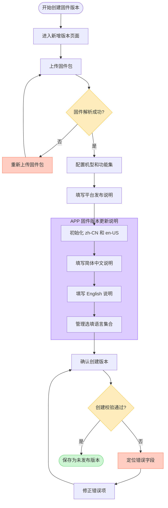
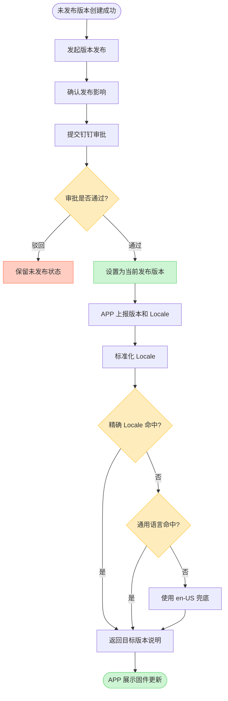
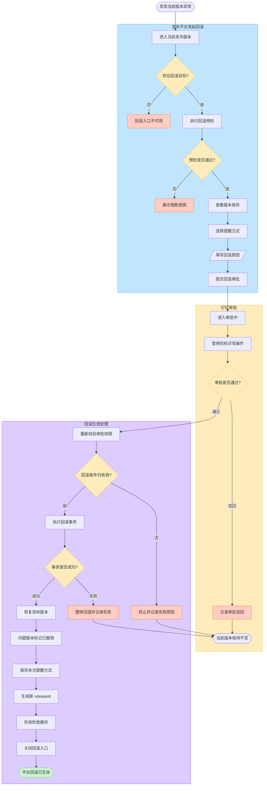
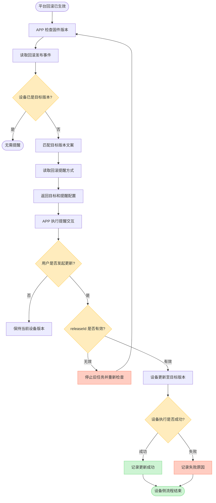

# 固件多语言配置与版本回滚业务流程及页面设计方案

## 1. 文档信息

| 项目 | 内容 |
| --- | --- |
| 文档版本 | V1.1 |
| 文档定位 | 固件版本多语言配置与版本回滚业务流程、平台侧页面设计讨论稿 |
| 涉及模块 | 新增固件版本、APP 多语言更新说明、当前发布版本、撤销并回滚、钉钉审批、操作日志 |
| 涉及角色 | 固件研发、测试人员、产品线负责人、平台管理员 |
| 编写日期 | 2026-07-15 |
| 文档状态 | 待评审 |

## 2. 文档目的

本文档用于统一固件版本多语言配置与版本回滚的业务口径、操作流程和平台侧页面设计，重点解决以下问题：

1. 创建固件版本时能够同时维护面向 APP 用户的多语言版本更新说明。
2. 简体中文和 English 作为固定必填语言，其他语言按需添加。
3. 平台发布说明与 APP 固件版本更新说明分开填写、分开使用。
4. 操作人能够快速确认正在撤销的版本和即将恢复的版本。
5. 操作人能够在提交审批前识别适用机型、功能集配置和 APP 用户说明等关键差异。
6. 回滚时重新选择本次 APP 提醒方式，不沿用或覆盖目标版本原来的发布提醒配置。
7. 回滚继续进入钉钉审批，审批通过后才切换当前发布版本。
8. 平台回滚不会自动选择强提醒，也不会自动要求设备执行版本降级。
9. 平台回滚生效与用户是否发起设备版本更新分开记录。

## 3. 固件版本多语言配置设计

### 3.1 能力定位

多语言能力绑定“固件版本”，不绑定“固件标识”。同一固件标识下的不同版本分别保存各自的 APP 固件版本更新说明，避免新版本覆盖历史版本文案，并保证回滚时可以读取目标版本原有说明。

本期多语言配置仅包含面向 APP 用户的固件版本更新说明，不包含：

- 多语言固件包。
- 平台自身的国际化文案。
- APP 固定标题、按钮和通用状态文案。
- 自动翻译或翻译平台对接。

### 3.2 内容类型区分

| 内容 | 使用对象 | 是否多语言 | 是否必填 |
| --- | --- | --- | --- |
| 平台发布说明 | 固件研发、测试人员、审批人和操作日志 | 否 | 是 |
| APP 固件版本更新说明 | APP 最终用户 | 是 | `zh-CN`、`en-US` 必填 |
| APP 固定标题和按钮 | APP 自身国际化资源 | 不由平台配置 | 不适用 |

页面和文档中统一使用“平台发布说明”，不使用容易产生歧义的“内部说明”。

### 3.3 新增版本页面结构

多语言配置作为新增固件版本表单中的一个完整模块，不设计为多步向导。页面从上到下建议为：

```text
新增固件版本

一、固件包
上传文件、解析状态、版本号、文件大小

二、基础配置
适用机型、功能集配置、关联功能

三、平台发布说明
平台发布说明 *

四、APP 固件版本更新说明
简体中文 zh-CN *
English en-US *
其他选填语言

[取消] [确认创建]
```

### 3.4 多语言编辑器

多语言编辑器建议采用“左侧语言列表 + 右侧文案编辑区”，避免语言较多时横向 Tab 溢出。

```text
APP 固件版本更新说明
┌──────────────────┬─────────────────────────────────────┐
│ 简体中文   必填   │ 语言：简体中文                      │
│ English    必填   │ Locale：zh-CN                      │
│ Deutsch    选填 × │                                     │
│ Français   选填 × │ 更新说明 *                          │
│                  │ ┌─────────────────────────────────┐ │
│ + 添加语言        │ │ 提升设备连接稳定性……             │ │
│                  │ └─────────────────────────────────┘ │
│                  │                               18/80 │
└──────────────────┴─────────────────────────────────────┘
```

交互规则：

1. 系统自动初始化简体中文 `zh-CN` 和 English `en-US`。
2. 两个必填语言固定在语言列表顶部，不允许删除。
3. 默认选中 `zh-CN`。
4. 其他语言通过“添加语言”下拉框添加。
5. 下拉框支持搜索，只展示系统支持且尚未添加的 Locale。
6. 已添加 Locale 在选择器中禁用，防止重复配置。
7. 选填语言支持删除；必填语言不展示删除操作。
8. 简体中文、日文、韩文最多 `80` 字，英文及其他语言最多 `160` 个字符，并展示字符计数。
9. 不允许输入 HTML 或脚本内容。
10. 本期不提供自动翻译。
11. 可以提供“复制中文”或“复制 English”作为录入辅助，但复制不代表翻译已经完成。

### 3.5 选填语言集合管理

“添加其他语言”不是创建流程中的子向导，而是一个可以重复操作的语言集合管理模块：

```text
点击添加语言
-> 打开 Locale 选择器
-> 选择未配置的语言
-> 生成语言项
-> 填写对应文案
-> 可继续添加、编辑或删除选填语言
-> 创建版本时统一校验整个语言集合
```

选填语言添加后如果没有填写内容，操作人必须补充内容或删除该语言，否则不能创建版本。

### 3.6 创建固件版本流程



### 3.7 创建校验

点击“确认创建”时一次性校验全部业务必填项：

1. 固件包已经上传且解析成功。
2. 适用机型、功能集等基础必填配置完整。
3. 平台发布说明已填写。
4. `zh-CN` APP 固件版本更新说明已填写。
5. `en-US` APP 固件版本更新说明已填写。
6. 所有已添加的选填语言均已填写，或已从语言集合中删除。
7. Locale 合法且没有重复。
8. 文案去除首尾空格后仍有有效内容。
9. 文案长度符合限制。

校验失败时：

- 不创建版本记录。
- 保留全部已填写数据。
- 在多语言模块标题展示未完成项数量。
- 在错误语言旁展示错误状态。
- 自动定位到第一个错误字段。

校验通过后直接保存为“未发布版本”，本期不支持保存缺少必填项的不完整草稿。

### 3.8 发布与 APP 多语言匹配流程

发布阶段不重复执行创建表单的业务必填预检。未发布版本提交钉钉审批，审批通过后直接进入发布事务。



发布接口仍需执行以下事务安全校验，但不在页面业务流程中展示为“发布预检”：

- 版本仍处于未发布状态。
- 固件文件仍然有效。
- 当前用户仍拥有发布权限。
- 同一固件标识没有并发发布或回滚。
- 审批单与目标版本关系仍然有效。

### 3.9 Locale 匹配规则

1. 服务端标准化大小写、连字符和下划线，例如将 `en_US` 转换为 `en-US`。
2. 优先精确匹配完整 Locale。
3. 未精确命中时匹配已配置的同语言通用 Locale。
4. 仍未命中时使用 `en-US`。
5. APP 未传 Locale 或 Locale 非法时使用 `en-US`。
6. `zh-CN` 不默认作为 `zh-TW` 或 `zh-HK` 的兜底，避免把简体中文错误用于繁体中文用户；除非业务后续明确调整该规则。

### 3.10 版本状态与多语言维护权限

| 版本状态 | 多语言说明操作 |
| --- | --- |
| 未发布 | 在编辑版本页面修改全部语言 |
| 发布审批中 | 锁定，不允许修改 |
| 当前发布 | 通过独立入口维护，填写修改原因并记录修改前后内容 |
| 当前唯一回滚目标 | 允许独立维护，保证后续回滚文案有效 |
| 其他历史发布 | 只读 |
| 已撤销 | 只读 |

当前发布版本的文案修改后，需要失效 APP 升级检查缓存。回滚目标版本的文案修改后只记录修订，待该版本重新生效时使用。

### 3.11 多语言详情展示

版本详情中的 APP 固件版本更新说明至少展示：

- 简体中文说明。
- English 说明。
- 已配置语言数量。
- Locale 列表。
- 每种语言的修改人和修改时间。
- 已发布文案的修订记录。

### 3.12 多语言验收标准

1. 创建版本时自动生成 `zh-CN` 和 `en-US` 两个必填语言。
2. 两个必填语言均不可删除。
3. 缺少任意一个必填语言时不能创建版本。
4. 其他语言可添加、编辑和删除，Locale 不可重复。
5. 已添加的选填语言为空时不能创建版本。
6. 校验失败时保留表单数据并定位错误语言。
7. 创建成功后版本状态为未发布，不再进行重复的发布业务预检。
8. APP 能按精确 Locale、通用语言和 `en-US` 顺序获得对应文案。
9. 当前发布版本文案修改后能够按权限、原因和修订记录追溯。
10. 平台发布说明和 APP 固件版本更新说明分开展示、分开使用。

## 4. 已确认的回滚业务口径

### 4.1 当前发布版本

原页面中的“最新发布版本”建议统一称为“当前发布版本”。

```text
当前发布版本 = 服务端当前向 APP 返回的目标固件版本
最高版本号 = 版本号数值最大，不一定是当前发布版本
```

例如：

```text
V12 当前发布
-> 发布 V13
-> V13 成为当前发布版本，V12 成为本次唯一回滚目标
-> 回滚 V13
-> V12 恢复为当前发布版本，V13 标记为已撤销
```

回滚后，V13 仍可能是最高版本号，但 APP 当前目标版本已经恢复为 V12。

### 4.2 回滚定义

回滚是撤销当前发布版本，并恢复至该次发布前实际生效的上一个发布版本。

- 只能对当前发布版本发起回滚。
- 回滚目标由当前发布事件保存的 `rollbackTargetVersionId` 唯一确定。
- 不允许操作人从任意历史版本中手动选择目标。
- 一次发布最多执行一次回滚。
- 回滚完成后关闭本次回滚入口，直到再次发布新版本。
- 回滚不删除当前版本和历史发布记录。

### 4.3 APP 提醒方式

回滚操作人需要重新选择本次回滚生效后的 APP 提醒方式：

- 不提醒。
- 弱提醒。
- 强提醒。
- 强制提醒。

本期明确：

1. 系统不根据设备版本高低自动选择强提醒或强制提醒。
2. 系统不因为平台完成回滚而自动执行设备版本降级。
3. 本次选择保存在回滚发布事件中，不覆盖目标版本历史发布时的提醒方式。
4. APP 按本次回滚事件保存的提醒方式执行现有提醒交互。
5. 用户是否发起设备版本更新，由对应提醒方式的 APP 交互和用户操作决定。
6. 弱提醒在设备设置入口显示更新红点；强提醒在设备卡片下方展示升级横幅；强制提醒进入页面后持续展示升级弹窗。
7. 强制提醒不等于自动安装，仍需用户点击后发起升级。

### 4.4 APP 固件版本更新说明

- 回滚时不重新编辑多语言说明。
- APP 使用回滚目标版本已有的多语言固件版本更新说明。
- 文案匹配顺序为“精确 Locale -> 通用语言 -> `en-US`”。
- 回滚目标缺少有效的 `zh-CN` 或 `en-US` 说明时禁止发起回滚。

## 5. 当前发布版本模块

### 5.1 信息字段

| 字段 | 展示规则 |
| --- | --- |
| 当前固件版本号 | 示例：`23.110.211.13` |
| 上一个发布版本号 | 示例：`23.110.211.12`；不存在时显示 `-` |
| 生效方式 | 首次发布、正常发布、回滚恢复 |
| 生效时间 | 当前版本最近一次生效时间 |
| 下载地址 | 支持复制和直接下载；下载失败需提示具体原因 |
| 文件大小 | 示例：`1.12 MB`，统一单位格式 |
| APP 提醒方式 | 展示当前生效事件使用的提醒方式 |
| 适用机型 | 展示当前版本全部适用机型 |
| 操作 | 详情、撤销并回滚 |

### 5.2 回滚入口条件

“存在上一个发布版本号”只是入口条件之一。完整条件如下：

1. 当前有效事件为成功的正常发布事件。
2. 当前发布事件存在唯一 `rollbackTargetVersionId`。
3. `rollbackAvailable = true`。
4. 回滚目标固件包存在、可下载且文件校验有效。
5. 回滚目标覆盖当前版本的全部适用机型。
6. 回滚目标存在有效的 `zh-CN` 和 `en-US` APP 固件版本更新说明。
7. 当前用户拥有回滚权限。
8. 同一固件标识下没有发布、回滚或审批操作正在进行。

首个发布版本没有上一个发布版本时，不展示“撤销并回滚”入口。

回滚成功后，当前发布版本模块应展示：

```text
当前固件版本号：23.110.211.12
生效方式：由 23.110.211.13 回滚恢复
上一个发布版本号：-
撤销并回滚：不展示
```

## 6. 比较式回滚弹窗

### 6.1 设计目标

回滚弹窗定位为“回滚决策界面”，不是完整的版本详情页。弹窗需要帮助操作人快速回答三个问题：

1. 正在撤销哪个版本、恢复哪个版本？
2. 回滚后哪些机型、功能配置和 APP 用户说明会发生变化？
3. 回滚后 APP 使用什么方式提醒用户？

### 6.2 页面结构

建议弹窗宽度约为 `920px`，从上到下分为四个区域：

1. 回滚结果预览。
2. 关键差异对比。
3. 风险与阻断提示。
4. 本次回滚配置。

示意结构：

```text
┌──────────────────────────────────────────────────────────────────────┐
│ 撤销并回滚版本                                                   ×  │
│ 当前版本 23.110.211.13 将被撤销，恢复至 23.110.211.12                 │
├──────────────────────────────────────────────────────────────────────┤
│ 核心信息                                                            │
│ 对比项       当前发布版本             回滚目标版本          变化       │
│ 版本号       23.110.211.13          23.110.211.12        切换目标版本 │
│ 状态         当前发布                历史发布              将恢复生效   │
│ 生效时间     2026-06-30 14:13       2026-06-20 10:20     -           │
│ 适用机型     QD20-DK                 QD20-DK              无变化       │
│ 功能集配置   12 项                   10 项                 2 项变化     │
│ APP 说明     4 种语言                3 种语言              en-US 兜底  │
│                                                                      │
│ [仅看配置差异]                                      [查看目标版本详情]│
│                                                                      │
│ 功能集配置差异摘要                                                   │
│ 回滚后移除：低功耗模式、智能追踪                                     │
│ 回滚后恢复：旧版网络重连配置                                         │
├──────────────────────────────────────────────────────────────────────┤
│ 本次回滚配置                                                         │
│ APP 提醒方式 *                                                       │
│ ○ 不提醒    ● 弱提醒    ○ 强提醒    ○ 强制提醒                        │
│                                                                      │
│ 回滚原因 *                                                           │
│ [请填写问题表现、影响范围及回滚原因]                                 │
├──────────────────────────────────────────────────────────────────────┤
│                                                   [取消] [提交回滚审批]│
└──────────────────────────────────────────────────────────────────────┘
```

### 6.3 对比信息规则

#### 6.3.1 始终展示

以下信息用于确认版本身份和回滚目标，不受“仅看配置差异”控制：

| 对比项 | 当前发布版本 | 回滚目标版本 | 展示目的 |
| --- | --- | --- | --- |
| 版本号 | 当前正在分发的版本 | 本次唯一恢复版本 | 防止回错目标 |
| 状态 | 当前发布 | 历史发布 | 展示回滚后的状态变化 |
| 最近生效时间 | 当前版本生效时间 | 目标版本上次生效时间 | 辅助判断历史情况 |
| 适用机型 | 当前版本机型 | 目标版本机型 | 判断设备覆盖是否一致 |
| 固件包状态 | 有效或失效 | 有效或失效 | 确认目标文件可用性 |

#### 6.3.2 支持仅看差异

以下结构化配置支持“仅看配置差异”：

- 功能集配置。
- 功能集版本。
- 关联功能。
- APP 说明语言覆盖。

“仅看配置差异”默认开启，但不得隐藏版本号、状态、适用机型和固件包状态等核心身份信息。

#### 6.3.3 不进入主对比区

以下内容不建议在主对比区完整展开：

- 固件下载地址：没有直接对比价值，通过下载图标或详情入口访问。
- 完整内部版本说明：默认展示摘要，支持展开查看。
- 全部多语言文案：默认展示目标版本简体中文、English 摘要和已配置 Locale，支持展开查看。
- 文件 MD5：弹窗不展示。

### 6.4 差异表达规则

1. 不使用“版本降低一级”等推断性表达，直接展示“从当前版本切换至回滚目标版本”。
2. 功能差异统一称为“功能集配置差异”，不宣称比较了固件二进制内部代码。
3. 新增、移除、恢复使用不同状态标签，并同时使用文字说明，不只依赖颜色。
4. 目标版本未覆盖当前版本全部适用机型时，不只展示警告，直接阻止提交回滚审批。
5. 目标固件包失效、`zh-CN` 或 `en-US` 文案缺失等硬性问题，在进入审批前阻止操作。

### 6.5 APP 说明展示

弹窗重点展示回滚后用户实际可能看到的目标版本说明：

```text
默认说明（简体中文）：提升设备连接稳定性并修复部分已知问题。
English：Improve device connection stability and fix known issues.
已配置语言：en-US、zh-CN、de-DE
未匹配语言：使用 en-US 兜底
```

当前版本与目标版本的全部文案不直接平铺。操作人可以通过“查看文案差异”展开查看。

### 6.6 本次提醒方式

对比区可以展示两个版本历史发布时的提醒方式，但必须标记为“仅供参考”。

本次实际生效的提醒方式必须在“本次回滚配置”区域重新选择：

```text
APP 提醒方式 *
○ 不提醒  ○ 弱提醒  ○ 强提醒  ○ 强制提醒

说明：该设置仅用于本次回滚生效后的 APP 提醒，
不覆盖目标版本原发布配置，也不代表平台自动执行设备版本更新。
```

### 6.7 回滚原因

回滚原因为必填项，建议最多 `500` 字，填写提示为：

```text
请说明问题表现、影响范围、回滚原因及后续处理计划。
```

### 6.8 操作按钮

| 按钮 | 规则 |
| --- | --- |
| 取消 | 关闭弹窗，不创建审批记录 |
| 提交回滚审批 | 校验提醒方式和回滚原因后创建钉钉审批 |

主按钮不能命名为“确认回滚”，因为提交后只进入审批，不会立即切换当前发布版本。

## 7. 平台回滚与钉钉审批流程



### 7.1 流程说明

1. 点击回滚入口后，平台先校验回滚目标、目标固件包、适用机型、中英文文案、权限和并发状态。
2. 预检通过后打开比较式回滚弹窗。
3. 操作人查看版本差异，重新选择 APP 提醒方式并填写回滚原因。
4. 提交后创建钉钉审批，当前版本继续生效。
5. 审批期间暂停同一固件标识的发布和其他回滚操作。
6. 审批驳回时保留当前发布版本，并记录驳回原因。
7. 审批通过后，服务端重新校验当前版本、回滚目标和审批快照。
8. 重新校验通过后，以原子事务切换版本并记录回滚结果。
9. 只有升级检查接口已经读取到恢复后的版本时，平台才展示“回滚已生效”。

## 8. 回滚生效后的 APP 提醒流程



### 8.1 流程说明

1. APP 检查更新时读取当前生效的回滚发布事件。
2. 设备版本已经等于目标版本时，不返回更新提醒。
3. 设备版本不等于目标版本时，服务端返回目标版本、多语言说明和本次回滚选择的提醒方式。
4. 系统不根据设备版本高低自动覆盖提醒方式。
5. APP 按提醒方式执行现有交互，平台不会自动触发设备安装。
6. 用户发起更新后，APP 在安装前校验 `releaseId`。
7. `releaseId` 已失效时停止旧任务，并重新检查当前发布版本。
8. 设备执行结果独立记录，不作为平台回滚生效的前置条件。

## 9. 审批单信息

钉钉审批单应包含以下信息：

| 信息 | 展示要求 |
| --- | --- |
| 当前发布版本 | 展示版本号和当前状态 |
| 回滚目标版本 | 展示版本号和目标状态 |
| 适用机型差异 | 展示新增、减少或无变化 |
| 功能集配置差异 | 展示新增、移除和版本变化摘要 |
| 目标版本 APP 说明 | 展示简体中文、English 摘要和语言覆盖情况 |
| 本次提醒方式 | 展示操作人重新选择的提醒方式 |
| 回滚原因 | 完整展示 |
| 发起信息 | 发起人、角色和发起时间 |

审批单中的版本、提醒方式和原因使用提交时快照。审批通过后，服务端仍需重新校验当前版本和回滚目标，避免审批期间数据变化导致错误回滚。

## 10. 状态与数据规则

### 10.1 回滚状态

| 状态 | 含义 |
| --- | --- |
| 待审批 | 已提交钉钉审批，当前版本继续生效 |
| 已驳回 | 审批未通过，当前版本保持不变 |
| 执行中 | 审批通过，平台正在切换版本 |
| 已生效 | 版本指针和升级检查接口均已切换至目标版本 |
| 执行失败 | 回滚事务失败，当前版本保持不变 |
| 已失效 | 审批期间版本状态发生变化，原审批单不可继续执行 |

### 10.2 回滚事务

回滚事务至少需要完成：

1. 创建回滚记录。
2. 将回滚目标恢复为当前发布版本。
3. 将问题版本标记为已撤销。
4. 保存本次回滚选择的 APP 提醒方式。
5. 生成新的 `releaseId`，使旧发布标识失效。
6. 将 `rollbackAvailable` 设置为 `false`。
7. 记录操作人、审批单、回滚原因和执行结果。

事务中任一步骤失败时整体回退，不允许出现版本指针已切换但回滚记录未生成的中间状态。

### 10.3 提醒方式存储

建议将本次提醒方式保存在回滚发布事件中：

```text
releaseEvent.action = rollback
releaseEvent.fromVersion = 23.110.211.13
releaseEvent.toVersion = 23.110.211.12
releaseEvent.reminderPolicy = 本次选择值
```

不得直接覆盖 V12 原正常发布事件中的提醒方式。

## 11. 异常与边界规则

| 场景 | 处理规则 |
| --- | --- |
| 没有上一个发布版本 | 不展示回滚入口 |
| 当前有效事件已经是回滚 | 不允许连续回滚 |
| 目标固件包缺失或校验失败 | 阻止提交审批 |
| 目标版本未覆盖当前全部适用机型 | 阻止提交审批 |
| 目标版本缺少 `zh-CN` 或 `en-US` APP 说明 | 阻止提交审批 |
| 未选择本次提醒方式 | 弹窗内提示必填，不允许提交 |
| 未填写回滚原因 | 弹窗内提示必填，不允许提交 |
| 审批期间当前版本发生变化 | 原审批单失效，不执行回滚 |
| 审批驳回 | 当前版本不变，记录驳回原因 |
| 回滚事务执行失败 | 整体回退，当前版本不变 |
| APP 持有旧 releaseId | 安装前校验失败并重新检查版本 |
| 用户未发起设备更新 | 设备保持当前版本，不影响平台回滚状态 |
| 设备执行失败 | 独立记录失败原因，不回退平台版本指针 |

## 12. 操作日志

以下操作必须记录日志：

- 发起回滚。
- 回滚预检失败。
- 提交钉钉审批。
- 审批通过、驳回或失效。
- 回滚执行成功或失败。
- 当前发布版本指针切换。
- 本次回滚提醒方式。
- APP 使用失效 `releaseId` 请求安装。
- 设备版本更新成功或失败。

日志至少包含固件标识、当前版本、目标版本、提醒方式、回滚原因、操作人、审批人、操作时间和执行结果。

## 13. 验收标准

### 13.1 当前发布版本模块

1. 正确展示当前版本和上一个发布版本。
2. 没有回滚目标时显示 `-`，不展示回滚入口。
3. 下载地址支持复制和直接下载。
4. 回滚恢复后正确展示“由 Vxx 回滚恢复”。
5. 回滚恢复后不允许继续回滚到更早版本。

### 13.2 比较式回滚弹窗

1. 弹窗始终展示当前版本和唯一回滚目标版本。
2. 核心身份信息不受“仅看配置差异”控制。
3. 能够识别适用机型、功能集配置和 APP 说明语言覆盖差异。
4. 目标版本机型覆盖不完整时阻止提交审批。
5. 目标固件包、`zh-CN` 或 `en-US` 说明失效时阻止提交审批。
6. 本次 APP 提醒方式和回滚原因均为必填。
7. 主按钮显示“提交回滚审批”。

### 13.3 回滚与审批

1. 提交审批后当前版本继续生效。
2. 审批驳回后当前版本保持不变。
3. 审批通过后重新校验审批快照和当前状态。
4. 回滚事务失败时不改变当前发布版本。
5. 回滚成功后目标版本恢复为当前发布版本，问题版本标记为已撤销。
6. 回滚成功后生成新的 `releaseId` 并关闭回滚入口。
7. 本次提醒方式保存在回滚事件中，不覆盖目标版本历史配置。

### 13.4 APP 与设备

1. APP 读取本次回滚选择的提醒方式。
2. 系统不根据设备版本高低自动选择强提醒。
3. 平台回滚生效不会自动执行设备版本更新。
4. 用户发起更新前需要校验有效 `releaseId`。
5. 设备执行结果与平台回滚状态分别记录。

## 14. 已确认与待确认事项

本轮已根据 APP 参考效果确认：

1. 弱提醒为设备设置入口红点；强提醒为设备卡片底部橙色横幅；强制提醒为持续升级弹窗。
2. 继续使用“强制提醒”命名，交互说明中明确其不代表自动安装固件。

以下事项仍需在研发排期或 APP 联调前确认：

1. 本次回滚提醒方式适用于所有版本不等于目标版本的设备，还是只适用于已安装问题版本的设备。
2. 用户确认更新后，设备是否支持安装版本号低于当前版本的目标固件。
3. 目标版本多语言说明在审批期间发生修改时，是继续使用最新内容，还是使审批单失效。
4. 回滚事务执行失败后，是否允许在原审批结果下重试，还是需要重新提交审批。
5. APP 升级检查缓存和下载凭证的最长有效时间。
