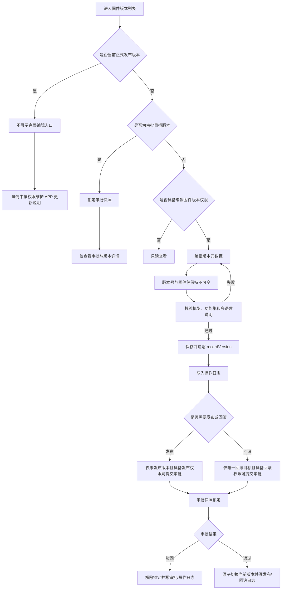

# 固件版本编辑、角色权限与审计闭环

## 1. 业务流程

## 2. 状态与操作矩阵

| 状态 | 编辑 | 发布 | 删除 | 说明 |
| --- | --- | --- | --- | --- |
| 未发布 | 允许 | 允许提交审批 | 允许 | 三项分别校验角色权限 |
| 发布审批中 | 锁定 | 不允许重复提交 | 不允许 | 审批快照必须保持不变 |
| 当前正式发布 | 禁止完整编辑 | 不适用 | 禁止 | 仅允许受控维护 APP 更新说明 |
| 历史发布 | 允许编辑元数据 | 禁止直接发布 | 禁止 | 版本号、固件包和历史事件引用不可变 |
| 已撤回 | 允许编辑元数据 | 禁止直接发布 | 禁止 | 保存后生成新的修订号 |

## 3. 角色模拟口径

| 角色 | 数据范围 | 核心权限 |
| --- | --- | --- |
| 系统管理员 | 全部产线 | 全部管理权限 |
| 产线主管 | 用户所属产线 | 发布、回滚、APP 文案、DING、日志查看 |
| 测试人员 | 用户所属产线 | 新增、编辑、删除未发布版本及差分查询；不允许发布和回滚 |
| 默认人员 | 用户所属产线 | 只读查看固件和模组 |
| FAE 技术支持组长 | 用户所属产线 | 查看版本、发布日志、DING 记录和操作日志 |
| FEA | 用户所属产线 | 只读查看版本和下载差分包 |
| 4G 模组权限角色 | 仅 4G 模组 | 版本维护、在线差分和差分包管理 |

权限判断顺序固定为：页面权限 → 功能操作权限 → 数据范围 → 版本状态 → 审批并发锁。任何一层不满足都不执行写操作。

## 4. 日志闭环

操作日志记录时间、操作人、角色、模块、动作、资源、结果和事件描述。审批日志记录审批类型、提交人、审批人、状态、时间和说明。

必须记录以下事件：

1. 待发布、历史和已撤回版本编辑成功，并记录新的 `recordVersion`。
2. 当前正式版本或审批目标版本的编辑请求被阻止，并记录阻止原因。
3. 角色权限和用户角色、产线范围发生变化。
4. 发布或回滚审批提交、通过、驳回、失效。
5. 发布、回滚、DING 发送和撤回的最终结果。

页面模拟数据至少覆盖编辑成功、状态阻止、角色变更、发布审批中、回滚审批通过和发布审批驳回。
