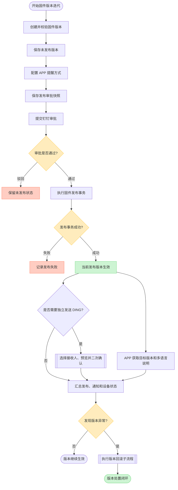
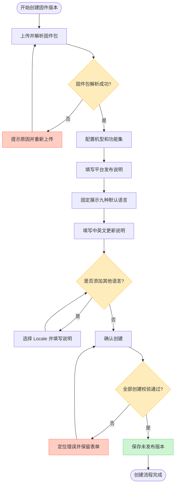
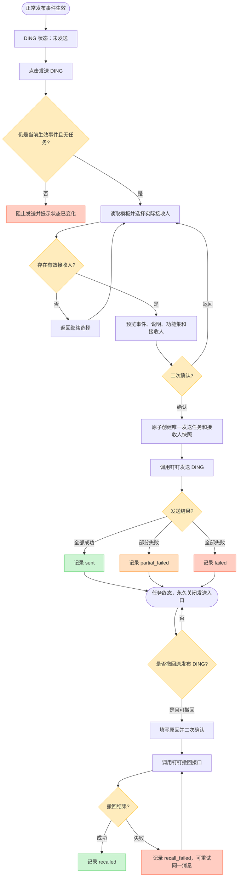
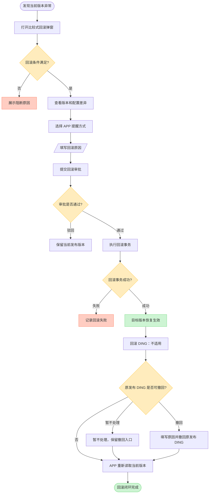

# 固件多语言配置、版本回滚与 DING 通知产品方案

## 1. 文档信息

| 项目 | 内容 |
| --- | --- |
| 文档版本 | V1.1 |
| 文档定位 | 0714 固件发布迭代统一产品方案 |
| 迭代范围 | 固件版本多语言配置、当前发布版本回滚、事件生效后独立 DING 通知 |
| 涉及模块 | 固件版本创建、发布确认、钉钉审批、当前发布版本、版本详情、DING 通知、操作日志 |
| 涉及角色 | 固件研发、测试人员、产品线负责人、平台管理员、DING 接收人 |
| 编写日期 | 2026-07-15 |
| 文档状态 | 已按 2026-07-17 决策更新，待交互评审 |

### 1.1 V1.1 决策摘要

本版以以下规则为最终口径，替代 V1.0 中“审批时配置 DING、发布后自动发送、失败重试或补发”的设计：

1. 发布与回滚都必须先完成钉钉审批，审批单不包含 DING 开关、接收人或通知决策。
2. 只有当前生效的正常发布事件可由有权限人员独立点击一次“发送 DING”；回滚事件不触发且不允许发送 DING。
3. 发送前必须选择实际接收人、预览消息并进行二次确认，不再发起新的发布审批。
4. 每个正常发布 `releaseId` 最多创建一个 DING 发送任务；发送任务不支持重试、补发或重新通知。
5. 已成功或部分成功的发布 DING 支持独立撤回，撤回失败可针对同一消息重试，不创建新的通知。
6. “DING 接收人模板”只用于预填接收人，不代表默认开启或自动发送。

## 2. 需求背景

当前固件发布流程已经支持固件版本创建、钉钉审批和版本发布，但仍存在以下问题：

1. APP 固件版本更新说明只有单语言或与平台发布说明混用，无法根据用户 Locale 展示对应内容。
2. 新版本发布异常后缺少明确、可追溯的一次性回滚能力。
3. 测试人员完成平台发布后，需要再次进入钉钉 DING 应用，重复选择接收人并录入版本发布内容。
4. 手工 DING 容易发生延迟、漏发、错发，且与固件发布记录没有直接关联。
5. 并非每个固件版本都需要 DING 通知，不能把 DING 设置为所有发布的固定后置动作。
6. DING 接收人随钉钉组织架构变化，不能在固件平台维护一套独立、静态的人员名单。

本期需要在不推翻原发布审批链路的基础上，补齐“创建、审批、发布、通知、APP 分发、异常回滚和审计”的业务闭环。

## 3. 需求目标

### 3.1 多语言目标

1. 创建固件版本时支持维护 APP 固件版本更新说明。
2. 默认语言固定展示简体中文、英文、意大利语、韩语、德语、日语、法语、俄语和西班牙语，其中 `zh-CN`、`en-US` 必填。
3. 九种默认语言不可删除；七种选填语言允许为空，其他 Locale 可按需添加、编辑和删除。
4. APP 按 Locale 获取对应文案，未匹配时使用 `en-US`。
5. 多语言说明与平台发布说明分开管理。

### 3.2 回滚目标

1. 当前发布版本异常时可以恢复到本次发布前实际生效的版本。
2. 回滚目标由发布事件唯一确定，不允许任意选择历史版本。
3. 回滚时展示当前版本与目标版本差异。
4. 回滚时重新选择本次 APP 提醒方式，不自动使用强提醒。
5. 平台回滚生效与设备是否完成版本更新分开记录。

### 3.3 DING 通知目标

1. DING 与发布、回滚审批解耦，只对成功生效的正常发布事件提供独立发送入口。
2. DING 接收人通过钉钉组织架构选择，固件标识级模板只做预填。
3. DING 内容自动读取事件、平台发布说明和功能集信息，避免重复录入。
4. 每个正常发布事件最多创建一次 DING 发送任务，发送前二次确认；回滚事件固定为“不适用”。
5. DING 成功或失败都不改变已经生效的固件版本。
6. DING 发送与撤回分别记录状态，原消息、接收人、撤回人、原因和结果均可追溯。

## 4. 产品原则

### 4.1 单一信息源

固件发布平台是版本信息的唯一来源：

- 平台发布说明用于审批、DING 和内部追溯。
- APP 固件版本更新说明用于 APP 用户提示。
- DING 不要求测试人员重新输入整份发布内容。

### 4.2 审批、发布和通知分离

```text
审批通过 != 固件发布成功
固件发布成功 != DING 发送成功
平台回滚成功 != 设备完成版本更新
```

三类状态必须分别记录，不能用一个“成功”状态代替。

### 4.3 DING 事件级独立发送

DING 是单次发布事件的可选能力：

- 发布或回滚审批时不配置、不决策、不自动发送。
- 正常发布生效后默认状态为“未发送”，不生成伪通知记录；回滚事件固定为“不适用”。
- 只有当前生效的正常发布事件展示“发送 DING”，历史、被替代和回滚事件不允许发送。
- 发送时选择接收人、预览内容并二次确认；任务创建后发送入口永久关闭，符合条件时提供独立撤回入口。

### 4.4 可靠但不强耦合

DING 任务由有权限人员在事件生效后显式创建，不放入发布或回滚数据库事务。通知失败只记录终态，不回滚版本，也不开放第二次任务。

### 4.5 记录不可覆盖

版本发布、回滚、DING 发送和文案修订均新增事件记录，不删除或覆盖历史操作。

## 5. 本期范围

### 5.1 包含范围

- 创建固件版本时在左侧滚动列表固定展示九种默认语言，并支持添加默认范围外的 Locale。
- 平台发布说明与 APP 固件版本更新说明分离。
- 当前发布版本指针和唯一回滚目标。
- 当前发布版本一次性回滚。
- 比较式回滚弹窗。
- 回滚时重新选择 APP 提醒方式。
- 生效事件独立发送一次 DING。
- 钉钉组织架构部门和指定成员选择。
- DING 接收范围、消息内容和实际接收人快照。
- DING 接收人模板、消息预览、二次确认和事件级唯一任务。
- APP Locale 匹配、发布标识校验和设备结果记录。
- 审批、发布、回滚、DING 和文案修订日志。

### 5.2 不包含范围

- 多语言固件包。
- 自动翻译或翻译平台对接。
- 灰度发布、自动回滚和设备分组发布。
- 任意历史版本选择和连续回滚。
- DING 短信、电话、定时发送和分别发送。
- DING 外部联系人。
- 将固件包作为 DING 附件发送。
- DING 自动发送、发送重试、补发和重新通知。
- 完整设备恢复进度看板。

## 6. 名词与内容口径

| 名词 | 定义 |
| --- | --- |
| 固件标识 | 固件版本的管理上下文，一个标识下可以有多个版本 |
| 固件版本 | 固件标识下的一次具体固件包和配置记录 |
| 平台发布说明 | 面向研发、测试、审批人和内部通知接收人的版本说明 |
| APP 固件版本更新说明 | 面向 APP 用户的多语言更新文案 |
| 当前发布版本 | 服务端当前向 APP 返回的目标版本，不等于最高版本号 |
| 回滚目标 | 当前版本本次发布前实际生效的上一发布版本 |
| 发布事件 | 一次审批通过并成功切换当前发布版本的记录 |
| 回滚事件 | 一次撤销当前发布版本并恢复目标版本的记录 |
| DING 接收范围规则 | 部门、角色或指定成员等组织架构选择规则 |
| DING 接收人快照 | 某次发送时解析出的实际有效成员列表 |

## 7. 角色与职责

| 角色 | 主要职责 |
| --- | --- |
| 固件研发 | 上传固件、配置功能集、填写平台发布说明和 APP 多语言说明 |
| 测试人员 | 验证版本、发起发布、发起回滚，并在事件生效后按需发送一次 DING |
| 产品线负责人 | 审批发布和回滚，核对版本影响，不审批 DING 通知 |
| 平台管理员 | 配置权限、钉钉应用、组织架构可见范围和 DING 接收人模板 |
| DING 接收人 | 获取内部发布或回滚通知，进入平台查看版本详情 |

## 8. 端到端业务流程

### 8.1 完整业务流程图



### 8.2 关键结果矩阵

| 场景 | 版本结果 | DING 结果 |
| --- | --- | --- |
| 发布审批驳回 | 保持未发布 | 不发送 |
| 审批通过但发布事务失败 | 当前发布版本不变 | 不发送 |
| 发布成功且未主动发送 DING | 新版本生效 | 显示“未发送”，不创建通知记录 |
| 发布成功且 DING 成功 | 新版本生效 | 记录任务与接收人快照 |
| 发布成功但 DING 失败 | 新版本继续生效 | 记录终态，不重试、不补发 |
| 发布 DING 撤回成功 | 版本状态不变 | 保留发送事实并记录撤回人、原因和时间 |
| 发布 DING 撤回失败 | 版本状态不变 | 记录失败原因，可重试同一消息 |
| 回滚审批驳回 | 当前版本不变 | 不发送回滚通知 |
| 回滚成功 | 目标版本恢复生效 | 回滚 DING 为“不适用”；原发布 DING 可撤回时提示独立处理 |

## 9. 创建固件版本

### 9.1 页面结构

新增固件版本页面依次包含：

1. 固件包上传与解析。
2. 适用机型和功能集配置。
3. 平台发布说明。
4. APP 固件版本更新说明。
5. 关联功能。

### 9.2 平台发布说明

平台发布说明为必填，面向研发、测试、审批人和 DING 接收人，建议包含：

```text
1. 主要变更：
2. 修复问题：
3. 影响范围：
4. 测试情况：
5. 已知风险：
```

平台发布说明不要求多语言。

### 9.3 APP 多语言说明

系统自动初始化并在左侧固定顺序展示：

1. 简体中文 `zh-CN`，必填。
2. 英文 `en-US`，必填。
3. 意大利语 `it-IT`，选填。
4. 韩语 `ko-KR`，选填。
5. 德语 `de-DE`，选填。
6. 日语 `ja-JP`，选填。
7. 法语 `fr-FR`，选填。
8. 俄语 `ru-RU`，选填。
9. 西班牙语 `es-ES`，选填。

九种默认语言均不可删除，语言名称统一使用中文，左侧列表固定高度并支持纵向滚动。默认范围外的语言通过标准 Locale 选择器添加。规则如下：

1. 不允许手动输入非法 Locale。
2. 同一 Locale 不允许重复。
3. 默认选填语言为空时标记“未配置”，不进入版本数据和审批快照，APP 使用 `en-US` 兜底。
4. 简体中文、日文、韩文每种语言最多 `80` 字，英文及其他语言最多 `160` 个字符，并展示实时计数。
5. 不允许 HTML 或脚本内容。
6. 本期不提供自动翻译。

### 9.4 创建校验

点击“确认创建”时校验：

- 固件包解析成功。
- 机型和功能集等基础必填项完整。
- 平台发布说明已填写。
- `zh-CN` 已填写。
- `en-US` 已填写。
- 默认选填语言允许为空；新增的扩展 Locale 有内容时才进入版本数据。
- Locale 唯一且合法。

校验失败时保留全部表单数据并定位第一个错误字段。校验成功后保存为未发布版本，本期不保存缺少必填项的不完整草稿。

### 9.5 创建固件版本子流程图



创建成功代表业务必填项已经完整，不在发布页面重复设置一轮业务必填预检；发布接口仍执行状态、权限、文件有效性、审批关系和并发安全校验。

## 10. 发布确认与审批边界

### 10.1 发布确认字段

发布确认弹窗展示：

| 字段 | 规则 |
| --- | --- |
| 当前发布版本 | 没有当前版本时显示 `-` |
| 目标发布版本 | 本次待发布版本 |
| 适用机型 | 展示完整机型范围 |
| APP 提醒方式 | 发布时选择 |
| 平台发布说明 | 只读摘要 |
| 功能集能力 | 展示当前版本与目标版本差异 |
| DING | 不展示、不配置、不进入审批快照 |

### 10.2 审批快照

提交审批时保存：

- 目标版本。
- APP 提醒方式。
- 平台发布说明快照。
- APP 多语言说明快照。
- 功能集配置快照。
- 配置人和配置时间。

审批期间版本、平台发布说明、APP 多语言说明和功能集配置均锁定。审批驳回后解除锁定。DING 不属于发布审批，也不因发送 DING 再发起一次审批。

## 11. DING 接收人配置

### 11.1 选人方式

固件平台应接入钉钉组织架构选人能力，不在平台独立维护姓名或手机号名单。

本期建议支持：

- 部门全员。
- 指定成员。
- 跨部门成员搜索。

按角色选择需要先验证钉钉接口能力；外部联系人本期不支持。

### 11.2 规则与快照

固件标识可保存接收人模板；模板仅用于打开独立发送弹窗时预填。发送时重新确认并生成实际接收人快照：

| 对象 | 模板保存 | 发送时处理 |
| --- | --- | --- |
| 部门 | `departmentId`、名称、组织路径 | 展开当前有效成员 |
| 指定成员 | `userId`、姓名、所属部门 | 校验成员仍有效 |
| 角色 | `roleId`、名称 | 接口支持后展开当前角色成员 |

发送时执行：

1. 解析部门、角色和成员规则。
2. 合并并去重。
3. 过滤离职、停用和超出应用通讯录权限的成员。
4. 校验单次 DING 接收人数限制。
5. 保存当次实际接收人快照。

### 11.3 接收人配置异常

| 场景 | 处理 |
| --- | --- |
| 部门被删除 | 配置标记失效并提示维护 |
| 指定成员离职 | 发送时过滤并记录 |
| 同一成员来自多个范围 | 去重后只发送一次 |
| 解析后无人 | 阻止创建 DING 任务，要求重新选择 |
| 超过人数限制 | 阻止创建 DING 任务并提示缩小范围 |
| 通讯录权限不足 | 显示权限错误，不伪装成空组织 |

## 12. 钉钉审批与发布事务

### 12.1 审批结果

审批驳回：

- 版本保持未发布。
- 不创建 DING 任务。
- 保存驳回人、原因和时间。
- 解除版本和配置锁定。

审批通过后执行发布事务，事务安全校验包含：

- 目标版本仍为未发布状态。
- 固件包仍然有效。
- 审批单和目标版本仍然一致。
- 用户和审批关系仍然有效。
- 同一固件标识没有并发发布或回滚。

这些属于事务安全校验，不作为页面级业务预检重复展示。

### 12.2 发布事务

同一事务内完成：

1. 创建发布记录。
2. 保存当前版本为唯一回滚目标。
3. 切换当前发布版本指针。
4. 生成新的 `releaseId`。
5. 设置一次性 `rollbackAvailable`。
6. 保存 APP 提醒方式和审批快照。
7. 写入操作日志。

事务提交后失效 APP 升级检查缓存。只有新版本已经能被升级检查接口读取时，平台才展示发布成功。

## 13. DING 通知任务

### 13.1 触发规则

```text
正常发布审批通过
-> 发布事务成功并形成当前生效 releaseId
-> 有权限人员主动点击“发送 DING”
-> 选择实际接收人并预览
-> 二次确认
-> 创建该 releaseId 的唯一 DING 任务
```

审批中、审批驳回、事务失败、历史事件、已被替代事件、回滚事件以及已有 DING 任务的事件均不得发送。

### 13.2 DING 通知子流程图



### 13.3 内容模板

建议模板：

```text
标题：[固件发布] {固件标识} {版本号}

固件标识：{firmwareMark}
发布版本：{version}
适用机型：{models}
发布时间：{publishTime}
发布人：{publisher}
审批人：{approver}

版本修改点：
{platformReleaseNotes}

版本详情：{versionDetailUrl}
```

平台发布说明过长时应生成摘要并附详情链接，不允许直接截断到语义不完整。固件包不作为 DING 附件发送。

发送确认时读取当前生效事件、版本平台发布说明和功能集信息，并保存最终 `messageSnapshot`。消息不属于审批快照，审批人不对 DING 接收范围负责。

### 13.4 任务与结果状态

| 状态 | 含义 |
| --- | --- |
| `not_sent` | 页面派生状态：当前事件尚未创建 DING 任务，不落通知记录 |
| `sending` | 正在调用钉钉接口 |
| `sent` | 全部接收人发送成功 |
| `partial_failed` | 部分成员发送失败，终态 |
| `failed` | 全部失败，终态 |

### 13.5 幂等

通知任务唯一键：

```text
releaseId + noticeType
```

服务端必须使用唯一约束或等价原子操作保证同一事件最多创建一个任务。重复点击、并发请求和接口超时重放都只能返回原任务，不得创建第二条 DING。

### 13.6 失败终态

DING 失败不改变固件发布状态：

1. `sent`、`partial_failed` 和 `failed` 均关闭发送入口。
2. 页面保留消息、实际接收人、发送时间和失败原因快照。
3. 本期不提供发送重试、补发或重新通知；已成功或部分成功的发布 DING 可独立撤回。
4. 确需再次通知时，应由产品重新评估新业务事件，而不是绕过事件级唯一约束。
5. 撤回失败允许对同一消息执行幂等重试，不创建新的 DING 发送任务。

## 14. APP 多语言分发

### 14.1 Locale 匹配

服务端匹配顺序：

```text
精确 Locale -> 已配置的通用语言 -> en-US
```

规则：

- 标准化大小写、连字符和下划线。
- APP 不传 Locale 或 Locale 非法时使用 `en-US`。
- `zh-CN` 不自动用于 `zh-TW` 或 `zh-HK`，除非业务后续明确该规则。
- 一次接口响应只返回一个最终命中文案。
- 返回 `requestedLocale`、`resolvedLocale` 和 `fallback`。

### 14.2 APP 执行

1. APP 上报设备版本和 Locale。
2. 服务端读取当前发布版本和当前生效提醒方式。
3. 设备已是目标版本时返回无需更新。
4. 设备不是目标版本时返回目标版本、多语言说明和 `releaseId`。
5. 用户根据 APP 交互决定是否发起版本更新。
6. APP 安装前再次校验 `releaseId`。
7. 设备执行结果独立上报。

APP 提醒效果按以下口径执行：

- 弱提醒：设备设置入口显示更新红点，不主动遮挡当前页面。
- 强提醒：设备卡片下方展示橙色升级横幅，用户可继续使用其他功能。
- 强制提醒：进入设备页面持续展示升级弹窗，但仍由用户点击后发起升级，不代表平台自动安装固件。
- 不提醒：不主动展示提醒效果，设备设置入口仍可查看可用版本。

DING 状态不影响 APP 获取当前版本。

## 15. 当前发布版本与回滚

### 15.1 当前发布版本模块

| 字段 | 展示与交互规则 |
| --- | --- |
| 当前固件版本号 | 展示服务端当前生效版本，例如 `23.110.211.13` |
| 上一个发布版本固件号 | 展示本次发布前实际生效版本，例如 `23.110.211.12`；不存在时显示 `-` |
| 当前版本下载地址 | 展示完整地址或省略展示并保留完整悬浮内容；提供“复制”和“下载”操作，点击下载直接获取固件文件 |
| 文件大小 | 由固件文件字节数自动换算，例如 `1.12 MB` |
| APP 提醒方式 | 标签展示“不提醒、弱提醒、强提醒、强制提醒”之一 |
| 适用机型 | 展示完整机型范围，例如 `QD20-DK` |
| 生效信息 | 展示发布或回滚生效方式、生效时间和操作人 |
| DING 状态 | 未创建任务时展示“未发送”；创建后展示发送中、成功、部分失败或失败 |
| 操作 | 提供“详情”和“撤销并回滚”；无唯一回滚目标时回滚操作禁用并说明原因 |

下载地址复制成功或失败均需要即时反馈；下载鉴权失败、文件失效或文件不存在时应明确提示，不能跳转到空白页。

### 15.2 回滚条件

- 当前有效事件为成功的正常发布事件。
- 存在唯一回滚目标。
- `rollbackAvailable = true`。
- 目标固件包有效。
- 目标覆盖当前版本全部适用机型。
- 目标存在有效 `zh-CN` 和 `en-US` 文案。
- 用户拥有回滚权限。
- 没有发布或回滚正在进行。

### 15.3 比较式回滚弹窗

弹窗上半区采用“当前版本”和“回滚后版本”双列对比，差异项需要高亮，避免操作人逐页查找：

| 对比项 | 当前版本 | 回滚后版本 |
| --- | --- | --- |
| 固件版本号 | 当前生效版本 | 唯一回滚目标版本 |
| 版本状态 | 当前发布 | 回滚后恢复为当前发布 |
| 原生效时间 | 当前版本发布时间 | 目标版本上次生效时间 |
| 固件文件 | 下载地址、文件大小、校验值 | 下载地址、文件大小、校验值 |
| 适用机型 | 当前机型范围 | 目标机型范围 |
| 功能集配置 | 当前配置摘要 | 目标配置摘要 |
| APP 更新说明 | 当前 Locale 数量及中英文摘要 | 目标 Locale 数量及中英文摘要 |
| 原 APP 提醒方式 | 只读展示 | 只读展示 |

弹窗下半区为本次回滚操作配置：

- 本次 APP 提醒方式，必选，不默认固定为强提醒或强制提醒。
- 回滚原因，必填。
- 风险确认项，明确“平台切换目标版本不等于设备立即执行版本更新”。

回滚审批弹窗不出现 DING 配置。回滚事务成功后形成新的当前生效事件，但该事件不创建、不允许发送回滚 DING；若原发布 DING 已发送且仍可撤回，只提示用户独立处理。

### 15.4 回滚流程



回滚不会按设备版本高低自动选择强提醒，也不会自动触发设备版本更新。

### 15.5 回滚事务结果

回滚事务成功时必须原子完成：

1. 将目标版本切换为当前发布版本，并保存本次重新选择的 APP 提醒方式。
2. 将问题版本标记为已撤销。
3. 将原发布事件的 `rollbackAvailable` 设置为 `false`。
4. 新增回滚事件并生成新的 `releaseId`，但不为该回滚事件生成下一层回滚目标。
5. 失效 APP 升级检查缓存并写入完整操作日志。

因此，本期回滚完成后不能再次执行连续回滚；后续只有新的正常版本发布成功，才会重新形成一次新的唯一回滚目标。

## 16. 页面信息架构

| 页面或弹窗 | 新增能力 |
| --- | --- |
| 新增/编辑版本 | 平台发布说明、`zh-CN`、`en-US`、选填 Locale 管理 |
| 发布确认 | APP 提醒方式、APP 模拟预览、版本与功能集审批快照 |
| DING 接收人模板 | 固件标识级预填成员，不含启用开关，不自动发送 |
| 独立发送 DING | 仅从当前正常发布版本进入，选择部门与成员、预览消息并二次确认 |
| 当前发布版本 | 当前目标、回滚目标、DING 状态、发送、撤回和回滚入口 |
| 版本详情 | 多语言说明、发布记录、审批日志、DING 发送与撤回记录 |
| 回滚弹窗 | 版本对比、提醒方式、回滚原因及原发布 DING 风险提示，不包含 DING 配置 |
| 操作日志 | 发布、回滚、DING、文案修订和失败记录 |

### 16.1 发布日志时间结构

发布日志采用两级信息层级，但全页只保留一条主时间轴：

1. 左侧主时间轴的每个节点代表一次发布、回滚或审批失败事件；成功事件使用版本生效时间，驳回事件使用审批结束时间，审批中事件使用提交时间。
2. 展开区是该事件的执行步骤，不是第二条主时间轴；同日只展示时分秒，跨日步骤才补充日期。
3. 步骤按 `提交审批 -> 审批结果 -> 版本切换 -> 可选 DING` 的业务序号排序，时间相同时不得仅依赖时间字符串排序。
4. DING 与审批、版本切换之间使用“可选后置通知”分隔；未发送时不生成虚假时间节点。
5. 当前生效事件默认展开，其他事件采用手风琴交互；搜索命中后自动展开首个匹配事件。
6. 一个固件标识只能有一个“当前生效”事件。新发布后上一事件转为“历史发布”，回滚后被撤销的发布事件转为“已回滚”。
7. 成功步骤以绿色节点表达，不重复展示“成功”标签；审批中、驳回、部分失败和失败保留文字状态。
8. 同一天存在多次发布或回滚时，日期只展示一次，每个发布、回滚、驳回或失败事件仍保留为独立记录。
9. 日期标题汇总当天记录数、成功发布次数、成功回滚次数和异常数；驳回或失败只计入记录数和异常数，不计入成功次数。
10. 日期组按日期倒序，组内事件按主事件时间倒序；展开后的步骤继续按业务序号正序。
11. 默认展示近 7 天，支持今天、全部和自定义日期范围；日期筛选作用于完整事件，不得截断事件内部步骤。
12. DING 跨天发送或撤回仍归属原正常发布事件；跨日步骤显示完整日期和时间。
13. 发布日志为只读审计视图，只展示 DING 状态与通知历史，不提供发送或查看操作按钮；独立发送和查看入口统一放在固件列表的当前发布版本区域。

## 17. 数据模型建议

### 17.1 固件版本

| 字段 | 说明 |
| --- | --- |
| `versionId` | 版本唯一 ID |
| `platformReleaseNotes` | 平台发布说明 |
| `appReleaseNotes` | 按 Locale 保存的 APP 更新说明 |
| `publishStatus` | `unpublished`、`released`、`withdrawn` |
| `recordVersion` | 并发修订号 |

### 17.2 发布事件

| 字段 | 说明 |
| --- | --- |
| `releaseId` | 发布事件唯一标识 |
| `action` | `publish` 或 `rollback` |
| `fromVersionId` | 操作前版本 |
| `toVersionId` | 操作后版本 |
| `rollbackTargetVersionId` | 本次唯一回滚目标 |
| `rollbackAvailable` | 是否允许一次性回滚 |
| `appReminderPolicy` | 本次 APP 提醒方式 |

### 17.3 DING 接收范围

| 字段 | 说明 |
| --- | --- |
| `scopeType` | `department`、`user`、后续可扩展 `role` |
| `scopeId` | 钉钉部门、成员或角色 ID |
| `scopeName` | 展示名称 |
| `scopePath` | 组织路径 |
| `sourceLevel` | 产品线默认、固件标识覆盖或单次发布调整 |

### 17.4 DING 通知任务

| 字段 | 说明 |
| --- | --- |
| `noticeId` | 通知任务 ID |
| `releaseId` | 关联正常发布事件，回滚事件不创建通知任务 |
| `noticeType` | 固定为 `publish` |
| `status` | 发送状态：`sending`、`sent`、`partial_failed`、`failed` |
| `recallStatus` | 撤回状态：`not_requested`、`recalling`、`recalled`、`recall_failed`、`partial_recalled` |
| `messageSnapshot` | 实际消息内容快照 |
| `recipientRuleSnapshot` | 发送确认时接收规则快照 |
| `recipientSnapshot` | 发送时实际成员快照 |
| `dingTaskId` | 钉钉返回任务 ID |
| `attemptCount` | 固定为 `1`，用于审计确认没有重试 |
| `failureReason` | 失败原因 |
| `recallReason` | 撤回原因 |
| `recalledBy` | 撤回操作人 |
| `recalledAt` | 撤回成功时间 |
| `recallFailureReason` | 撤回失败原因 |

## 18. 权限建议

| 权限 | 说明 |
| --- | --- |
| 查看 DING 接收人模板 | 查看固件标识接收人模板 |
| 管理 DING 接收人模板 | 管理固件标识预填接收人 |
| 发送 DING | 对当前生效且未创建任务的正常发布事件执行一次独立发送 |
| 撤回 DING | 对已成功或部分成功的发布 DING 执行独立撤回 |
| 发布固件版本 | 发起钉钉发布审批 |
| 回滚固件版本 | 发起回滚审批 |

前端入口控制不能替代服务端鉴权。

## 19. 异常与边界规则

| 场景 | 处理规则 |
| --- | --- |
| 缺少 `zh-CN` 或 `en-US` | 阻止创建版本 |
| 选填 Locale 内容为空 | 阻止创建，要求填写或删除该语言 |
| 正常发布刚生效 | 显示“未发送”，不创建 DING 记录 |
| 回滚刚生效 | DING 显示“不适用”，不允许创建回滚 DING |
| 独立发送时接收人为空 | 阻止进入二次确认 |
| 审批驳回 | 不发布、不发送 DING |
| 审批通过但发布失败 | 不发送 DING |
| 重复审批回调 | 幂等处理，不重复发布，不自动触发 DING |
| 重复点击或并发发送 | 返回同一任务，不创建第二条记录 |
| 发布成功但 DING 失败 | 版本保持生效，通知任务终态 |
| DING 部分失败 | 记录失败成员，任务终态，不重试 |
| DING 接收人离职 | 发送时过滤并记录 |
| 当前事件被新发布替代 | 隐藏发送入口，历史事件不得发送 |
| APP 持有旧 `releaseId` | 安装前校验失败并重新检查版本 |
| 当前版本没有回滚目标 | 不展示回滚入口 |
| 回滚成功后再次回滚 | 阻止连续回滚，等待下一次发布 |
| 回滚成功且原发布 DING 可撤回 | 提示独立撤回，不自动撤回 |
| 原发布 DING 撤回失败 | 回滚结果保持成功，记录原因并允许重试同一消息 |

## 20. 操作日志

必须记录：

- 固件版本创建和创建失败。
- 平台发布说明和 APP 多语言文案修订。
- 发布审批提交、通过和驳回。
- 发布事务成功和失败。
- DING 接收人模板变更。
- DING 接收范围和内容快照。
- DING 任务创建、发送成功、部分失败、失败、撤回请求、撤回成功和撤回失败。
- 回滚审批、回滚成功和失败。
- APP 使用失效 `releaseId`。
- 设备版本更新结果。

## 21. 验收标准

### 21.1 多语言

1. 创建版本时自动生成 `zh-CN` 和 `en-US`。
2. 两个必填语言不能删除，缺少任意一个不能创建版本。
3. 其他 Locale 可添加、编辑和删除，不允许重复。
4. APP 按精确 Locale、通用语言和 `en-US` 顺序匹配。
5. 平台发布说明和 APP 更新说明分开展示和使用。

### 21.2 发布与 DING

1. 发布与回滚审批弹窗不出现 DING 开关或接收人字段，审批快照不保存 DING 决策。
2. 正常发布生效后显示“未发送”；回滚事件显示“不适用”，二者都不自动创建通知记录。
3. 只有当前生效的正常发布事件且没有 DING 任务时展示“发送 DING”；发布日志不展示任何 DING 操作按钮。
4. 发送弹窗可以从钉钉组织架构选择部门和成员，并展示实际人数。
5. 发送前展示事件、版本变化、生效时间、平台发布说明、功能集和最终消息预览。
6. 接收人为空时不能进入二次确认；确认页明确发送不可重试或补发，成功后可按权限撤回。
7. 同一 `releaseId` 最多创建一个 DING 任务，并发请求不会重复发送。
8. `sent`、`partial_failed` 和 `failed` 都永久关闭发送入口。
9. DING 失败不会改变固件发布状态。
10. 版本详情可以查看 DING 内容、实际接收人、发送状态、撤回状态、原因、时间和失败原因。
11. 撤回要求填写原因并二次确认；撤回失败不影响版本状态且可重试同一消息。

### 21.3 回滚

1. 只有当前发布版本且存在唯一目标时可以回滚。
2. 回滚弹窗展示当前版本和目标版本差异。
3. 回滚时重新选择 APP 提醒方式。
4. 系统不自动选择强提醒或自动触发设备版本更新。
5. 回滚审批通过且事务成功后目标版本恢复生效。
6. 问题版本标记为已撤销，回滚入口关闭。
7. 回滚审批不配置 DING，回滚生效后也不允许发送回滚 DING。
8. 原发布 DING 仍可撤回时，回滚成功结果提示独立撤回；暂不处理后入口继续保留。

## 22. 上线前待确认事项

1. 企业当前是否具备创建 DING 的开放接口和应用权限。
2. 钉钉官方选人组件是否可以嵌入当前固件平台。
3. 应用通讯录可见范围及所需部门、成员读取权限。
4. DING 接口是否支持部门直接发送，还是必须展开为成员 ID。
5. 单次接收人数、调用频率和消息长度限制。
6. 是否支持按角色选择和读取角色成员。
7. 是否能获取送达、已读或确认状态。
8. 超过人数上限时是否允许拆批发送。
9. `zh-TW`、`zh-HK` 未配置时的最终回退规则。
10. 当前发布版本文案修订是否需要额外审批。
