# 固件发布平台本期迭代产品需求方案

## 1. 文档信息

| 项目 | 内容 |
| --- | --- |
| 文档版本 | V1.1 |
| 文档日期 | 2026-07-23 |
| 文档状态 | 已按当前确认方案整合，进入产品与技术评审 |
| 适用平台 | 固件发布平台 |
| 关联原型 | `prototype-versions/v1.24-fixed-15-locales-20260723` |
| 产品范围 | 固件标识、固件版本、功能集、APP 更新说明、发布审批、回滚、DING、发布日志、差分包、角色权限与审计 |

本文档是本期迭代的统一产品基线。此前文档中的阶段性讨论，若与本文冲突，以本文为准。历史审批、发布、回滚和 DING 记录不得因规则升级被追溯改写。

## 2. 背景与问题

现有固件平台能够维护固件包和执行正式发布，但缺少完整的版本配置、审批快照、异常回滚、多语言用户说明、发布影响判断和通知审计，导致以下问题：

1. 上传固件包后未完整配置对应功能集能力，版本数据不能真实表达固件支持范围。
2. 固件版本、平台发布说明和 APP 用户说明混用，审批人与最终用户看到的信息边界不清晰。
3. 发布前无法快速判断关联设备范围和功能集变化，操作风险不透明。
4. 发布、回滚、APP 提醒和 DING 通知互相耦合，失败时容易产生状态冲突。
5. 回滚目标、审批并发和版本状态缺少统一规则，存在重复审批、任意选择历史版本或连续回滚风险。
6. 发布记录、审批记录、DING 记录和操作日志缺少统一事件关联，问题难以追溯。
7. 4G 模组缺少在线差分和差分包管理的完整页面链路。
8. 用户、角色、数据范围与按钮权限缺少可验证的模拟数据。

## 3. 迭代目标

### 3.1 业务目标

1. 建立“固件包上传 -> 能力配置 -> 版本保存 -> 发布审批 -> 正式生效 -> 可选 DING -> 异常回滚 -> 审计追溯”的完整闭环。
2. 任一固件标识在任一时刻只能存在一个当前正式发布版本。
3. 所有正式发布和回滚统一经过钉钉审批，审批期间锁定提交快照。
4. 让操作人在发布前明确预计影响设备数、适用机型、功能集变化和 APP 提醒效果。
5. 将发布、APP 提醒、DING 通知和设备实际升级解耦，避免一个环节失败污染其他结果。
6. 通过固定 15 种 APP 语言、英文兜底和字数限制，控制升级说明质量。
7. 用角色权限、操作日志和事件日志保证所有关键写操作可追溯。

### 3.2 产品原则

- 单一当前版本：当前发布版本由服务端唯一指针确定，不以最高版本号推断。
- 快照执行：审批通过后执行提交时快照，不读取未经审批的临时内容。
- 状态解耦：审批通过不等于发布成功，发布成功不等于 DING 成功，平台生效不等于设备已升级。
- 最小阻断：仅对确定会导致错误执行的条件做前置阻断；适用机型差异进入审批判断，不由前端武断拦截。
- 历史不可覆盖：版本修订、发布、回滚、DING 发送和撤回均新增记录，不覆盖历史事实。
- 信息聚焦：页面只展示用户决策需要的信息，不重复堆叠同一版本数据。

## 4. 范围边界

### 4.1 本期包含

优先级定义：

| 优先级 | 定义 | 评审原则 |
| --- | --- | --- |
| P0 | 本期必须交付 | 缺失后发布主链路无法闭环、存在版本状态风险或不满足已确认核心需求 |
| P1 | 本期重要增强 | 不影响发布事务成立，但直接影响操作效率、信息理解或业务追溯完整性 |
| P2 | 后续规划 | 当前不进入开发验收，仅保留接口或产品扩展空间 |

本期需求迭代范围清单：

| 编号 | 涉及模块 | 需求能力 | 支持的能力目标 | 本期核心交付与验收口径 | 优先级 | 关键依赖 |
| --- | --- | --- | --- | --- | --- | --- |
| FR-01 | 固件标识 | 标识创建与维护 | 建立产品线、机型和版本集合的统一业务归属 | 支持新增、编辑、删除和查询；关联机型创建后不可二次修改；按权限和数据范围控制操作 | P0 | 产品线与机型基础数据 |
| FR-02 | 固件标识 / 固件列表 | 设备影响范围 | 发布前快速判断可能受影响的设备规模 | 标识顶部展示去重绑定设备数；版本列表展示关联设备数；审批快照展示预计影响设备且三处口径一致 | P0 | 设备中心绑定关系与机型映射 |
| FR-03 | 固件版本 | 固件包上传与解析 | 形成可验证、不可被历史覆盖的固件文件记录 | 支持 `.bin`、`.binpkg`；展示文件名、大小、下载地址和解析结果；解析失败不可创建版本 | P0 | 文件存储与固件解析服务 |
| FR-04 | 固件版本 | 移除功能集配置 | 避免重复维护已不属于固件发布平台的内部能力集 | 新增和编辑版本不展示或校验功能集；历史功能集只读快照继续保留 | P0 | 历史版本兼容 |
| FR-05 | 固件版本 / 功能点配置 | 关联机型平台功能点版本 | 明确每个固件版本实现的产品功能及对应功能版本 | 按固件标识产品线加载功能点；默认最新已发布可用版本并支持切换其他已发布版本；测试中和已停用版本不可新关联 | P0 | 机型平台功能管理 |
| FR-06 | 固件版本 / APP 更新说明 | 固定 15 语言配置 | 支持 APP 面向全球用户展示版本更新内容 | 左侧固定 15 种语言并可滚动；`zh`、`en` 必填；选填语言可为空；字数限制、旧语言码兼容和英文兜底完整可用 | P0 | APP 语言码契约 |
| FR-07 | 固件版本 | 版本状态与操作矩阵 | 避免当前版本、审批目标和历史版本操作冲突 | 当前版本不可完整编辑或发布；审批目标锁定；其他非当前版本支持编辑和发布；仅未发布版本可删除 | P0 | 版本状态模型与服务端权限 |
| FR-08 | 固件版本详情 | 版本配置与记录页签 | 在同一上下文完成版本信息追溯 | 提供功能点配置、APP 更新说明、历史功能集快照、发布记录、审批日志和 DING 记录；切换页签不关闭或重新打开抽屉 | P1 | 发布、审批和 DING 关联数据 |
| FR-09 | APP 提醒 / 发布确认 | 四种提醒策略与模拟器 | 提交审批前确认 APP 用户实际看到的提醒效果 | 支持不提醒、弱提醒、强提醒、强制提醒；右侧 APP 模拟器实时切换策略和 15 种语言，兜底内容有明确标识 | P1 | APP 已确认交互样式 |
| FR-10 | 发布审批 | 发布前置校验与快照 | 审批内容和最终执行内容保持一致 | 校验权限、并发、固件包、功能点来源版本和语言；冻结目标 `recordVersion`、影响范围、功能点版本、说明和提醒方式 | P0 | 钉钉审批接口与审批模板 |
| FR-11 | 发布执行 | 唯一当前版本原子切换 | 保证任何时刻只有一个当前正式发布版本 | 审批通过后复检快照；事务内切换状态、生成发布事件和唯一回滚目标；失败整体回退且不自动重试 | P0 | 数据库事务、审批回调幂等 |
| FR-12 | 回滚 | 唯一目标审批回滚 | 异常版本可安全恢复到本次发布前版本 | 回滚目标由当前发布事件唯一确定；展示关键差异；提醒方式和原因必填；统一走钉钉审批；成功后关闭连续回滚入口 | P0 | 发布事件前序关系与钉钉审批 |
| FR-13 | DING 通知 | 独立发送、记录与撤回 | 发布通知与发布事务解耦且全程可追溯 | DING 默认关闭；仅当前正常发布事件可创建一次任务；组织树选择接收人、消息预览和二次确认；支持原消息撤回及撤回失败重试 | P0 | 钉钉组织架构、发送与撤回接口 |
| FR-14 | 发布日志 | 时间线事件追溯 | 清晰说明同日多个版本如何审批、发布、失败或回滚 | 按日期和事件分组；下拉展开时间节点；支持版本、流程号、操作人和时间查询；页面保持只读且无 DING 写操作 | P1 | 发布、回滚、审批和通知事件 |
| FR-15 | 当前发布版本 | 当前版本决策入口 | 聚合当前状态和可执行操作，不重复展示版本数据 | 展示来源关系、生效时间、提醒方式、适用机型、DING 状态、文件与下载地址；按状态提供详情、回滚和 DING 操作 | P0 | 当前版本指针与当前发布事件 |
| FR-16 | 4G 模组 / 在线差分 | 多源版本差分任务 | 支持一个目标版本对多个源版本生成差分包 | 任务名称、目标版本、源版本和模组校验完整；展示状态、成功率、包数量、失败原因和逐源版本详情 | P1 | 差分生成服务 |
| FR-17 | 4G 模组 / 差分包 | 差分包聚合管理 | 按目标版本快速查询、下载和清理差分包 | 目标版本下拉展开源版本明细；支持下载和删除二次确认；删除不影响 OTA 已创建任务 | P1 | 文件存储与 OTA 差分包引用 |
| FR-18 | 模组型号 | 模组与固件关系查询 | 从模组维度定位关联固件范围 | 支持型号搜索；展示 SOC、关联固件数、FOTA 工具、配置文件和创建时间；关联数可返回固件列表筛选 | P1 | 模组基础数据 |
| FR-19 | 用户与角色 | 角色权限和数据范围 | 不同角色只能访问授权产线和操作 | 提供七类角色模拟；支持角色权限、用户角色、所属产线和审批范围配置；前后端执行同一权限判断顺序 | P0 | 统一身份与权限体系 |
| FR-20 | 操作日志 / 审批日志 | 全链路审计 | 所有关键成功、失败和被阻止操作均可追溯 | 操作日志记录人、角色、动作、资源、结果和原因；审批日志覆盖发布与回滚的审批中、通过、驳回和失效 | P0 | 用户身份、审批回调和业务事件 |
| FR-21 | 数据兼容 | 历史数据迁移 | 新规则上线后不破坏已有版本和审批事实 | 旧 Locale 映射为新语言码；历史审批和 DING 快照不改写；上线前清理多当前版本等异常数据 | P0 | 历史数据扫描与迁移脚本 |
| FR-22 | 原型与验收数据 | 可交互模拟数据 | 产品、研发和测试可直接覆盖全部关键状态 | 提供版本、审批、回滚、DING、差分、角色和日志的正反向模拟数据；桌面及 390px 窄屏链路可完整操作 | P0 | 原型数据与验收用例 |

优先级仅表示业务重要程度，不代表可以拆掉上下游依赖单独上线。例如 FR-10 发布审批与 FR-11 发布执行必须作为同一闭环验收；FR-12 回滚必须建立在 FR-11 已正确生成唯一回滚目标的基础上。

范围统计：本期共纳入 22 项需求，其中 P0 16 项、P1 6 项；另有 9 项明确排除内容，不进入本期开发验收。

### 4.2 本期不包含

| 编号 | 排除项 | 本期边界说明 | 当前责任系统或处理方式 | 后续进入条件 |
| --- | --- | --- | --- | --- |
| OUT-01 | 固件测试阶段 | 固件平台不新增测试任务、测试设备或测试结论页面 | OTA 系统按设备 ID 执行测试升级 | OTA 无法继续承接或需要统一测试门禁时重新评审 |
| OUT-02 | 灰度发布阶段 | 固件平台不新增灰度批次、比例、分组或放量规则 | OTA 系统提供灰度能力 | 需要把灰度结果设为正式发布前置门禁时另立需求 |
| OUT-03 | 设备执行结果汇总 | 不展示设备升级成功率、失败率和重试结果 | OTA 系统记录设备任务与执行结果 | OTA 提供稳定聚合接口并明确数据责任后接入 |
| OUT-04 | APP 分发结果 | APP 是否拉取或用户是否点击升级不作为平台发布完成条件 | APP 与 OTA 独立处理 | 明确可获得的 APP 触达口径和数据源后评审 |
| OUT-05 | DING 发送重试与补发 | 同一 `releaseId` 只能创建一次发送任务，失败即终态 | 通过发送前确认和接收人快照降低误发风险 | 钉钉提供可靠幂等重试且业务重新确认允许后评审 |
| OUT-06 | 任意历史版本回滚 | 不开放自由选择历史版本和连续多级回滚 | 仅恢复当前发布事件记录的唯一前序版本 | 建立多级依赖校验和更高等级审批机制后评审 |
| OUT-07 | APP 文案自动翻译 | 平台不自动生成或覆盖任何语言内容 | 由业务人员录入，未配置语言使用英文兜底 | 接入经过质量与合规评审的翻译服务后评审 |
| OUT-08 | 固件包替换 | 版本保存后不允许覆盖或编辑原固件文件 | 需要变更时创建新版本号 | 建立制品签名、版本别名和引用迁移机制后评审 |
| OUT-09 | 自动回滚 | 不根据监控指标自动触发回滚 | 有权限人员判断后提交钉钉审批 | 建立可靠监控指标、阈值和责任机制后评审 |

### 4.3 需求规则打点标准

为避免同一规则在产品、研发和测试阶段出现不同表述，本期所有关键操作统一使用规则编号。规则编号用于需求评审、接口设计、研发任务、测试用例和缺陷单引用，不作为面向业务用户展示的界面文案。

| 标准项 | 规则 |
| --- | --- |
| 编号格式 | `{模块缩写}-R{两位序号}`，例如 `PUB-R{序号}` |
| 规则结构 | 明确操作节点、规则类型、规则要求、预期结果和关联范围项 |
| 表述顺序 | 触发动作 -> 前置条件 -> 系统处理 -> 结果或限制 -> 异常处理 |
| 规则类型 | 前置、权限、数据、交互、状态、结果、异常、审计、并发、幂等、事务、兼容、兜底、验收 |
| 优先级 | 继承关联 `FR` 的优先级；同一规则关联多个 `FR` 时取最高优先级 |
| 验收方式 | 每个规则编号至少对应一个正向用例；涉及限制或失败状态时必须补充反向用例 |
| 变更要求 | 规则内容发生变化时保留原编号并记录变更；规则删除时标记废弃，不复用编号 |

模块编号约定：`FID` 固件标识与影响范围、`VER` 固件版本、`LOC` APP 多语言、`REM` APP 提醒、`PUB` 正常发布、`RBK` 回滚、`DING` 通知、`DET` 当前版本与详情、`RLG` 发布日志、`DIF` 在线差分、`DEL` 下架、`AUD` 权限与审计、`CON` 并发与异常。

| 业务模块 | 规则范围 | 规则数量 | 主要关联需求 |
| --- | --- | ---: | --- |
| 固件标识与影响范围 | `FID-R01～FID-R06` | 6 | FR-01、FR-02、FR-18 |
| 固件版本创建与编辑 | `VER-R01～VER-R12` | 12 | FR-03、FR-04、FR-05、FR-07 |
| APP 多语言 | `LOC-R01～LOC-R15` | 15 | FR-06、FR-08、FR-09、FR-21 |
| APP 提醒 | `REM-R01～REM-R05` | 5 | FR-06、FR-09、FR-10、FR-12、FR-14 |
| 正常发布 | `PUB-R01～PUB-R10` | 10 | FR-04、FR-06、FR-07、FR-10、FR-11、FR-13、FR-19、FR-20 |
| 回滚 | `RBK-R01～RBK-R09` | 9 | FR-09、FR-12、FR-13、FR-19、FR-20 |
| DING 通知 | `DING-R01～DING-R10` | 10 | FR-05、FR-12、FR-13、FR-20 |
| 当前版本与详情 | `DET-R01～DET-R05` | 5 | FR-08、FR-12、FR-13、FR-15、FR-20 |
| 发布日志 | `RLG-R01～RLG-R06` | 6 | FR-14、FR-20 |
| 4G 模组在线差分 | `DIF-R01～DIF-R08` | 8 | FR-16、FR-17、FR-19、FR-20 |
| 当前版本下架 | `DEL-R01～DEL-R10` | 10 | FR-07、FR-11、FR-15、FR-20 |
| 权限与审计 | `AUD-R01～AUD-R07` | 7 | FR-19、FR-20、FR-22 |
| 并发、幂等与异常 | `CON-R01～CON-R12` | 12 | FR-06、FR-07、FR-10、FR-11、FR-12、FR-13、FR-21 |
| 合计 | - | 115 | 覆盖本期核心操作与异常链路 |

## 5. 核心概念

| 概念 | 定义 |
| --- | --- |
| 固件标识 | 一类固件版本的业务归属，关联产品线、机型、设备范围和版本集合 |
| 固件版本 | 固件包、适用机型、说明和功能点版本快照组成的不可重复版本记录 |
| 功能点配置 | 来源于机型平台功能管理、按产品线加载，并绑定到具体已发布可用功能版本的固件配置快照 |
| 当前发布版本 | 当前由 APP 升级检查接口返回的唯一目标版本 |
| 历史发布版本 | 曾经正式生效，后被新发布或回滚替代的版本 |
| 已撤回版本 | 因回滚被撤销的原当前版本 |
| 发布事件 | 一次从原当前版本切换到目标版本的完整执行记录 |
| 回滚事件 | 撤销当前发布并恢复该发布事件唯一前序版本的执行记录 |
| 审批快照 | 提交审批时冻结的版本、说明、功能点版本、提醒方式和影响范围 |
| DING 任务 | 正常发布生效后由有权限人员独立创建的一次通知任务 |
| 关联设备数 | 根据固件标识或版本适用机型计算的去重绑定设备数，用于发布影响判断 |

## 6. 角色与权限

| 角色 | 数据范围 | 核心权限 |
| --- | --- | --- |
| 系统管理员 | 全部产线 | 全部页面、配置、发布、回滚、DING、角色与日志权限 |
| 产线主管 | 用户所属产线 | 查看、发布、回滚、维护 APP 文案、管理 DING、查看日志 |
| 测试人员 | 用户所属产线 | 新增、编辑、删除未发布版本，查看差分；无发布和回滚权限 |
| 默认人员 | 用户所属产线 | 只读查看固件与模组信息 |
| FAE 技术支持组长 | 用户所属产线 | 查看版本、发布日志、DING 记录和操作日志 |
| FEA | 用户所属产线 | 只读查看版本和下载差分包 |
| 4G 模组权限角色 | 仅 4G 模组 | 版本维护、在线差分、差分包下载与删除 |

权限判断顺序固定为：页面权限 -> 操作权限 -> 数据范围 -> 版本状态 -> 审批并发锁。任一条件不满足时不得执行写操作，并记录阻止原因。

## 7. 信息架构

```text
设备固件
├── 固件列表
│   ├── 固件列表
│   ├── 发布日志
│   ├── 在线差分（仅 4G 模组）
│   └── 差分包列表（仅 4G 模组）
└── 模组型号

日志管理
├── 操作日志
└── 审批日志

用户角色
├── 用户列表
└── 角色权限
```

固件列表主页面采用“左侧固件标识列表 + 右侧当前标识内容”的结构。固件版本的详情、编辑和流程操作使用抽屉或弹窗承载，不跳出当前业务上下文。

## 8. 总体业务流程

图示原则：总体流程只展示主干和关键分支；跨角色协作使用 UML 时序图；权限判断使用活动图；版本生命周期使用状态图。图中仅保留会改变决策或业务状态的节点，字段级校验以各章节规则表为准。

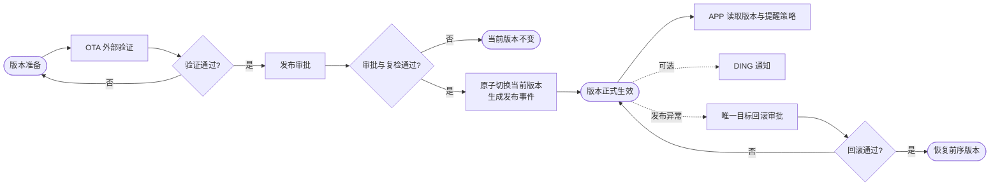

说明：图中的 OTA 测试是外部系统步骤，本平台只承接测试后的发布操作，不建设测试任务页面。

### 8.1 业务角色与职责关系

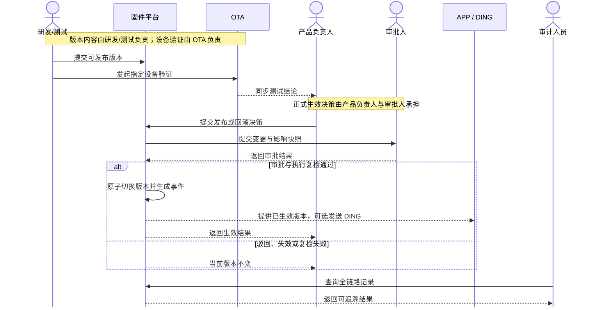

业务责任划分：固件研发或测试人员对版本内容负责，OTA 系统对指定设备验证负责，产品线负责人和钉钉审批人对正式生效决策负责，固件发布平台对状态一致性负责，APP 和 DING 只消费已经生效的发布事件。

### 8.2 固件版本创建与外部测试流程

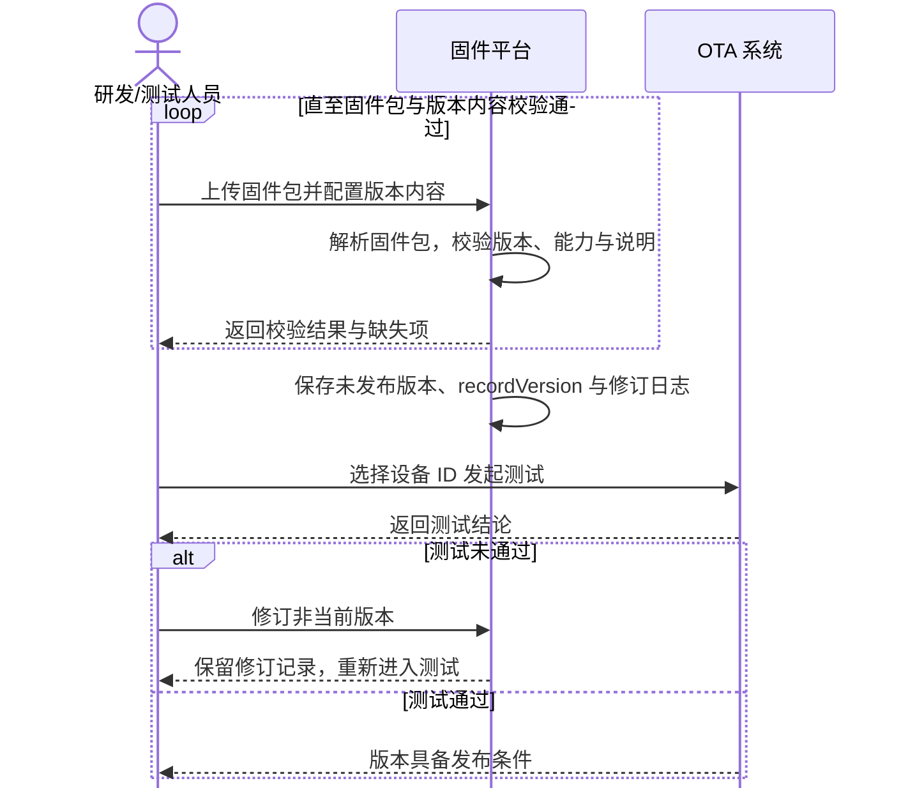

业务产物：一个内容完整的未发布版本、一份 OTA 外部测试结论和可追溯的版本修订记录。固件平台不复制 OTA 测试任务，也不把设备测试结果伪装为平台发布结果。

### 8.3 正常发布审批与生效流程

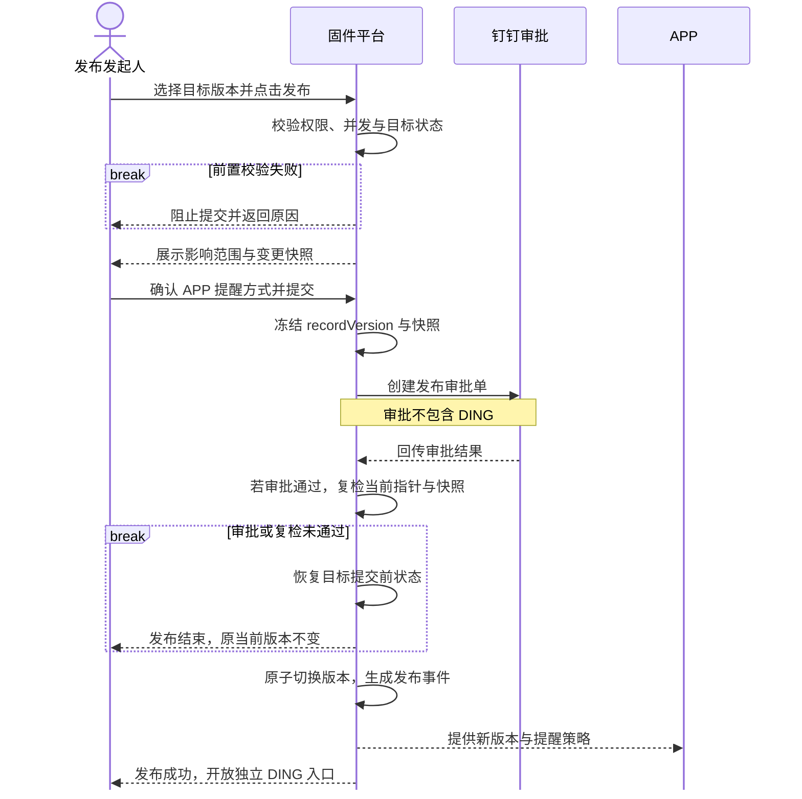

关键控制点：审批只决定正式发布与 APP 提醒策略，不包含 DING；审批通过后仍必须执行服务端复检；发布事务失败时不得产生两个当前版本或半条发布事件。

### 8.4 回滚审批与原发布 DING 处理流程

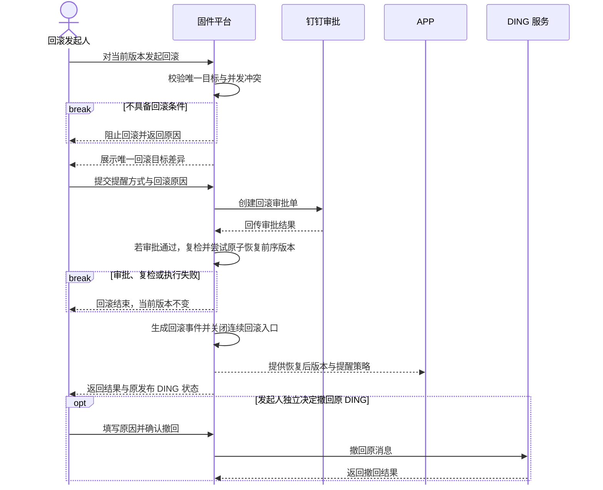

关键边界：回滚事件本身不发送 DING；原发布 DING 不自动撤回。回滚结果页保持简洁，原消息的查看或撤回放在当前版本区域独立处理，且不改变回滚结果。

### 8.5 DING 发送与撤回业务流程

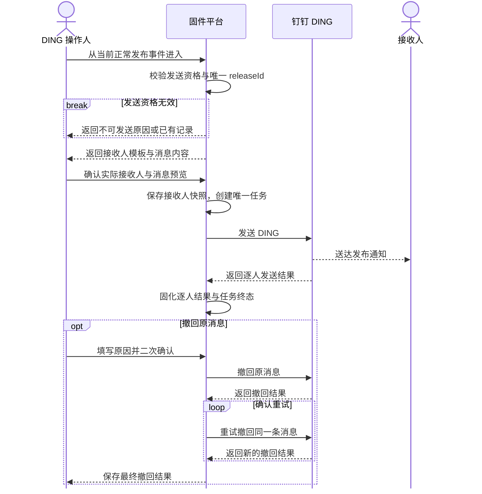

业务约束：DING 默认不开启；发送任务成功或失败后都不能补发和重试；只有撤回失败时允许针对同一条原消息重试撤回。

### 8.6 APP 获取更新与提醒展示流程

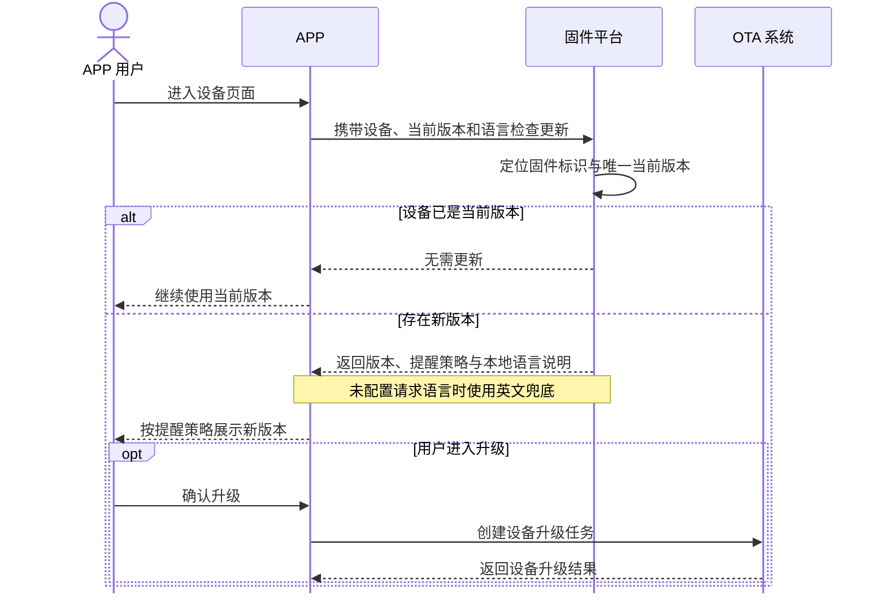

业务边界：固件平台只提供当前版本、下载信息、APP 说明和提醒策略。设备是否点击升级以及升级执行结果由 APP 和 OTA 链路负责，不回写为固件平台发布成功或失败。

### 8.7 权限校验与审计流程

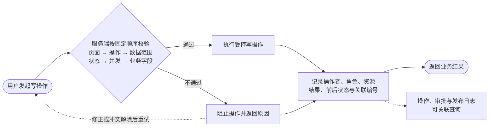

服务端必须重复执行权限、数据范围和状态校验，不能把前端隐藏按钮当作安全边界。成功和被阻止的关键写操作都进入审计。

### 8.8 4G 模组在线差分流程

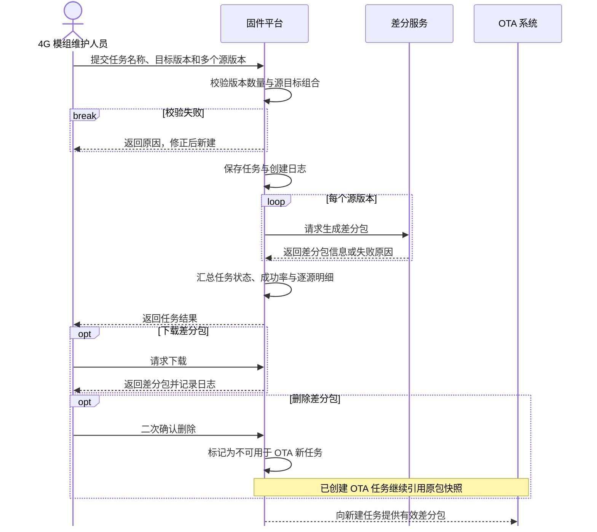

差分任务失败后不覆盖或重试原任务，通过新建任务保留历史事实。删除只影响 OTA 后续新任务的可选范围，不破坏已创建任务的引用。

### 8.9 固件版本业务状态流转

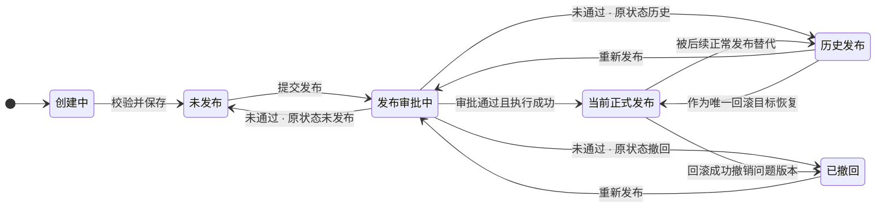

状态恢复必须以提交审批前的真实状态为准：历史版本或已撤回版本重新发布失败后，应分别恢复为历史发布或已撤回，不能统一错误降级为未发布。

## 9. 固件标识与影响范围

规则打点：

| 规则编号 | 操作节点 | 规则类型 | 规则要求 | 预期结果 | 关联范围项 |
| --- | --- | --- | --- | --- | --- |
| FID-R01 | 新增固件标识 | 数据 | 固件标识、所属产品线和关联机型必须完整且固件标识唯一 | 创建成功后形成版本集合的唯一业务归属 | FR-01 |
| FID-R02 | 编辑固件标识 | 状态 | 创建成功后不得修改关联机型；其他字段按权限开放 | 避免历史版本与设备范围口径漂移 | FR-01、FR-02 |
| FID-R03 | 查看标识概览 | 数据 | 绑定设备数按标识关联机型去重统计，无设备时展示 `0` | 操作人可判断该标识的整体影响规模 | FR-02 |
| FID-R04 | 查看版本列表 | 数据 | 关联设备数按版本适用机型去重统计 | 列表数据与发布审批中的预计影响设备一致 | FR-02 |
| FID-R05 | 查看模组关联固件 | 交互 | 关联固件数大于零时可返回固件列表并带入筛选条件 | 从模组维度形成有效查询闭环 | FR-18 |
| FID-R06 | 无关联数据 | 结果 | 数量为零时只展示 `0`，不提供无效跳转 | 明确区分零值、未知值和不可操作状态 | FR-02、FR-18 |

### 9.1 固件标识

固件标识至少包含：固件标识、所属产品线、关联机型、网络类型、电量类型、架构类型、创建时间和创建人。

关联机型创建后不可二次修改，避免已存在版本和设备范围失去一致性。其他可编辑字段按角色权限控制。

### 9.2 设备数

- 固件标识顶部展示“绑定设备数”，表示该标识下去重后的绑定设备总量。
- 固件版本列表展示“关联设备数”，表示符合该版本适用机型的绑定设备量。
- 提交发布审批时展示“预计影响设备”，取目标版本关联设备数。
- 设备数用于发布影响判断，不代表已推送、已下载或已升级设备数。
- 无关联设备时展示 `0`，不得使用空值或 `-` 混淆未知与零。

### 9.3 模组型号

模组型号页面用于查询模组型号、SOC 型号、关联固件数、FOTA 工具版本、配置文件和创建时间。关联固件数可点击并返回固件列表筛选对应标识；数量为零时只展示 `0`，不提供无效跳转。

## 10. 固件版本创建与编辑

规则打点：

| 规则编号 | 操作节点 | 规则类型 | 规则要求 | 预期结果 | 关联范围项 |
| --- | --- | --- | --- | --- | --- |
| VER-R01 | 上传固件包 | 前置 | 仅接收 `.bin`、`.binpkg`，解析成功后才能继续配置 | 失败文件不能形成版本记录 | FR-03 |
| VER-R02 | 移除功能集配置 | 范围 | 新增和编辑固件版本时不展示功能集配置，且不参与保存校验 | 新版本不写入功能集，历史版本配置保持不变 | FR-04 |
| VER-R03 | 加载功能点 | 数据 | 按当前固件标识所属产品线读取机型平台功能管理目录 | 不展示其他产品线或本地虚构的功能源 | FR-05 |
| VER-R04 | 保存新版本 | 数据 | 版本号在同一固件标识内唯一；平台说明、适用机型、中文和英文 APP 说明完整 | 校验通过后保存为未发布版本 | FR-03、FR-05、FR-06 |
| VER-R05 | 编辑非当前版本 | 权限 | 未发布、历史发布和已撤回版本可编辑；审批目标锁定 | 可编辑范围与版本状态保持一致 | FR-07 |
| VER-R06 | 编辑版本内容 | 状态 | 所有编辑状态均不得修改版本号或替换固件包 | 历史制品和引用关系保持稳定 | FR-03、FR-07 |
| VER-R07 | 保存历史修订 | 审计 | 历史发布或已撤回版本保存后递增 `recordVersion` 并保留修改前内容 | 审批可锁定明确内容版本且历史不可覆盖 | FR-07、FR-20 |
| VER-R08 | 删除版本 | 权限 | 仅未发布版本可删除；当前、历史、已撤回和审批中版本禁止删除 | 已形成业务事实的版本不被物理移除 | FR-07 |
| VER-R09 | 默认功能版本 | 交互 | 勾选功能点后默认带出最新已发布且可用版本 | 测试中的最新工作版本不会被误关联 | FR-05 |
| VER-R10 | 切换功能版本 | 交互 | 支持切换其他已发布可用版本；测试中和已停用版本不可新选 | 功能版本选择范围与源平台状态一致 | FR-05 |
| VER-R11 | 保存功能点快照 | 数据 | 保存功能标识、名称、分类、版本、说明和来源更新时间快照 | 源平台后续变化不追溯改写固件历史 | FR-05、FR-10 |
| VER-R12 | 功能版本失效 | 状态 | 历史快照继续展示；正常发布前必须切换至仍可关联的版本 | 历史可追溯且新发布不引用失效版本 | FR-05、FR-10 |

### 10.1 新增版本

新增版本流程必须按以下顺序完成：

1. 上传 `.bin` 或 `.binpkg` 固件包。
2. 完成文件解析，生成文件名、大小、下载地址和完整性信息。
3. 填写适用机型和平台发布说明。
4. 从当前产品线的机型平台功能目录选择功能点。
5. 为每个已选功能点确认最新可关联版本，或切换其他已发布可用版本。
6. 配置 APP 固件版本更新说明。
7. 保存功能点版本快照并创建未发布固件版本。

“添加功能”仅用于选择关联功能；固件标识的“更多”按钮继续作为标识级操作菜单，两者不得复用同一交互。

### 10.2 字段规则

| 字段 | 是否必填 | 规则 |
| --- | --- | --- |
| 固件包 | 是 | 仅支持规定格式，上传与解析成功后方可继续 |
| 固件版本号 | 是 | 同一固件标识内唯一，保存后不可修改 |
| 适用机型 | 是 | 用于计算关联设备数和发布影响范围 |
| 功能集能力 | 是 | 目录内能力均需选择对应版本，不允许缺项 |
| 平台发布说明 | 是 | 最多 500 字，用于审批、DING 和内部追溯 |
| APP 更新说明 | 是 | `zh`、`en` 必填，其他语言选填 |
| 关联功能 | 否 | 从功能目录弹窗多选，不允许自由创建重复功能 |

### 10.3 编辑规则

| 版本状态 | 完整编辑 | 发布 | 删除 |
| --- | --- | --- | --- |
| 未发布 | 允许 | 允许 | 允许 |
| 发布审批中 | 锁定 | 进入已有审批 | 禁止 |
| 当前正式发布 | 禁止 | 不展示 | 禁止 |
| 历史发布 | 允许 | 允许重新发布 | 禁止 |
| 已撤回 | 允许 | 允许重新发布 | 禁止 |

补充规则：

- 所有编辑场景均不允许修改版本号或替换固件包。
- 当前正式发布版本只允许通过独立入口维护 APP 更新说明。
- 保存历史或已撤回版本时递增 `recordVersion` 并记录修订前内容。
- 审批目标版本必须锁定，防止审批快照与执行内容不一致。
- 编辑、发布、删除分别判断资格，允许编辑不等于允许删除。

## 11. APP 15 语言更新说明

规则打点：

| 规则编号 | 操作节点 | 规则类型 | 规则要求 | 预期结果 | 关联范围项 |
| --- | --- | --- | --- | --- | --- |
| LOC-R01 | 进入语言配置 | 交互 | 左侧固定展示 15 种中文语言名称并支持纵向滚动 | 无需添加语言即可访问全部配置项 | FR-06 |
| LOC-R02 | 保存版本 | 前置 | 简体中文 `zh` 和英文 `en` 必填，其他 13 种语言选填 | 缺失必填语言时阻止保存并定位首个错误 | FR-06 |
| LOC-R03 | 输入更新说明 | 数据 | 中文、繁体中文、日语、韩语上限 80 字，其他语言上限 160 字 | 超限内容不能进入版本或审批快照 | FR-06 |
| LOC-R04 | 切换语言 | 交互 | 保留其他语言未保存内容、抽屉状态和列表滚动位置 | 连续配置过程中不丢失输入或重开容器 | FR-06、FR-08 |
| LOC-R05 | APP 获取说明 | 结果 | 精确语言未配置或语言非法时统一使用英文说明 | APP 始终获得可展示内容并标识英文兜底 | FR-06、FR-09 |
| LOC-R06 | 保存选填语言 | 数据 | 空选填语言不写入新版本数据和审批快照 | 避免生成无意义空字段 | FR-06 |
| LOC-R07 | 维护当前版本文案 | 审计 | 仅允许通过独立入口修改 APP 说明，必须填写原因并递增 `recordVersion` | 文案立即生效且不改变原发布审批事实 | FR-06、FR-07、FR-20 |
| LOC-R08 | 读取旧 Locale | 兼容 | 旧语言码映射到固定目录，历史审批和 DING 快照不改写 | 新旧数据可用且历史事实保持不变 | FR-21 |

### 11.1 固定目录

| 语言 | 语言码 | 必填 | 上限 |
| --- | --- | --- | --- |
| 简体中文 | `zh` | 是 | 80 |
| 英文 | `en` | 是 | 160 |
| 繁体中文 | `zh_FT` | 否 | 80 |
| 越南语 | `vi` | 否 | 160 |
| 泰语 | `th` | 否 | 160 |
| 日语 | `ja` | 否 | 80 |
| 韩语 | `ko` | 否 | 80 |
| 俄语 | `ru` | 否 | 160 |
| 德语 | `de` | 否 | 160 |
| 法语 | `fr` | 否 | 160 |
| 西班牙语 | `es` | 否 | 160 |
| 意大利语 | `it` | 否 | 160 |
| 荷兰语 | `nl` | 否 | 160 |
| 波兰语 | `pl` | 否 | 160 |
| 葡萄牙语 | `pt` | 否 | 160 |

`zh_FT` 按当前 APP 约定保留大小写和下划线。若后续更换标准语言码，需要单独评审接口兼容。

### 11.2 交互规则

- 左侧按固定顺序展示全部 15 种语言，固定高度并支持纵向滚动。
- 不提供添加语言和删除语言操作。
- 必填语言显示“必填”；选填语言实时显示“未配置”或“已配置”。
- 顶部显示“已配置 X / 15”。
- 切换语言不得清空其他语言内容，重新渲染时保持抽屉和列表滚动位置。
- 点击列表底部语言后自动滚动到可视区域，不重新打开抽屉。
- 不允许输入 HTML 或脚本内容。

### 11.3 数据与兜底

- 空的选填语言不写入版本数据，也不进入新审批快照。
- APP 精确命中已配置语言时返回该语言内容。
- 未配置或非法语言统一使用英文 `en` 说明兜底。
- APP 预览器允许切换全部 15 种语言；发生兜底时明确显示“英文兜底”。
- 旧版本语言码在版本读取或维护时映射到新语言码；历史审批快照保持原始值。

### 11.4 已发布文案维护

当前正式版本的 APP 更新说明可由具备“维护 APP 更新说明”权限的人员独立修订，无需重新发起发布审批。保存时必须填写修改原因、递增 `recordVersion`、生成不可覆盖的文案修订记录，并立即失效 APP 升级检查缓存。该入口只修改 APP 用户说明，不允许改动固件包、版本号、平台发布说明、功能集或原发布审批快照。

## 12. APP 提醒策略

规则打点：

| 规则编号 | 操作节点 | 规则类型 | 规则要求 | 预期结果 | 关联范围项 |
| --- | --- | --- | --- | --- | --- |
| REM-R01 | 提交发布审批 | 前置 | 必须为本次发布选择不提醒、弱提醒、强提醒或强制提醒 | 未选择时阻止提交审批 | FR-09、FR-10 |
| REM-R02 | 提交回滚审批 | 前置 | 回滚必须重新选择本次 APP 提醒方式，不继承原事件 | 回滚恢复版本与本次用户触达策略明确绑定 | FR-09、FR-12 |
| REM-R03 | 切换提醒策略 | 交互 | 右侧 APP 模拟器实时展示对应提醒效果 | 提交前可确认 APP 端最终表现 | FR-09 |
| REM-R04 | 切换预览语言 | 交互 | 支持全部 15 种语言；未配置语言展示英文兜底标识 | 提醒样式与语言内容可组合核对 | FR-06、FR-09 |
| REM-R05 | 保存提醒策略 | 数据 | 策略写入本次发布或回滚事件，不覆盖目标版本历史事件 | 同一版本多次发布的提醒记录互不污染 | FR-09、FR-14 |

| 提醒策略 | APP 表现 | 适用说明 |
| --- | --- | --- |
| 不提醒 | 不主动展示提醒，保留升级入口 | 低风险或无需主动触达 |
| 弱提醒 | 设备设置入口显示更新红点 | 低打扰提醒 |
| 强提醒 | 设备卡片展示升级横幅 | 需要明显提示但不持续打断 |
| 强制提醒 | 进入相关页面持续展示升级弹窗 | 高优先级版本提示 |

提交发布和回滚审批时必须重新选择本次提醒方式。提醒方式保存到本次发布或回滚事件，不覆盖目标版本的历史事件配置。

审批弹窗右侧提供 APP 模拟器，提醒方式和预览语言切换后立即展示对应效果。模拟器只预览样式和说明，不表示 APP 已分发或设备已升级。

## 13. 正常发布

规则打点：

| 规则编号 | 操作节点 | 规则类型 | 规则要求 | 预期结果 | 关联范围项 |
| --- | --- | --- | --- | --- | --- |
| PUB-R01 | 展示发布入口 | 状态 | 除当前正式版本外均支持发布；审批目标点击后打开已有审批 | 不重复创建审批且所有可发布版本有明确入口 | FR-07、FR-10 |
| PUB-R02 | 点击发布 | 权限 | 按页面权限、操作权限、数据范围、版本状态和审批锁顺序校验 | 任一条件不满足时阻止并给出明确原因 | FR-10、FR-19 |
| PUB-R03 | 提交审批 | 前置 | 校验固件包、功能集、必填语言、提醒策略和审批并发 | 仅完整且无冲突的版本进入审批 | FR-04、FR-06、FR-10 |
| PUB-R04 | 创建审批 | 数据 | 冻结目标 `recordVersion`、影响设备、能力集、说明和提醒方式 | 审批内容与待执行内容一一对应 | FR-10 |
| PUB-R05 | 审批期间 | 状态 | 当前正式版本继续生效，目标版本及其内容锁定 | 审批不会提前改变线上当前版本 | FR-07、FR-10 |
| PUB-R06 | 审批通过 | 前置 | 服务端复检当前指针、目标版本、固件包和快照版本号 | 条件变化时审批失效，不执行切换 | FR-10、FR-11 |
| PUB-R07 | 执行发布 | 结果 | 在同一事务中切换唯一当前版本并生成发布事件和回滚目标 | 任一时刻只有一个当前正式版本 | FR-11 |
| PUB-R08 | 执行失败 | 异常 | 整体回退且当前版本不变，不自动重试 | 不产生双当前版本或半条事件 | FR-11、FR-20 |
| PUB-R09 | 审批驳回或失效 | 状态 | 恢复目标版本提交前真实状态并解除锁定 | 历史发布、已撤回和未发布状态不被错误改写 | FR-07、FR-10 |
| PUB-R10 | 发布完成 | 结果 | DING 不随发布自动发送，仅开放独立入口 | 发布事务与通知结果解耦 | FR-11、FR-13 |

### 13.1 发布入口

- 当前正式发布版本不展示“发布”。
- 未发布、历史发布和已撤回版本均展示“发布”。
- 当前审批目标版本展示“发布”，点击后进入已有审批，不创建第二张审批单。
- 同一固件标识存在其他发布或回滚审批时，入口保持可见，但点击后提示冲突。

### 13.2 提交审批

提交前校验：

1. 操作人具备发布权限和目标产线数据范围。
2. 同一固件标识不存在其他有效审批。
3. 目标不是当前正式发布版本。
4. 固件包存在且完整性有效。
5. 目标版本功能集完整。
6. `zh`、`en` 有效，所有已配置语言未超限。
7. 已选择 APP 提醒方式。

审批快照至少包含：固件标识、原当前版本、目标版本、目标 `recordVersion`、固件包信息、适用机型、预计影响设备、功能集、平台发布说明、实际配置语言、APP 提醒方式、提交人和提交时间。

DING 开关、接收人和通知内容不进入发布审批。

### 13.3 审批结果

- 审批中：当前正式版本继续生效，目标版本锁定。
- 审批驳回：不切换当前版本；目标版本恢复提交前状态。
- 审批失效：记录失效原因并解除锁定，不自动重新提交。
- 审批通过：服务端复检当前版本、目标版本、固件包和快照版本号。
- 复检失败：整次发布失败，当前版本不变，不自动重试。
- 复检通过：原子切换当前版本，旧当前版本变为历史发布，目标版本变为唯一当前发布。

发布事务必须同时更新当前版本指针、版本状态、发布事件、唯一回滚目标和审计记录。任一步骤失败时整体回退。

## 14. 回滚

规则打点：

| 规则编号 | 操作节点 | 规则类型 | 规则要求 | 预期结果 | 关联范围项 |
| --- | --- | --- | --- | --- | --- |
| RBK-R01 | 展示回滚入口 | 状态 | 仅当前正常发布事件存在唯一前序版本且未回滚时展示 | 不能任意选择历史版本或连续多级回滚 | FR-12 |
| RBK-R02 | 点击撤销并回滚 | 前置 | 无发布或回滚审批，原 DING 不处于发送中或撤回中 | 避免版本与通知并发造成状态冲突 | FR-12、FR-13 |
| RBK-R03 | 填写回滚信息 | 交互 | 展示关键差异，必须重新选择提醒方式并填写最多 500 字原因 | 操作人明确恢复目标、用户影响和回滚原因 | FR-09、FR-12 |
| RBK-R04 | 提交回滚 | 权限 | 所有回滚统一创建钉钉审批，不提供立即回滚入口 | 高风险状态切换具有审批依据 | FR-12、FR-19 |
| RBK-R05 | 审批期间 | 状态 | 当前版本继续生效，同一标识的发布与回滚操作锁定 | 审批结果产生前线上状态不变化 | FR-12 |
| RBK-R06 | 审批通过 | 前置 | 再次校验当前指针、唯一目标、固件包和审批快照 | 条件已变化时不执行错误恢复 | FR-12 |
| RBK-R07 | 执行回滚 | 结果 | 原子恢复前序版本，将问题版本标记为已撤回并关闭本次回滚入口 | 回滚形成唯一、可追溯的恢复结果 | FR-12、FR-20 |
| RBK-R08 | 执行失败 | 异常 | 整体回退且当前版本不变，不自动重试 | 不留下部分恢复状态 | FR-12 |
| RBK-R09 | 回滚完成 | 结果 | 回滚事件 DING 固定为不适用，不自动发送或撤回原 DING | 回滚结果不受通知服务结果影响 | FR-12、FR-13 |

### 14.1 回滚目标

回滚目标不是用户任意选择的历史版本，而是当前正常发布事件记录的唯一前序当前版本。

满足以下条件时才展示“撤销并回滚”：

- 当前有效事件是正常发布事件。
- 当前事件存在唯一前序版本。
- 当前事件尚未执行过回滚。
- 无其他发布或回滚审批。
- 原发布 DING 不处于发送中或撤回中。

回滚成功后关闭该事件的回滚入口，不支持连续回滚到更早版本。后续再次正常发布时，才形成新的唯一回滚目标。

### 14.2 回滚弹窗

弹窗展示当前版本与回滚目标的：版本号、版本状态、适用机型、功能集配置和 APP 说明语言数量。适用机型存在差异时展示差异，但不阻止提交。

操作人必须重新选择 APP 提醒方式并填写最多 500 字的回滚原因。主按钮使用“提交回滚审批”，避免误解为立即回滚。

### 14.3 回滚审批与执行

- 所有回滚统一走钉钉审批。
- 审批期间当前版本继续生效，同一标识的发布和回滚操作锁定。
- 审批驳回或失效时当前版本保持不变。
- 审批通过后再次校验当前指针、唯一目标、固件包和审批快照。
- 校验通过后以原子事务恢复目标版本，并将问题版本标记为已撤回。
- 回滚事务失败时整体回退，不修改当前版本，不自动重试。
- 成功结果页只展示恢复后的当前版本和完成按钮，不堆叠 DING 或设备执行说明。

### 14.4 回滚与 DING

- 回滚审批不配置 DING，回滚事件不创建 DING，状态固定为“不适用”。
- 回滚不会自动发送或自动撤回原发布 DING。
- 原发布 DING 已发送且可撤回时，在回滚后的当前版本区域展示原通知状态和独立撤回入口。
- 原 DING 正在发送或撤回时暂时阻止发起回滚，等待通知进入终态后再操作。
- DING 撤回成功或失败均不改变已经生效的回滚结果。

## 15. 独立 DING 通知

规则打点：

| 规则编号 | 操作节点 | 规则类型 | 规则要求 | 预期结果 | 关联范围项 |
| --- | --- | --- | --- | --- | --- |
| DING-R01 | 展示发送入口 | 状态 | 仅当前生效的正常发布事件且未创建任务时展示 | 回滚、历史或已替代事件不可发送 | FR-13 |
| DING-R02 | 打开发送弹窗 | 数据 | 接收范围模板只负责预填，不代表默认开启或已确认 | 每次发送均由操作人确认实际接收人 | FR-13 |
| DING-R03 | 选择接收范围 | 交互 | 通过组织树选择组织、部门或成员并展示已选结果 | 接收范围可理解、可调整、可核对 | FR-13 |
| DING-R04 | 发送预览 | 数据 | 自动读取发布事件、平台说明和功能集，不重复录入 | 消息内容与已生效发布事实一致 | FR-05、FR-13 |
| DING-R05 | 确认发送 | 前置 | 展示版本变化、生效时间、人数、接收人和消息预览并二次确认 | 降低误发对象或内容错误风险 | FR-13 |
| DING-R06 | 创建任务 | 幂等 | 每个 `releaseId` 最多创建一个发送任务 | 重复点击不产生多条通知 | FR-13 |
| DING-R07 | 发送失败或部分失败 | 结果 | 保存为终态，不允许重试、补发或重新创建 | 通知历史保持唯一且可审计 | FR-13、FR-20 |
| DING-R08 | 撤回原消息 | 权限 | 仅发送成功或部分成功的消息可撤回，必须填写原因并二次确认 | 撤回动作有明确对象和审计依据 | FR-13、FR-20 |
| DING-R09 | 撤回失败 | 异常 | 允许针对同一条原消息重试撤回，不创建新发送任务 | 撤回链路可恢复且不突破发送一次限制 | FR-13 |
| DING-R10 | 回滚后处理原 DING | 状态 | 在当前版本区域展示原通知状态和可用撤回操作 | 通知处置独立于已完成回滚 | FR-12、FR-13 |

### 15.1 发送资格

DING 默认不开启，只对“当前生效的正常发布事件”提供一次独立发送入口。回滚事件、历史发布事件、已替代事件均不允许发送。

每个发布 `releaseId` 最多创建一个发送任务。任务一旦创建，无论成功、部分失败或失败，均不允许重试、补发或重新创建通知。

### 15.2 接收范围

- 接收人使用钉钉组织架构树选择，可选择组织、部门或成员。
- 固件标识可保存接收人模板，只用于发送时预填。
- 模板不代表默认开启，发送前必须确认实际接收人。
- 创建任务时保存接收人快照，组织架构后续变化不覆盖历史记录。

### 15.3 发送流程

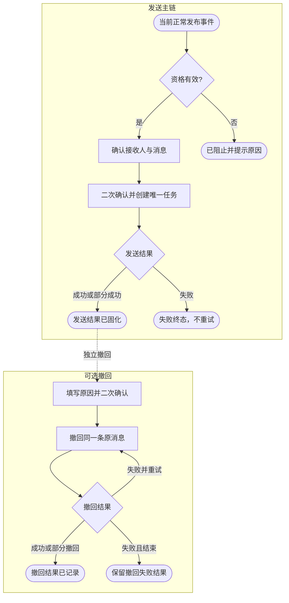

### 15.4 消息与撤回

DING 内容自动读取发布事件、平台发布说明和功能集信息，不要求重复录入。发送前必须展示版本变化、生效时间、实际接收人数、接收人快照和消息预览。

只有发送成功或部分成功的原消息允许撤回。撤回必须填写原因并二次确认。撤回失败可重试同一条消息，但不得创建新的 DING 发送任务。

## 16. 当前发布版本与版本详情

规则打点：

| 规则编号 | 操作节点 | 规则类型 | 规则要求 | 预期结果 | 关联范围项 |
| --- | --- | --- | --- | --- | --- |
| DET-R01 | 查看当前版本 | 数据 | 聚合版本、来源、生效时间、提醒、机型、DING、文件和下载信息 | 用户无需跨页面判断当前线上状态 | FR-15 |
| DET-R02 | 当前版本操作 | 状态 | 只展示当前状态可用的详情、回滚、发送或撤回 DING 操作 | 不可用操作禁用并说明原因 | FR-12、FR-13、FR-15 |
| DET-R03 | 打开版本详情 | 交互 | 使用同一详情抽屉承载六类页签 | 基础信息和关联记录处于同一版本上下文 | FR-08 |
| DET-R04 | 切换详情页签 | 交互 | 只替换抽屉内部内容，不关闭、重开或重复播放动画 | 页签切换稳定且不丢失当前位置 | FR-08 |
| DET-R05 | 查看详情记录 | 数据 | 发布、审批和 DING 记录均使用当前版本及事件关联标识查询 | 不串联其他版本或其他发布事件数据 | FR-08、FR-20 |

### 16.1 当前发布版本

当前版本区域展示：版本号、来源关系、生效时间、APP 提醒方式、适用机型、DING 状态、文件大小和下载地址。

操作区仅保留与当前状态相关的入口：详情、撤销并回滚、发送 DING、撤回 DING 或查看 DING 记录。不可用操作使用明确禁用状态和原因，不使用无反馈点击。

### 16.2 版本详情

详情抽屉包含基础信息和以下页签：

1. 功能集配置。
2. APP 更新说明及文案修订记录。
3. 关联功能。
4. 发布记录。
5. 审批日志。
6. DING 记录。

切换页签只替换抽屉内部内容，不关闭或重新打开抽屉，不重复播放进入动画。

## 17. 发布日志

规则打点：

| 规则编号 | 操作节点 | 规则类型 | 规则要求 | 预期结果 | 关联范围项 |
| --- | --- | --- | --- | --- | --- |
| RLG-R01 | 进入发布日志 | 数据 | 按日期分组，同日多个发布或回滚事件独立展示 | 高频发布时版本链路仍可区分 | FR-14 |
| RLG-R02 | 查看事件摘要 | 数据 | 默认展示版本变化、事件状态、生效时间和操作人 | 首屏只呈现决策所需焦点信息 | FR-14 |
| RLG-R03 | 展开事件 | 交互 | 在当前页面按时间节点下拉展开审批、执行、结果和通知阶段 | 无需跳转即可理解完整链路 | FR-14 |
| RLG-R04 | 查询事件 | 交互 | 支持版本号、流程号、操作人和时间范围组合查询 | 可快速定位具体发布或回滚事件 | FR-14、FR-20 |
| RLG-R05 | 页面操作边界 | 权限 | 发布日志保持只读，不提供发送 DING 或其他写操作 | 历史追溯页不承担业务执行职责 | FR-14 |
| RLG-R06 | 事件命名 | 交互 | 模块统一命名为“发布日志”，不使用“生命周期” | 页面名称与实际数据范围一致 | FR-14 |

“生命周期”统一命名为“发布日志”。该页面用于回答“哪个版本在什么时间、经过什么审批和操作后成为当前版本或被回滚”，不承载设备执行结果。

### 17.1 展示规则

- 记录按日期分组，同一天多个发布或回滚事件分别展示。
- 每个事件以时间线节点展示审批、执行、结果和通知等阶段。
- 默认展示版本变化、事件状态、生效时间和操作人。
- 点击事件在当前页面下拉展开节点，不跳转详情页。
- 支持按版本号、链路编号、操作人和时间范围查询。
- 发布日志保持只读，不提供“发送 DING”等写操作。

### 17.2 事件状态

| 状态 | 含义 |
| --- | --- |
| 审批中 | 审批尚未结束，当前版本未变化 |
| 已驳回 | 审批未通过，目标未生效 |
| 已失效 | 执行条件变化，审批结果不再可执行 |
| 发布成功 | 正常发布事务完成 |
| 发布失败 | 发布事务回退，当前版本未变化 |
| 当前生效 | 该事件对应当前正式版本 |
| 已替代 | 后续发布替代了该事件 |
| 已回滚 | 该正常发布事件已被回滚撤销 |
| 回滚成功 | 回滚事务完成，前序版本恢复 |

## 18. 4G 模组在线差分

规则打点：

| 规则编号 | 操作节点 | 规则类型 | 规则要求 | 预期结果 | 关联范围项 |
| --- | --- | --- | --- | --- | --- |
| DIF-R01 | 展示差分页签 | 权限 | 仅 4G 模组产品线及具备对应权限的角色可见 | 其他产品线不出现无效功能入口 | FR-16、FR-19 |
| DIF-R02 | 新建差分任务 | 前置 | 任务名称不超过 50 字，目标版本单选，源版本多选 | 任务输入结构明确且可校验 | FR-16 |
| DIF-R03 | 选择版本 | 数据 | 源版本不得包含目标版本，模组型号由固件标识自动带出 | 避免无意义自差分和型号错配 | FR-16 |
| DIF-R04 | 查看任务结果 | 数据 | 展示总体状态、成功率、包数量和逐源版本失败原因 | 一个任务内可判断每条差分结果 | FR-16 |
| DIF-R05 | 差分任务失败 | 状态 | 不在原任务上重试，需要新建任务 | 历史输入和失败事实不被覆盖 | FR-16、FR-20 |
| DIF-R06 | 查看差分包 | 交互 | 按目标版本聚合，下拉展示源版本、大小、名称和操作 | 多包数据保持清晰且可追溯 | FR-17 |
| DIF-R07 | 删除差分包 | 前置 | 删除前二次确认；删除后 OTA 新任务不可再选 | 防止误删并明确后续影响 | FR-17 |
| DIF-R08 | 已引用差分包 | 结果 | 删除不影响 OTA 已创建任务 | 既有 OTA 任务执行事实保持稳定 | FR-17 |

在线差分和差分包页签只在 4G 模组产品线展示。

### 18.1 在线差分

- 支持按差分任务名称查询和按状态筛选。
- 新建任务时填写不超过 50 字的任务名称。
- 目标版本单选，源版本多选且不得包含目标版本。
- 模组型号由当前固件标识自动带出。
- 任务列表展示目标版本、源版本、状态、成功率、差分包数和完成时间。
- 任务详情按源版本展示差分状态、失败原因和成功包下载入口。
- 失败任务不在原任务上重试，需要新建任务以保留历史结果。

### 18.2 差分包列表

- 按目标版本聚合展示差分包数量和更新时间。
- 下拉展开后展示源版本、差分包大小、名称、下载和删除操作。
- 删除前必须二次确认。
- 删除后 OTA 新任务不可再选择该包，已创建任务不受影响。

## 19. 日志与审计

规则打点：

| 规则编号 | 操作节点 | 规则类型 | 规则要求 | 预期结果 | 关联范围项 |
| --- | --- | --- | --- | --- | --- |
| AUD-R01 | 执行写操作 | 权限 | 服务端按页面、操作、数据范围、版本状态、审批锁顺序校验 | 前端隐藏按钮不作为唯一安全边界 | FR-19 |
| AUD-R02 | 权限不足或状态冲突 | 审计 | 阻止操作并记录操作人、资源、结果和明确原因 | 失败和被阻止行为均可追溯 | FR-19、FR-20 |
| AUD-R03 | 版本及通知操作 | 审计 | 新增、编辑、删除、发布、回滚、文案修订、DING 和差分操作全部记录 | 关键业务写操作不存在审计空白 | FR-20 |
| AUD-R04 | 角色与用户配置 | 审计 | 记录变更前后角色、数据范围、审批范围和操作人 | 权限变化具有完整依据 | FR-19、FR-20 |
| AUD-R05 | 记录审批状态 | 数据 | 发布和回滚覆盖审批中、通过、驳回和失效 | 审批结果可独立查询并关联业务事件 | FR-20 |
| AUD-R06 | 跨日志查询 | 数据 | 使用固件、版本、修订号、审批、流程、发布和 DING 标识关联 | 操作日志、审批日志和发布日志可互相追溯 | FR-20 |
| AUD-R07 | 提供模拟数据 | 验收 | 七类角色、不同产线、正反向权限和日志状态均有 mock 数据 | 产品和测试可直接验证授权边界 | FR-19、FR-22 |

### 19.1 操作日志

操作日志字段包括：操作时间、操作人、角色、模块、动作、资源、结果和事件描述。

必须记录：版本新增、编辑、删除、发布、回滚、文案修订、DING 发送与撤回、差分任务、差分包删除、角色权限和用户范围变更，以及所有被状态或权限阻止的写操作。

### 19.2 审批日志

审批日志字段包括：固件版本号、审批类型、提交人、提交时间、审批人、审批状态、审批时间和说明。

发布和回滚审批均应覆盖审批中、通过、驳回和失效状态，并能够通过固件标识、版本号、审批单号和流程编号关联到发布日志。

### 19.3 关键关联标识

建议统一使用：

- `firmwareId`：固件标识。
- `version`：固件版本号。
- `recordVersion`：版本内容修订号。
- `approvalId`：审批单号。
- `flowId`：发布或回滚链路编号。
- `releaseId`：实际生效事件编号。
- `dingTaskId`：DING 任务编号。

## 20. 并发、幂等与异常

| 规则编号 | 场景 | 规则类型 | 处理规则 | 预期结果 | 关联范围项 |
| --- | --- | --- | --- | --- | --- |
| CON-R01 | 同一标识已有有效审批 | 并发 | 阻止创建第二张发布或回滚审批 | 同一标识只有一条有效审批链路 | FR-10、FR-12 |
| CON-R02 | 重复点击同一审批目标的发布 | 幂等 | 打开已有审批，不重复提交 | 不产生重复审批单 | FR-10 |
| CON-R03 | 审批期间目标被修改 | 异常 | 正常情况下目标锁定；检测到异常修改则审批失效 | 执行内容不偏离审批快照 | FR-07、FR-10 |
| CON-R04 | 审批通过时当前版本已变化 | 异常 | 复检失败，审批失效，不执行切换 | 不覆盖新形成的当前版本 | FR-10、FR-11 |
| CON-R05 | 发布或回滚事务部分失败 | 事务 | 整体回滚，不留下双当前版本或半条事件 | 状态和事件数据保持一致 | FR-11、FR-12 |
| CON-R06 | 历史或已撤回版本审批驳回 | 状态 | 恢复提交前真实状态 | 不统一错误降级为未发布 | FR-07、FR-10 |
| CON-R07 | DING 重复点击 | 幂等 | 以 `releaseId` 做幂等，只允许一个任务 | 同一发布事件最多发送一次 | FR-13 |
| CON-R08 | DING 发送失败 | 结果 | 保存终态，不支持发送重试或补发 | 通知记录唯一且不可覆盖 | FR-13 |
| CON-R09 | DING 撤回失败 | 异常 | 允许针对原消息重试撤回 | 不创建第二条通知 | FR-13 |
| CON-R10 | 原 DING 发送中或撤回中 | 并发 | 暂时阻止回滚，等待终态 | 避免通知和版本处置并发冲突 | FR-12、FR-13 |
| CON-R11 | APP 语言未配置 | 兜底 | 使用英文说明 | APP 始终有可用内容 | FR-06 |
| CON-R12 | 旧 Locale 数据 | 兼容 | 映射到固定 15 语言目录，历史快照不改写 | 新旧版本兼容且历史事实不变 | FR-21 |

## 21. 数据迁移与兼容

1. 旧版本 `zh-CN`、`zh-Hans`、`zh-SG` 映射为 `zh`。
2. `zh-TW`、`zh-HK`、`zh-Hant` 和 `zh_FT` 映射为 `zh_FT`。
3. `en-US` 和 `en-*` 映射为 `en`。
4. 其他已支持地区码映射为对应双字母语言码，`pt-*` 统一为 `pt`。
5. 版本维护保存后使用新语言码；历史审批快照、历史 DING 消息和日志不追溯更新。
6. 上线前校验每个固件标识最多一个当前发布版本；发现多当前版本数据时不得自动猜测，应进入人工修复清单。
7. 为历史当前版本补齐发布事件和唯一前序关系时必须保留原始时间与操作人来源。

## 22. 非功能要求

- 发布和回滚状态切换必须使用事务或等价原子机制。
- 审批回调、DING 创建和撤回接口必须支持幂等。
- 所有写操作必须进行服务端权限和数据范围校验，不能仅依赖前端按钮隐藏。
- 列表、弹窗和抽屉在桌面及 390px 窄屏不得出现横向溢出、文字重叠或按钮被遮挡。
- 抽屉页签和语言切换不得重复打开容器或丢失未保存内容。
- 固件包下载地址、消息内容和用户输入必须进行安全转义。
- 时间统一保存完整时间戳，页面按用户时区展示。

## 23. 模拟数据要求

原型至少提供以下可直接验证的数据：

- 当前发布、未发布、发布审批中、历史发布和已撤回版本。
- 同一天多个发布事件、发布驳回、发布执行失败和回滚成功事件。
- 中英文和部分选填语言已配置版本，以及英文兜底场景。
- DING 未发送、发送中、成功、部分失败、撤回中、已撤回和撤回失败状态。
- 绑定设备数、版本关联设备数和零设备版本。
- 4G 模组成功、部分失败和失败的差分任务及差分包。
- 七类角色、不同产线范围、角色变更和权限变更日志。
- 发布审批、回滚审批和权限阻止的操作日志。

## 24. 验收标准

### 24.1 版本与功能集

- 上传固件包后必须完成全部功能集能力配置才能创建版本。
- 添加功能使用独立选择弹窗，固件列表操作列和固件标识“更多”保持各自职责。
- 当前版本不可完整编辑；其他非审批目标版本按状态矩阵正确展示编辑、发布和删除。
- 除当前版本外均有发布入口，审批目标点击后进入已有审批。

### 24.2 多语言与 APP 预览

- 左侧固定展示 15 种中文语言名称并可滚动。
- `zh`、`en` 缺失时阻止保存并定位首个错误。
- 空选填语言不进入版本和审批快照。
- APP 预览可切换全部 15 种语言，并正确标识英文兜底。
- 四种提醒策略的模拟效果与已确认 APP 截图一致。

### 24.3 发布与回滚

- 同一标识始终只有一个当前发布版本。
- 审批中当前版本保持不变，驳回或失效不改变当前版本。
- 审批通过后复检快照，执行失败时完整回退。
- 回滚目标由当前发布事件唯一确定，不允许任意选择。
- 回滚成功后目标恢复为当前版本、问题版本变为已撤回，并关闭连续回滚入口。
- 回滚不创建 DING，成功结果页保持简洁。

### 24.4 DING

- 默认不发送，发布审批中不出现 DING 配置。
- 只有当前正常发布事件可独立发送一次。
- 组织树选择、接收人快照、消息预览和二次确认完整可用。
- 发送失败不支持重试或补发。
- 可撤回状态、撤回原因、二次确认、失败重试和日志均闭环。
- 发布日志中不出现发送 DING 操作。

### 24.5 页面与审计

- 版本详情切换页签时抽屉不重新打开。
- 发布日志按日期和事件时间线下拉展示，同日多版本不混淆。
- 关联设备数在标识、版本和审批影响范围三处口径一致。
- 角色权限、用户范围、操作日志和审批日志均有可验证模拟数据。
- 桌面与窄屏无异常留白、横向溢出、文字重叠和交互死路。

## 25. 上线前核对清单

- APP 团队确认 `zh_FT` 为正式、大小写敏感的语言码。
- OTA 团队确认测试和灰度继续由 OTA 系统承接，固件平台不重复建设。
- 服务端确认当前版本唯一索引、审批幂等键和发布事务方案。
- 钉钉侧确认审批回调、组织树、DING 发送和撤回接口能力。
- 数据团队确认标识绑定设备数和版本关联设备数的统计口径。
- 权限管理员确认七类角色的最终生产授权范围。
- 测试完成发布、驳回、失效、执行失败、回滚、DING 发送与撤回的全链路回归。

## 26. 结论

本期迭代的核心不是增加更多流程阶段，而是让已有固件发布链路具备明确边界、唯一状态、可审批快照、可恢复回滚和可追溯通知。测试与灰度继续由 OTA 系统负责；固件平台聚焦版本内容、正式生效决策、APP 提醒、独立 DING 和审计，从而形成职责清晰且无重复建设的发布闭环。
