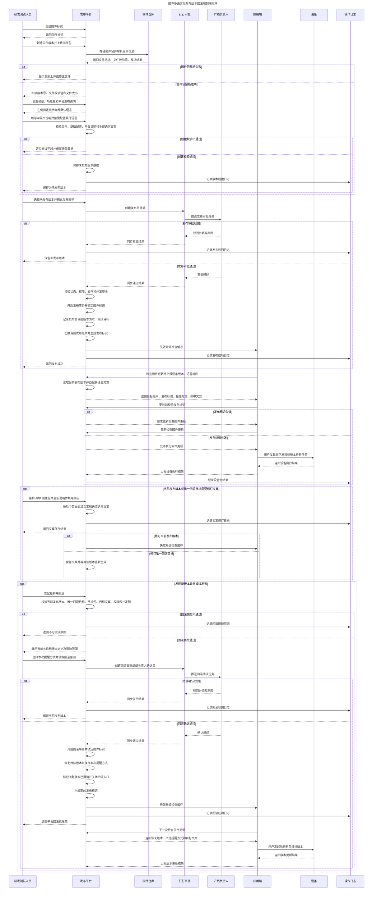
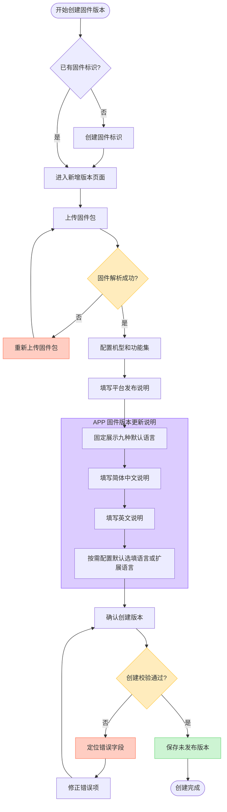
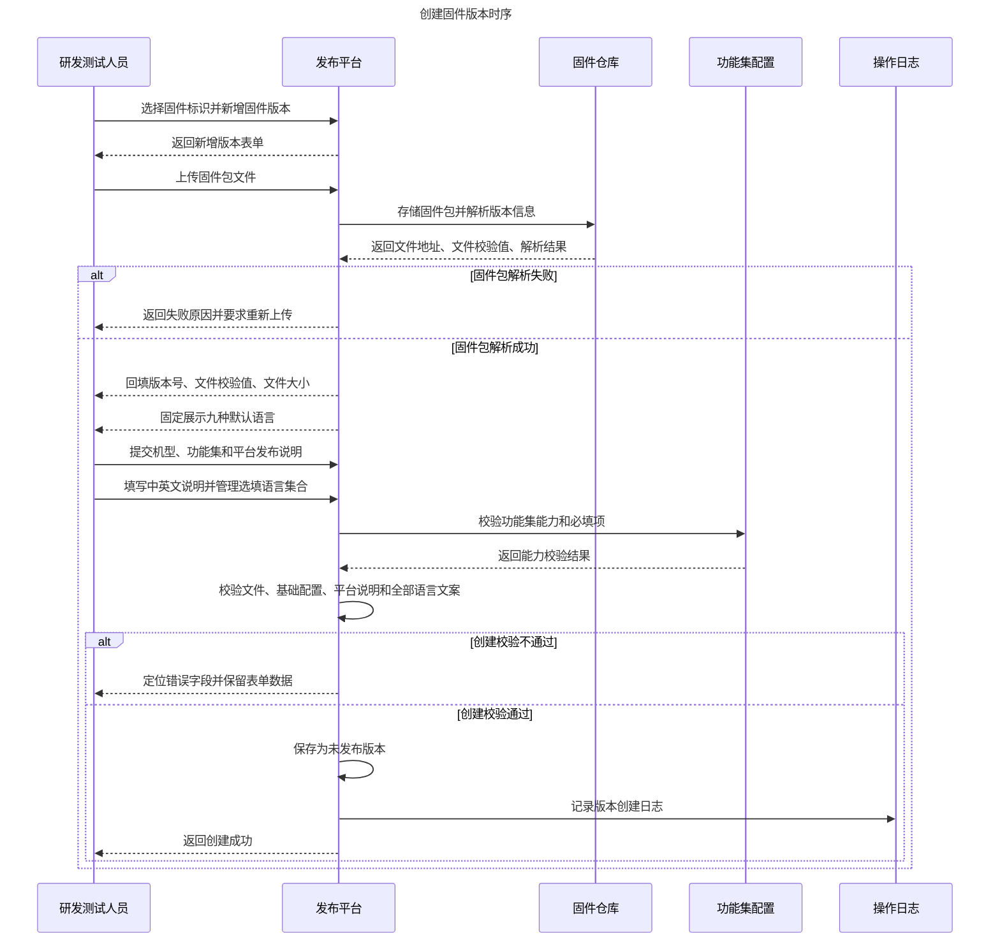
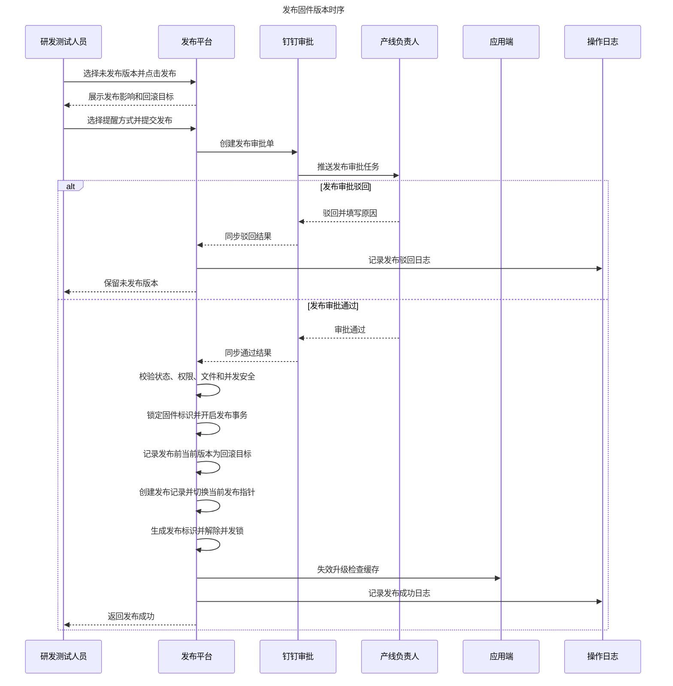
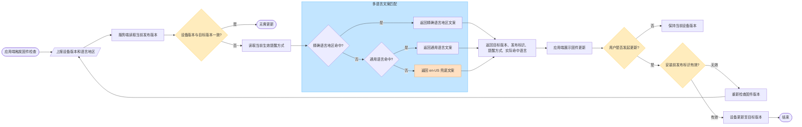
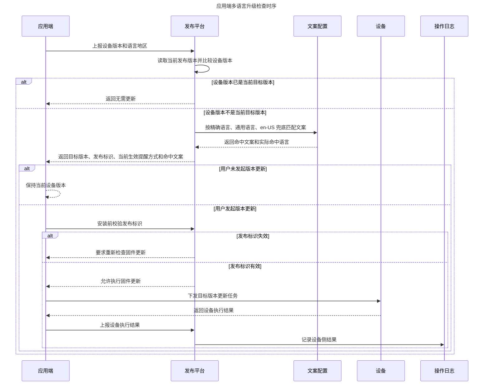
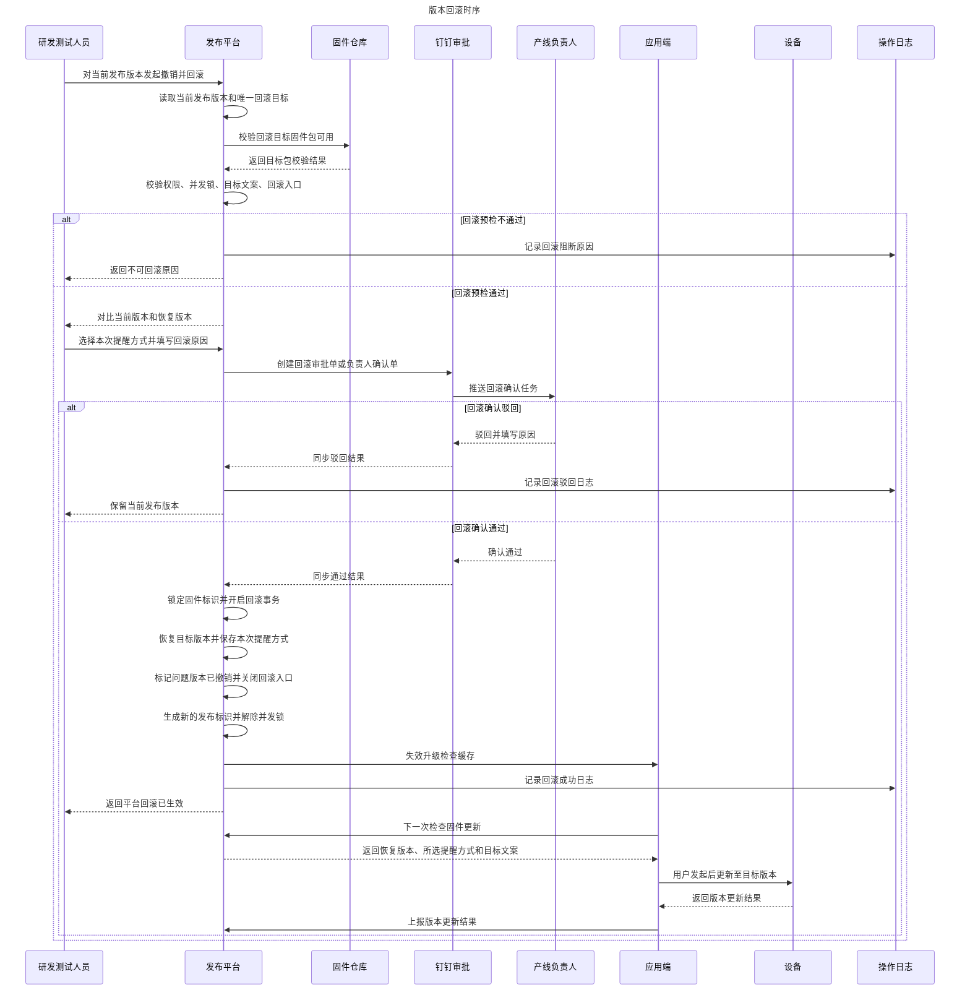
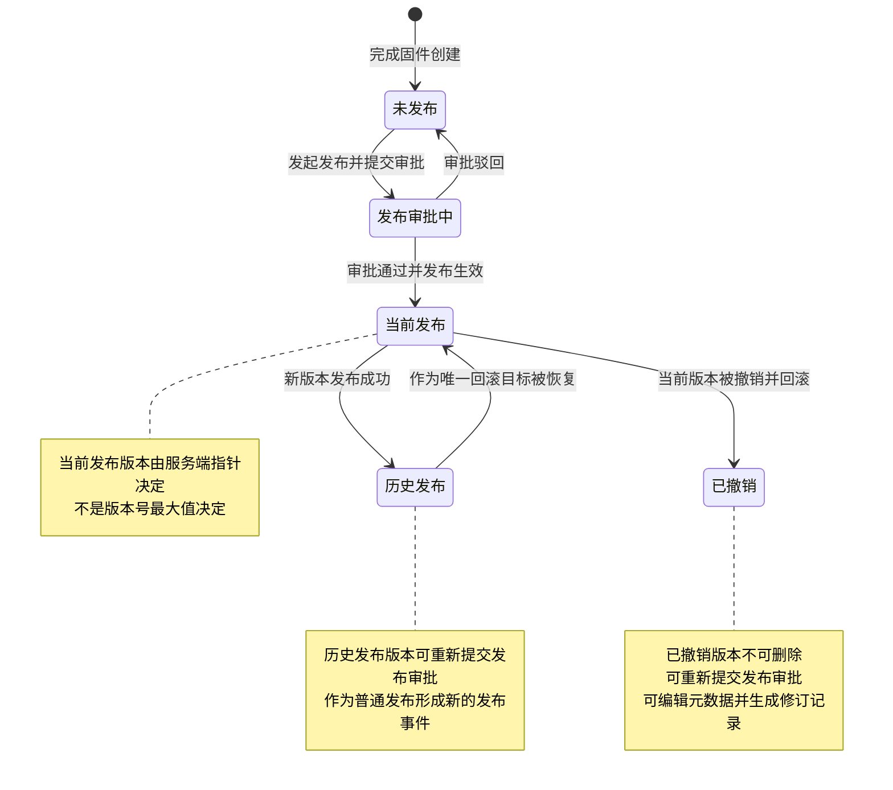

# 固件多语言发布与版本回滚业务链路流程图

## 1. 文档信息

| 项目 | 内容 |
| --- | --- |
| 文档版本 | 第二版 |
| 文档定位 | 0714 新迭代业务链路流程图 |
| 迭代范围 | 固件版本多语言配置、固件发布回滚、发布链路状态闭环 |
| 关联原流程 | 创建固件标识、创建固件版本、发布为最新固件版本、钉钉审批、应用端更新提示 |
| 关联新增能力 | APP 固件版本更新说明、中英文必填、英文兜底、当前发布版本指针、唯一回滚目标、回滚记录 |
| 编写日期 | 2026-07-15 |
| 文档状态 | 待评审 |

> 2026-07-23 起，多语言配置统一执行《APP固件更新说明_15语言配置规则》。本文关于九种默认语言、添加扩展语言及旧 Locale 的描述仅保留为历史链路，不再作为新版本数据规则。

## 2. 流程口径

本期不推翻原固件发布流程，而是在原链路上补齐两个能力：

1. 在“新增固件版本”阶段补充 APP 固件版本更新说明多语言配置能力，左侧固定展示十五种中文命名的语言，简体中文 `zh` 和英文 `en` 必填，其余十三种选填。
2. 在“发布为最新版本”阶段记录发布前的当前生效版本，形成唯一回滚目标；当新版本异常时，可撤销当前发布并恢复到发布前版本。

本期页面和流程统一使用以下内容口径：

```text
平台发布说明 = 面向研发、测试、审批人和平台日志的版本说明
APP 固件版本更新说明 = 面向 APP 最终用户的多语言更新说明
```

多语言能力绑定固件版本，不绑定固件标识；页面不再使用“内部说明”表述。

原流程中的“最新固件版本”在本期页面与接口口径中建议统一表达为“当前发布版本”：

```
当前发布版本 = 服务端当前向应用端返回的目标固件版本
最高版本号 = 版本号数值最大，不一定等于当前发布版本
```

这样可以避免回滚后出现“最高版本号已撤销，但应用端当前目标是上一个稳定版本”的概念冲突。

## 3. 端到端业务总链路（统一建模语言时序图）



总链路规则：

1. 新增固件版本完成后只生成“未发布版本”，不会更新应用端当前目标。
2. 发布动作继续沿用原流程中的产线负责人钉钉审批；审批通过后才切换当前发布版本。
3. 固件包解析失败或创建校验失败时保留表单数据并返回错误字段，不生成未发布版本、当前发布指针和回滚目标。
4. 发布事务必须同时完成：发布记录、当前发布版本指针、唯一回滚目标、发布标识、应用端缓存失效和操作日志；任一步失败都不应出现部分生效。
5. 发布和回滚都必须锁定同一固件标识，避免同一固件标识下并发发布、并发回滚或发布回滚交叉执行。
6. 回滚属于线上生效变更，建议纳入“负责人确认/审批”节点；如业务决定不走钉钉审批，也必须保留强权限、回滚原因、二次确认和操作日志。
7. 应用端与设备只读取“当前发布版本”，不按最高版本号判断升级目标。
8. 应用端安装前必须校验发布标识；如果期间发生二次发布或回滚，应要求重新检查固件更新，避免按旧目标安装。
9. 当前发布版本的多语言说明修订后，需要失效应用端缓存；唯一回滚目标的多语言说明修订后，只记录文案变更，待该版本后续恢复为当前发布版本时生效。
10. 平台发布或回滚生效不等于设备已完成版本更新；本期平台不采集或展示设备侧执行结果。
11. 创建版本时校验平台发布说明、`zh-CN` 和 `en-US`；空的默认选填语言不进入版本数据和审批快照，发布阶段不重复设置页面级业务预检。
12. 发布接口仍需校验版本状态、权限、文件有效性和并发状态，该校验属于事务安全保护，不作为页面业务预检展示。

## 3.1 本轮原型实现口径

为避免原型偏离原固件发布页面，本轮原型只覆盖平台侧轻量迭代，不完整模拟应用端和设备侧链路：

1. 创建固件版本时左侧固定展示九种默认语言并支持纵向滚动，`zh-CN` 和 `en-US` 必填，其他默认语言选填，也可添加扩展 Locale。
2. 发布确认阶段选择发布提醒方式；真实业务仍进入钉钉审批，本原型点击确认后模拟审批通过并立即生效。
3. 版本列表新增“发布记录”信息，支持快速查看每个版本最近一次发布、回滚或失败记录。
4. 当前发布版本区域支持“撤销并回滚”，展示上一发布版本号、一次性回滚说明和回滚流程步骤。
5. 回滚必须显性模拟钉钉审批；审批通过后恢复上一发布版本并关闭本次回滚入口，审批驳回则当前发布版本保持不变。
6. 本轮原型不展示应用端视角模拟、安装前发布标识校验、设备版本更新执行结果；这些链路保留在业务全链路中，后续如需做应用端或设备侧原型再单独展开。

## 4. 创建固件版本链路



创建固件版本时序图：



创建链路规则：

| 节点 | 本期优化点 |
| --- | --- |
| 上传固件包 | 沿用原上传与解析能力，解析版本号、文件校验值和功能集能力 |
| 功能集配置 | 沿用现有功能集配置规则，连接类型等必填能力仍需校验 |
| 平台发布说明 | 面向固件研发、测试、审批人和后续追溯，内容应更详细 |
| APP 固件版本更新说明 | 面向 APP 用户，`zh-CN` 和 `en-US` 必填，其他语言可选 |
| 选填语言管理 | 作为可重复添加、编辑和删除的语言集合管理，不设计为线性子向导 |
| 完成创建 | 仅保存为未发布版本，不触发应用端更新提示 |

创建版本时一次性校验全部业务必填项：固件包、机型、功能集、平台发布说明、`zh-CN`、`en-US` 及所有已添加的选填语言。缺少任意必填项时不创建版本，不保存不完整草稿。

## 5. 发布固件版本链路

```mermaid
flowchart LR
    f1(["开始发布"])
    f2["在版本列表选择待发布版本"]
    f3["点击发布"]
    f6["选择应用端发布提醒方式"]
    f7["确认发布影响，当前版本、目标版本、适用机型"]
    f8["提交钉钉审批"]
    f9{"产线负责人审批通过?"}
    f10["审批驳回，填写驳回原因"]
    f11["发布事务"]

    subgraph fg1 ["发布事务内容"]
        direction TB
        f12["锁定固件标识发布状态"]
        f13["记录发布前当前版本"]
        f14["创建发布记录"]
        f15["更新当前发布版本指针"]
        f16["绑定唯一回滚目标"]
        f17["失效应用端升级检查缓存"]
        f18["写入操作日志"]
    end

    f19(["发布成功"])
    f20["应用端下一次检查固件更新"]
    f21["应用端展示目标版本升级提示"]

    f1 --> f2 --> f3 --> f6 --> f7 --> f8 --> f9
    f9 -->|"驳回"| f10 --> f2
    f9 -->|"通过"| f11 --> f12 --> f13 --> f14 --> f15 --> f16 --> f17 --> f18 --> f19
    f19 --> f20 --> f21

    style f9 fill:#FFECBD,stroke:#FFC943
    style f10 fill:#FFCDC2,stroke:#FF7556
    style fg1 fill:#DCCCFF,stroke:#874FFF
    style f19 fill:#CDF4D3,stroke:#66D575
```



发布固件版本时序图：



创建版本时已经完成全部业务必填校验，发布阶段不再重复设置页面级业务预检。发布事务只保留以下安全校验：

| 校验项 | 规则 |
| --- | --- |
| 目标版本状态 | 必须为未发布版本 |
| 固件包 | 创建后文件仍然可用 |
| 用户权限 | 当前用户仍拥有发布权限 |
| 审批关系 | 审批单与目标版本仍然一致 |
| 并发状态 | 同一固件标识下无发布或回滚执行中 |

发布成功后的版本关系：

```
发布前：版本三十二 = 当前发布版本
发布后：版本三十三 = 当前发布版本
系统记录：版本三十三的回滚目标版本标识 = 版本三十二
```

## 6. 应用端多语言升级检查链路



应用端多语言升级检查时序图：



多语言链路规则：

1. 平台只维护随固件版本变化的 APP 固件版本更新说明，不维护 APP 固定标题、按钮和通用状态文案。
2. 语言地区匹配顺序为：精确 Locale -> 通用语言 -> `en-US`。
3. 创建版本时 `zh-CN` 和 `en-US` 均为必填语言。
4. 系统不根据设备版本高低自动覆盖当前生效事件的提醒方式。
5. 平台发布或回滚生效不会自动触发设备版本更新。
6. 当前发布版本的 APP 文案修改后，APP 下一次检查应读取最新内容。
7. 回滚目标版本的 APP 文案修改后，不影响当前 APP；只有该版本后续重新生效时才使用。

## 7. 版本回滚链路

```mermaid
flowchart LR
    r1(["发现发布异常"])
    r2["进入当前发布版本"]
    r3["点击撤销并回滚"]
    r4["系统读取唯一回滚目标"]
    r5{"回滚预检通过?"}
    r6["阻止回滚并提示原因"]
    r7["对比当前版本和恢复版本"]
    r8["选择本次提醒方式"]
    rollbackReason[/"填写回滚原因"/]
    r9["提交回滚确认/审批"]
    r10{"负责人确认通过?"}
    r11["驳回并保留当前版本"]
    r12["回滚事务"]

    subgraph rg1 ["回滚事务内容"]
        direction TB
        r13["锁定固件标识发布状态"]
        r14["创建回滚记录"]
        r15["恢复到发布前版本"]
        r16["标记问题版本已撤销"]
        saveReminder["保存本次提醒方式"]
        r17["关闭本次回滚入口"]
        r18["生成新的发布标识"]
        r19["失效应用端升级检查缓存"]
        r20["写入操作日志"]
    end

    r21(["平台回滚已生效"])
    r22["应用端下一次检查固件更新"]
    r23["返回目标文案和所选提醒方式"]
    r24["用户发起后更新至目标版本"]
    r25(["设备侧后续执行结果独立记录"])

    r1 --> r2 --> r3 --> r4 --> r5
    r5 -->|"否"| r6
    r5 -->|"是"| r7 --> r8 --> rollbackReason --> r9 --> r10
    r10 -->|"驳回"| r11
    r10 -->|"通过"| r12 --> r13 --> r14 --> r15 --> r16 --> saveReminder --> r17 --> r18 --> r19 --> r20 --> r21
    r21 --> r22 --> r23 --> r24 --> r25

    style r5 fill:#FFECBD,stroke:#FFC943
    style r10 fill:#FFECBD,stroke:#FFC943
    style r6 fill:#FFCDC2,stroke:#FF7556
    style r11 fill:#FFCDC2,stroke:#FF7556
    style rg1 fill:#DCCCFF,stroke:#874FFF
    style r21 fill:#CDF4D3,stroke:#66D575
```



版本回滚时序图：



回滚链路规则：

| 规则 | 说明 |
| --- | --- |
| 回滚对象 | 只能对当前发布版本发起回滚 |
| 回滚目标 | 由发布时记录的回滚目标版本标识唯一确定 |
| 目标选择 | 操作人不能手动选择任意历史版本 |
| 应用端文案 | 不重新填写，复用目标版本已有多语言说明 |
| 提醒方式 | 回滚时重新选择，系统不按设备版本高低自动覆盖 |
| 回滚次数 | 一次发布最多回滚一次，回滚后入口关闭 |
| 平台结果 | 当前发布版本指针恢复成功即表示平台回滚生效 |
| 设备结果 | 用户是否发起更新及设备执行结果独立记录，不影响平台回滚状态 |

回滚成功后的版本关系：

```
发布前：版本三十二 = 当前发布版本
发布后：版本三十三 = 当前发布版本，版本三十三的回滚目标版本标识 = 版本三十二
回滚后：版本三十二 = 当前发布版本，生效方式 = 由版本三十三回滚恢复
回滚后：版本三十三 = 已撤销
回滚入口：关闭，不允许继续从版本三十二回滚到版本三十一
```

## 8. 版本状态流转



状态规则：

| 状态 | 触发来源 | 允许操作 |
| --- | --- | --- |
| 未发布 | 创建版本保存成功 | 编辑、删除、发起发布 |
| 发布审批中 | 提交发布审批 | 查看；点击发布进入已有审批，不重复提交 |
| 当前发布 | 审批通过并发布成功，或回滚恢复成功 | 查看、通过独立入口维护应用端说明、符合条件时回滚；禁止完整编辑 |
| 历史发布 | 被新版本替换 | 查看、编辑元数据并重新提交发布审批；禁止改版本号、固件包和删除 |
| 已撤销 | 当前版本被回滚撤销 | 查看、编辑元数据并重新提交发布审批；禁止改版本号、固件包和删除 |

## 9. 本期能力闭环检查

| 业务问题 | 本期链路解决方式 |
| --- | --- |
| 原发布说明只有单语言 | 新增 APP 固件版本更新说明，`zh-CN` 和 `en-US` 必填 |
| 平台说明和用户说明混用 | 拆分平台发布说明与 APP 固件版本更新说明 |
| 发布后不知道上一个生效版本 | 发布事务记录回滚目标版本标识 |
| 新版本异常无法快速恢复 | 当前发布版本支持撤销并回滚至唯一目标 |
| 回滚时重复填写用户文案 | 回滚复用目标版本已有多语言说明 |
| 回滚后可能连续误回退 | 回滚成功后关闭入口，必须再次发布才产生新回滚目标 |
| 应用端仍拿到旧发布结果 | 发布或回滚后生成新发布标识并失效缓存，安装前再次校验 |
| 平台成功和设备恢复混淆 | 平台回滚生效与设备侧版本更新结果分开记录 |
| 审批流程被新能力绕过 | 发布和回滚统一走钉钉审批，审批通过后才允许执行版本事务 |
| 发布或回滚并发导致指针错乱 | 发布和回滚前锁定固件标识，同一时间只允许一个生效事务 |
| 发布事务部分成功导致数据不一致 | 发布事务需同时写入发布记录、当前发布指针、回滚目标、发布标识、缓存失效和日志 |
| 回滚事务部分成功导致版本状态不一致 | 回滚事务需同时恢复目标版本、撤销问题版本、关闭回滚入口、生成新发布标识、失效缓存和写日志 |
| 非当前版本编辑破坏历史引用 | 版本号和固件包保持不可变，只允许编辑元数据；保存后递增 `recordVersion` 并写操作日志 |
| 文案修订缺少追溯 | 当前发布版本维护文案时填写修改原因；历史及已撤销版本随完整编辑生成修订记录 |
| 安装过程中目标版本被切换 | 应用端安装前校验发布标识，失效时重新检查固件更新 |
| 固件创建失败路径不明确 | 固件包解析失败和创建校验失败都保留表单数据，不生成未发布版本或发布记录 |

## 10. 已确认事项

1. 发布和回滚统一进入钉钉审批，审批通过且事务校验成功后才允许切换当前发布版本。
2. APP 提醒方式在提交审批前选择并进入审批快照，审批通过后服务端读取该快照执行。
3. 审批单展示版本变化、影响范围、平台发布说明、APP 多语言摘要和功能点配置摘要。
4. 回滚审批单只读展示目标版本已有的 APP 说明，不提供文案编辑入口。
5. 已撤销版本本期不支持直接复制为新的未发布版本。
6. 发布或回滚事务失败时整体回退，不自动重试；需要重新排查并重新提交审批。
7. 当前发布版本的 APP 文案修订不追加审批，但必须限制权限、填写修改原因并记录修订日志。
8. 本期平台拿不到可靠的设备执行结果，因此页面不展示设备升级结果或汇总数据。
9. `zh-TW`、`zh-HK` 未配置时回退 `en-US`，不自动使用 `zh-CN`。
10. 除当前正式发布版本和正在审批的目标版本外，其他版本允许编辑元数据；编辑、发布和删除是三套独立权限与状态规则。
11. 除当前正式发布版本外，其他版本均允许按权限发起发布；审批中的目标版本进入已有审批，历史或已撤回版本审批驳回、失效后恢复提交前状态。
