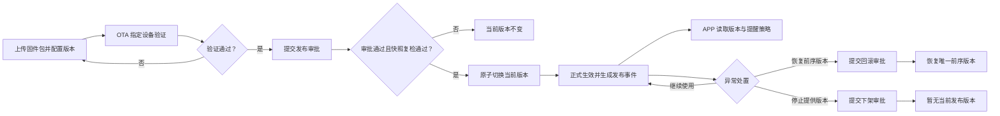
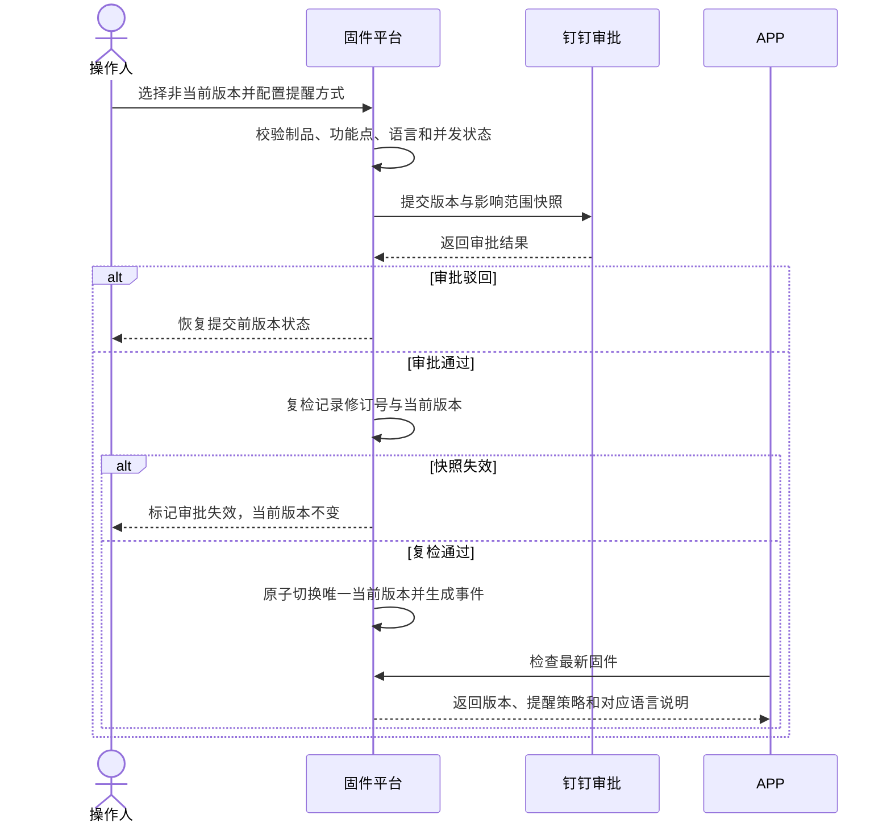
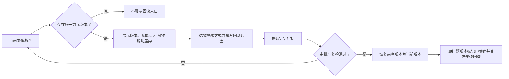
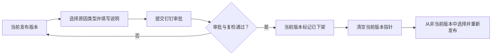
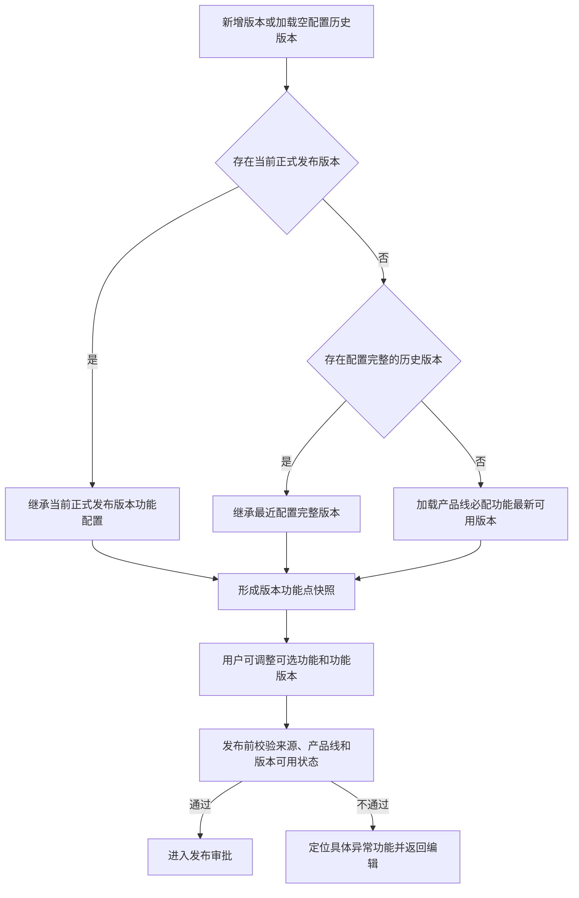
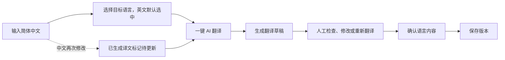

# 固件发布平台本期迭代产品需求方案

## 1. 文档信息

| 项目 | 内容 |
| --- | --- |
| 文档版本 | V1.4 |
| 更新日期 | 2026-07-30 |
| 关联原型 | `prototype-versions/v1.44-feature-config-visual-cleanup-20260730` |
| 产品范围 | 固件标识、固件版本、功能点、APP 更新说明、发布审批、回滚、下架、发布日志、在线差分、角色权限与审计 |
| 基线原则 | 本文档为本期统一产品基线；阶段性讨论与本文冲突时，以本文为准 |

## 2. 背景与目标

现有固件平台具备固件包维护和正式发布能力，但版本内容、审批快照、异常回滚、多语言用户说明、影响范围和审计关系仍不完整。本期目标是建立以下闭环：

```text
上传固件包 -> 配置功能点 -> 配置 APP 多语言说明 -> 保存版本
-> OTA 指定设备验证 -> 提交钉钉审批 -> 正式生效
-> 回滚或下架 -> 发布日志与操作日志追溯
```

核心目标：

1. 一个固件标识任一时刻只能存在一个当前正式发布版本。
2. 发布、回滚和下架统一走钉钉审批，审批期间冻结提交快照。
3. 除当前正式发布版本和审批目标外，其他版本均可编辑并可重新发布。
4. 发布前明确关联设备数、适用机型、功能点版本、APP 提醒效果和多语言内容。
5. 测试升级继续由 OTA 系统按设备 ID 承担，本平台不重复建设测试和灰度阶段。
6. 关键状态变化均形成审批记录、发布事件和操作日志，且三者可关联追溯。

## 3. 产品原则

- 单一当前版本：以服务端当前版本指针为准，不以最大版本号推断。
- 快照执行：审批通过后执行提交时的版本快照，正式执行前必须复检。
- 状态解耦：审批通过不等于发布成功；平台生效不等于设备已升级。
- 最小阻断：只阻断会造成错误执行的条件，其余风险进入审批判断。
- 版本可追溯：固件包不可覆盖，版本内容修改生成新的记录修订号。
- 用户信息聚焦：列表与详情不重复堆叠，只展示当前决策所需信息。
- 服务端兜底：页面限制、权限校验、状态校验和幂等控制必须由服务端再次执行。

## 4. 范围边界

### 4.1 本期需求范围

| 编号 | 涉及模块 | 能力目标 | 核心交付与验收口径 | 优先级 |
| --- | --- | --- | --- | --- |
| FR-01 | 固件标识 | 建立产品线、机型和版本集合的业务归属 | 支持新增、编辑、删除、查询；关联机型创建后不可修改 | P0 |
| FR-02 | 固件标识 / 版本列表 | 快速判断发布影响设备范围 | 标识顶部与版本列表展示去重关联设备数，审批快照口径一致 | P0 |
| FR-03 | 固件版本 | 创建可验证的固件制品记录 | 支持 `.bin`、`.binpkg`；解析失败不可创建；固件包保存后不可替换 | P0 |
| FR-04 | 功能点配置 | 绑定机型平台功能管理中的功能版本 | 存量空配置版本按基线补齐；新增版本优先继承当前正式发布版本；固件必配功能不可移除；功能版本可切换其他已发布版本 | P0 |
| FR-05 | APP 更新说明 | 支持 15 种语言与英文兜底 | 简体中文、英文必填；其他语言可选；固定语言目录、字数限制和兜底规则完整 | P0 |
| FR-06 | AI 翻译 | 从简体中文快速生成多语言草稿 | 可选择目标语言、一键翻译、重新翻译、人工修改和确认；中文变更后旧译文标记待更新 | P1 |
| FR-07 | 版本状态与操作 | 避免编辑、发布、删除状态冲突 | 当前版本不可编辑或发布；审批目标锁定；其他版本可编辑、发布；仅未发布版本可删除 | P0 |
| FR-08 | 版本详情 | 在同一抽屉追溯版本配置与事件 | 摘要展示状态、影响设备和生效信息，制品区展示文件与修订信息；功能点只展示发布时冻结的名称、标识、分类、配置版本和版本说明，不展示运行时源状态；提供 APP 更新说明、发布记录和审批日志；切换页签不重开抽屉 | P1 |
| FR-09 | APP 提醒 | 发布前预览 APP 用户体验 | 支持不提醒、弱提醒、强提醒、强制提醒；模拟器实时切换策略和语言 | P1 |
| FR-10 | 发布审批 | 保证审批内容与执行内容一致 | 校验版本、功能点、语言、提醒方式和并发状态；冻结记录修订号与影响范围 | P0 |
| FR-11 | 发布执行 | 原子切换唯一当前版本 | 审批通过后复检；事务内切换状态并生成发布事件和唯一回滚目标 | P0 |
| FR-12 | 回滚 | 恢复当前发布事件的唯一前序版本 | 展示差异；原因和提醒方式必填；走钉钉审批；成功后关闭连续回滚入口 | P0 |
| FR-13 | 下架 | 停止提供当前发布版本 | 当前版本可提交下架审批；审批通过后清空当前版本，保留固件包和历史记录 | P0 |
| FR-14 | 发布日志 | 按时间线追溯同日多次发布 | 按日期分组；事件可下拉展开；展示审批、发布、回滚、下架和缓存节点 | P1 |
| FR-15 | 4G 模组在线差分 | 一个目标版本对多个源版本创建差分任务 | 完整展示状态、成功率、包数量、失败原因和逐源版本结果 | P1 |
| FR-16 | 4G 模组差分包 | 按目标版本聚合管理差分包 | 支持下拉查看源版本明细、下载和删除确认 | P1 |
| FR-17 | 模组型号 | 从模组维度查询关联固件 | 展示 SOC、关联固件数、工具、配置文件和创建时间 | P1 |
| FR-18 | 用户与角色 | 控制页面、操作和产品线数据范围 | 提供角色与用户模拟数据；前后端使用统一权限判断顺序 | P0 |
| FR-19 | 日志与审计 | 追溯所有关键成功、失败和被阻止操作 | 操作日志与审批日志覆盖发布、回滚、下架、版本维护、差分和权限变更 | P0 |
| FR-20 | 原型验收数据 | 覆盖关键正向与异常状态 | 提供版本、审批、回滚、下架、差分、角色和日志模拟数据；桌面与 390px 可操作 | P0 |

范围统计：P0 13 项，P1 7 项，共 20 项。

### 4.2 本期不包含

| 编号 | 排除项 | 当前处理 |
| --- | --- | --- |
| OUT-01 | 固件测试阶段 | OTA 系统按设备 ID 执行测试升级 |
| OUT-02 | 灰度发布阶段 | OTA 系统承担灰度与放量能力 |
| OUT-03 | 设备执行结果汇总 | 本平台没有可靠数据源，不展示成功率和重试结果 |
| OUT-04 | APP 分发结果 | APP 拉取或用户点击升级不作为平台发布完成条件 |
| OUT-05 | 任意历史版本回滚 | 只允许恢复当前发布事件记录的唯一前序版本 |
| OUT-06 | 自动回滚 | 由有权限人员判断后提交审批 |
| OUT-07 | 固件包替换 | 需要变更时创建新版本号 |
| OUT-08 | 复制已撤销版本 | 本期不提供一键复制为新版本 |

## 5. 核心概念与状态

| 概念 | 定义 |
| --- | --- |
| 固件标识 | 一类固件版本的业务归属，关联产品线、机型、设备范围和版本集合 |
| 固件版本 | 固件包、说明、适用机型和功能点版本组成的版本记录 |
| 记录修订号 | 同一固件版本元数据的修订序号，格式为 R1、R2 等 |
| 当前发布版本 | 当前由升级检查接口返回的唯一目标版本 |
| 历史版本 | 曾经生效后被其他版本替代的版本 |
| 已撤销版本 | 因回滚被撤销的原当前版本 |
| 已下架版本 | 主动停止作为当前发布版本的版本 |
| 审批快照 | 提交时冻结的版本、记录修订号、功能点、说明、提醒方式和影响范围 |
| 发布事件 | 一次当前版本切换的不可变执行记录 |
| 唯一回滚目标 | 当前发布事件发生前的当前版本；不存在时不可回滚 |

版本状态与操作矩阵：

| 状态 | 编辑 | 发布 | 删除 | 详情 | 说明 |
| --- | --- | --- | --- | --- | --- |
| 未发布 | 支持 | 支持 | 支持 | 支持 | 保存后未正式生效 |
| 审批中 | 不支持 | 查看已有审批 | 不支持 | 支持 | 防止审批快照漂移 |
| 当前发布 | 不支持 | 不支持 | 不支持 | 支持 | 唯一正式生效版本 |
| 历史发布 | 支持 | 支持 | 不支持 | 支持 | 可修订后重新发布 |
| 已撤销 | 支持 | 支持 | 不支持 | 支持 | 可作为普通非当前版本重新发布 |
| 已下架 | 支持 | 支持 | 不支持 | 支持 | 下架后仍可重新发布 |

## 6. 角色与权限

| 角色 | 数据范围 | 核心权限 |
| --- | --- | --- |
| 系统管理员 | 全部产线 | 全部页面、版本、发布、回滚、下架、角色与日志权限 |
| 产线主管 | 用户所属产线 | 查看、发布、回滚、下架、维护 APP 文案和查看日志 |
| 测试人员 | 用户所属产线 | 新增、编辑、删除未发布版本和查看差分 |
| 默认人员 | 用户所属产线 | 只读查看固件和模组 |
| FAE 技术支持组长 | 用户所属产线 | 查看版本、发布日志和操作日志 |
| FEA | 用户所属产线 | 只读查看版本和下载差分包 |
| 4G 模组权限角色 | 仅 4G 模组 | 版本维护、在线差分和差分包管理 |

权限判断顺序：

```text
页面权限 -> 操作权限 -> 数据范围 -> 版本状态 -> 审批并发锁 -> 执行业务
```

任一条件不满足时不执行写操作，并记录阻止原因。

## 7. 信息架构

```text
设备固件
├── 固件列表
│   ├── 固件版本列表
│   ├── 发布日志
│   ├── 在线差分（仅 4G 模组）
│   └── 差分包列表（仅 4G 模组）
└── 模组型号

日志管理
├── 操作日志
└── 审批日志

用户角色
├── 用户列表
└── 角色权限
```

## 8. 业务流程

### 8.1 总体流程



### 8.2 正常发布



发布前置条件：

1. 目标版本不是当前发布版本。
2. 当前标识不存在其他进行中的发布、回滚或下架审批。
3. 固件包有效，适用机型、平台发布说明和功能点配置完整。
4. 简体中文、英文说明已确认，其他启用语言不存在待翻译或过期状态。
5. APP 提醒方式已选择。

### 8.3 回滚



回滚规则：

- 回滚目标由当前发布事件唯一确定，不允许手工选择任意历史版本。
- 回滚不修改目标版本原有历史配置，提醒方式记录在本次回滚事件中。
- 审批通过后必须复检当前版本和目标版本是否仍与快照一致。
- 成功后不能连续回滚；需要切换其他版本时走正常发布。

### 8.4 下架



下架结果边界：

- 停止将该版本作为新的升级检查目标。
- 不删除固件包，不影响已经升级的设备。
- 不承诺停止 OTA 已创建的升级任务。
- 下架后所有非当前版本均可按权限再次发布。

## 9. 版本创建与功能点配置

创建顺序固定为：

1. 上传固件包并完成解析。
2. 自动生成或校验固件版本号与 MD5。
3. 填写适用机型与平台发布说明。
4. 系统优先继承同一固件标识当前正式发布版本的适用机型、必配功能、可选功能及其配置版本，无须用户重复勾选。
5. 没有当前正式发布版本时，继承最近一个配置完整的版本；仍无可继承版本时，按当前产品线加载全部“固件必配”功能及其最新已发布可用版本。
6. 用户按需调整可选功能；必配与可选功能均可切换其他已发布可用版本。
7. 配置 APP 更新说明并保存版本。

功能点弹窗使用固定高度，左侧功能源列表与右侧功能配置分别滚动；添加数量不得无限拉长弹窗。

必配功能规则：

- 新增版本优先继承当前正式发布版本的功能点配置；无当前版本时继承最近一个配置完整版本；仍无基线时加载产品线必配功能。
- 历史版本若已存在旧功能配置记录但缺少新版快照，优先转换旧记录；完全没有功能记录时按同一基线规则补齐，补齐来源需保存在版本数据中。
- 继承范围包含适用机型、功能点、功能配置版本和语言启用范围；不得继承固件包、版本号、平台发布说明、APP 更新文案、关联设备数及审批状态。
- 必配功能在功能源列表中展示锁定勾选态，不展示复选框或重复的类型标签；在配置区与版本表格中不提供移除操作。
- 全选、取消全选和已选数量仅统计可选功能，不能影响必配功能。
- 保存版本与提交发布审批前，必须校验全部必配功能存在，且关联版本仍处于已发布可用状态。
- 可选功能可添加和移除；两类功能都支持切换其他已发布可用版本。

新增与编辑页交互规则：

- 页面采用单页三段式连续布局：固件包与适用范围、功能配置、发布说明，不增加步骤条和额外确认层级。
- 新增页上传前只展示固件包入口；解析后以摘要集中展示文件名、版本号、MD5 和文件大小。编辑页固件包只读，不展示“上传成功”等过程状态。
- 适用机型从当前固件标识绑定范围选择；编辑历史版本时，旧值即使不在当前范围也允许保留，避免无关字段被强制改写。
- 功能主表只展示功能名称和配置版本；添加可选功能、移除可选功能和切换版本统一在“配置功能”弹窗内完成。功能源或版本失效时，异常原因在配置版本下就地展示。
- APP 更新说明默认展示完整 15 种语言目录，左侧固定高度独立滚动，右侧编辑当前语言；保存校验命中语言错误时自动定位对应语言。
- 简体中文由用户直接填写，并作为 AI 翻译的唯一源文案；本期不提供根据平台发布说明生成 APP 中文的能力。
- 表单发生修改后，关闭按钮、取消按钮、遮罩和 Esc 退出统一触发放弃修改确认；未修改时直接关闭。

功能配置基线流程：



## 10. APP 更新说明与 AI 翻译

固定 15 种语言：

| 必填 | 选填 |
| --- | --- |
| 简体中文、英文 | 繁体中文、意大利语、韩语、德语、日语、法语、俄语、西班牙语、葡萄牙语、波兰语、土耳其语、荷兰语、阿拉伯语 |

交互流程：



规则：

- 左侧固定展示全部语言并可纵向滚动。
- 不提供“查看全部语言”或“收起语言列表”入口，新增、编辑和说明维护三处统一使用固定语言工作台。
- AI 翻译结果为草稿，未经确认不可进入发布审批。
- 修改简体中文后，已启用语言统一标记为待更新；再次翻译必须覆盖旧草稿。
- 英文为必填兜底语言；其他未配置语言读取英文。
- 每种语言按独立字符上限校验，超过上限不可保存或提交审批。

## 11. APP 提醒方式

| 类型 | APP 表现 | 使用建议 |
| --- | --- | --- |
| 不提醒 | 不主动提示，仅保留升级入口 | 低影响版本 |
| 弱提醒 | 设置入口显示红点 | 常规优化 |
| 强提醒 | 设备卡片展示升级横幅 | 重要修复 |
| 强制提醒 | 持续展示升级弹窗 | 严重安全或兼容问题 |

提醒方式进入发布或回滚审批快照。APP 模拟器只用于预览，不代表 APP 已分发，也不代表设备已执行升级。

发布审批中的功能点快照按“功能点、当前版本到目标版本、版本说明、结果”四列展示。版本说明取提交时冻结的目标功能版本快照，目标版本已移除该功能时取原功能版本快照用于追溯；审批弹窗不再展示重复解释审批范围的提示条。

## 12. 发布日志

发布日志按日期分组，同一天多个版本按生效时间倒序展示。每条记录包含：

- 流程类型：发布、回滚或下架。
- 版本变化与当前流程状态。
- 审批结果。
- 展开后的提交审批、审批通过或驳回、版本切换和缓存处理节点。
- 节点时间、操作人、操作者类型和结果摘要。

发布日志为只读页面，不承担版本编辑或发布执行操作。

## 13. 4G 模组差分

在线差分：

- 一个目标版本可选择多个源版本。
- 目标版本不能同时作为源版本。
- 展示任务状态、成功率、差分包数量、完成时间和失败原因。
- 任务详情逐个展示源版本结果。

差分包列表：

- 按目标版本聚合。
- 下拉展开源版本、包大小和文件名。
- 支持下载与删除。
- 删除仅影响后续 OTA 任务选择，不影响已经创建的 OTA 任务。

## 14. 审计与并发

操作日志至少记录：

- 版本新增、编辑、删除、发布、回滚和下架。
- APP 文案 AI 翻译确认与人工修订。
- 差分任务创建和差分包删除。
- 角色权限、用户角色和产品线范围变更。
- 因权限、状态、并发或快照失效被阻止的写操作。

审批日志至少记录：

- 审批编号、业务类型、目标版本、提交人、审批人和时间。
- 审批中、通过、驳回、失效状态。
- 审批快照和执行结果。

并发规则：

1. 同一固件标识同时只能存在一条进行中的生效审批。
2. 审批回调以审批编号幂等处理。
3. 执行前校验当前版本、目标版本、记录修订号和审批快照。
4. 任一校验失败时审批标记失效，不进行部分版本切换。
5. 发布事务失败时回滚全部状态，不自动重试。

## 15. 原型验收

### 15.1 发布

- 非当前版本均展示发布操作。
- 当前版本不展示编辑、发布或删除。
- 发布审批可提交、模拟通过和模拟驳回。
- 审批通过后只有一个当前版本，原当前版本变为历史版本。
- 审批驳回或失效后目标版本恢复提交前状态。

### 15.2 回滚与下架

- 只有存在唯一回滚目标时展示回滚入口。
- 回滚原因和提醒方式未填写时不可提交。
- 下架原因类型和具体说明未完成时不可提交。
- 下架后显示“暂无当前发布版本”，并可直接选择其他版本重新发布。
- 回滚、下架审批驳回时当前版本继续生效。

### 15.3 详情与日志

- 详情抽屉切换页签时不关闭或重新执行入场动画。
- 发布日志下拉展开后显示完整时间节点。
- 操作日志和审批日志具有发布、回滚、下架、版本维护和权限变更模拟数据。
- 角色权限中不存在超出当前产品范围的操作项。

### 15.4 响应式与稳定性

- 桌面端与 390px 宽度无横向溢出、文字遮挡或弹窗超出视口。
- 功能点选择数量增加时弹窗高度保持稳定，列表内部滚动。
- 刷新后保留当前原型状态，切换新版存储键时使用干净模拟数据。
- 控制台无脚本错误，所有可见按钮均有明确结果或关闭路径。

## 16. 上线前检查

1. 产品确认状态矩阵、提醒策略、下架原因和日志口径。
2. 研发确认唯一当前版本约束、事务边界、审批回调幂等和快照字段。
3. OTA 确认测试与灰度继续由 OTA 承担，平台下架不自动停止已有任务。
4. APP 确认 15 种 Locale、英文兜底、字符限制和四种提醒样式。
5. 测试完成发布、驳回、失效、回滚、下架、重新发布、AI 再翻译、权限和窄屏回归。

本期的核心是让固件版本内容、正式生效决策、APP 用户提示和审计记录形成职责清晰、状态唯一、异常可恢复的完整闭环。
