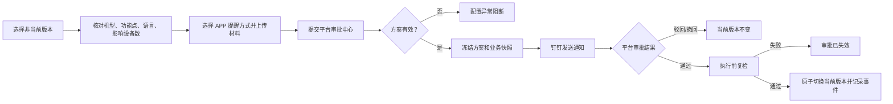

# 固件发布平台本期迭代产品需求方案

> **文档版本：V2.0**　|　更新日期：2026-10-31
> **适用范围：** 固件标识、固件版本、功能点、APP 更新说明、审批配置、审批中心、发布/回滚/下架、发布日志、在线差分、角色权限与审计
> **修订基线：** 《多级审批发布回滚下架_需求迭代范围与业务闭环_V1.0.md》V1.3
> **关联原型：** 当前仓库根目录原型（`0715固件发布all`，审批配置与审批中心页面）
> **文档定位：** 本文是总 PRD；审批配置、审批中心和三类审批的细则以修订基线为准。本文件路径保留历史名称，用于兼容已有引用。

## 1. 背景与目标

固件平台已经具备固件包、版本和发布日志能力。本期将版本内容、影响范围、APP 提醒、平台审批和通知渠道整理为一条可追溯链路，解决以下问题：

1. 发布、回滚、下架的审批事实分散，处理入口不统一。
2. 审批人难以在提交前确认目标版本、关联设备数、适用机型和提醒方式。
3. 钉钉承担通知入口，但审批处理入口容易被误解为钉钉，导致状态和权限口径不一致。
4. 审批通过、业务执行成功、通知发送成功和设备实际升级是不同事实，必须分别记录。
5. 方案变更、并发操作、执行失败和通知失败缺少可恢复的关联关系。

本期目标：

- 平台审批中心负责创建审批实例、节点流转、审批决策和审批留痕。
- 钉钉只负责待办通知、人工催办和终态结果通知；钉钉通知中的“审批中心”按钮默认跳转平台审批中心。
- 发布、回滚、下架分别绑定一套审批方案，提交时冻结方案、审批人和业务快照。
- 通过关联设备数、APP 提醒方式和版本材料，让审批人能够判断影响范围和用户提示策略。
- 审批通过后执行前复检，避免旧审批覆盖新的版本状态；执行失败必须重新发起审批。
- 审批、执行、通知、版本和操作日志可以按审批实例及业务操作关联追溯。

本期主链路：

```text
创建/编辑固件版本
  -> 配置功能点、APP 更新说明和适用机型
  -> OTA 指定设备验证
  -> 选择 APP 提醒方式并提交平台审批中心
  -> 平台冻结审批快照并创建节点任务
  -> 钉钉发送通知，审批人在平台审批中心处理
  -> 通过后执行前复检并发布/回滚/下架
  -> 记录审批、执行、通知、版本生命周期和操作日志
```

## 2. 产品原则与事实边界

| 原则 | 规则 |
| --- | --- |
| 平台审批事实源 | 审批状态、审批人、审批意见、节点时间线以平台审批中心为准。 |
| 钉钉职责 | 钉钉只发送通知、催办和结果，不承载审批决策，不提供通过、驳回或撤回业务处理。 |
| 三类操作独立 | 正常发布、版本回滚、版本下架分别维护审批方案，不支持多个操作共用一套方案。 |
| 快照执行 | 提交时冻结方案版本、节点审批人、目标版本、当前指针、记录修订号、影响范围、材料和提醒方式。 |
| 状态解耦 | 审批状态、执行状态、通知状态、版本状态分开记录；审批通过不等于执行成功。 |
| 服务端兜底 | 页面展示和按钮限制不能替代服务端权限、状态、并发、快照和幂等校验。 |
| 单一当前版本 | 同一固件标识同一时刻只能有一个当前发布版本，以服务端当前版本指针为准。 |
| 可追溯 | 关键状态变化必须关联审批实例 ID、业务操作 ID、操作人、时间和原因。 |
| 原型边界 | 当前原型使用本地模拟数据演示交互；不能据此宣称已完成真实接口、钉钉发送或设备执行。 |

## 3. 需求范围

### 3.1 本期包含

| 编号 | 模块 | 需求与验收重点 | 优先级 |
| --- | --- | --- | --- |
| FR-01 | 固件标识 | 新增、查询、编辑、删除；维护产品线、机型和版本集合归属。 | P0 |
| FR-02 | 版本影响范围 | 固件列表、版本详情和审批快照展示按适用机型去重计算的关联设备数。 | P0 |
| FR-03 | 固件版本 | 支持 `.bin`、`.binpkg` 解析；固件包保存后不可替换；版本号和 MD5 可追溯。 | P0 |
| FR-04 | 功能点配置 | 从产品线功能目录加载必配和可选功能；必配不可移除；支持版本快照和 OTA 验证配置。 | P0 |
| FR-05 | APP 更新说明 | 固定 15 种语言目录；简体中文和英文必填；其他语言可选；英文兜底。 | P0 |
| FR-06 | AI 翻译 | 以简体中文为唯一源文案，生成草稿；支持确认、人工修改和重新翻译。 | P1 |
| FR-07 | 版本状态与编辑 | 当前发布版本、审批目标和未发布版本按状态限制编辑、发布、删除。 | P0 |
| FR-08 | 版本详情 | 在同一详情抽屉查看摘要、制品、功能点、APP 更新说明、发布记录和审批日志。 | P1 |
| FR-09 | APP 提醒方式 | 支持不提醒、弱提醒、强提醒、强制提醒；提交前可预览效果。 | P1 |
| POL-01 | 审批配置 | 按产品线展示发布、回滚、下架三张操作卡片，每项操作仅一套当前方案。 | P0 |
| POL-02 | 审批方案版本 | 新建默认生成 V1；编辑生成递增版本；历史版本只读，在途审批不受新版本影响。 | P0 |
| POL-03 | 多级审批节点 | 支持 1 至 5 级串行；每级可配置多名启用平台用户，节点内采用或签。 | P0 |
| POL-04 | 审批方案校验 | 审批人不能跨节点重复，发起人不能作为本次审批人；配置异常阻断新申请。 | P0 |
| AC-01 | 审批中心 | 提供待我处理、我发起的、抄送我的、异常中心、已处理五类视图，以及筛选、排序、详情和连续处理。 | P0 |
| AC-02 | 审批详情 | 展示业务快照、材料、节点时间线、审批动作、撤回、催办、补发和重新发起边界。 | P0 |
| NOT-01 | 钉钉通知模板 | 审批配置抽屉内预览发布、回滚、下架三类通知字段、节点摘要和平台审批中心入口。 | P0 |
| PUB-01 | 正常发布 | 提交平台审批，审批通过后复检并原子切换当前发布版本。 | P0 |
| RBK-01 | 版本回滚 | 仅允许当前发布事件的唯一前序版本；展示差异，填写原因和提醒方式后提交审批。 | P0 |
| DEL-01 | 版本下架 | 当前版本提交下架审批；通过后清空当前版本指针，保留固件包和历史记录。 | P0 |
| LOG-01 | 发布与审批日志 | 关联提交、节点处理、执行、通知和版本生命周期事件，页面只读。 | P0 |
| AUD-01 | 权限与审计 | 覆盖版本维护、审批配置、审批处理、通知补发、角色权限和阻断原因。 | P0 |
| CON-01 | 并发与幂等 | 防止重复提交、重复回调、重复点击、并发保存和错误覆盖。 | P0 |
| OTA-01 | 在线差分 | 目标版本可选择多个源版本；展示任务结果、差分包和失败原因。 | P1 |

### 3.2 本期不包含

- 测试升级、灰度发布、放量策略和设备执行成功率；继续由 OTA 系统承担。
- APP 分发结果、用户点击升级结果和设备侧重试统计。
- 任意历史版本回滚、系统自动回滚和审批人临时代理。
- 会签、动态分支、加签、批量通过和批量驳回。
- 固件包替换；需要更换制品时创建新版本号。
- 下架后自动取消已经创建的 OTA 任务。
- 在钉钉内处理审批；钉钉通知中的平台入口只负责跳转。

## 4. 角色与权限

| 角色 | 核心职责 | 关键权限 |
| --- | --- | --- |
| 系统管理员 | 维护审批方案、查看异常、补发通知和维护平台权限 | 配置、启停、编辑和查看方案版本；查看权限范围内异常；补发当前有效通知；具备对应业务权限时可重新发起。 |
| 产品线负责人/产线主管 | 发起发布、回滚、下架并跟进结果 | 在所属产品线发起业务操作；查看审批和执行结果；撤回本人未完成审批。 |
| 审批人 | 处理被分配的当前节点 | 在平台审批中心查看业务快照并通过或驳回；不能在钉钉内完成审批。 |
| 结果抄送人 | 接收终态结果 | 只读查看审批和执行结果，不参与审批。 |
| 只读用户 | 查询状态和历史 | 查看版本、审批中心、日志和方案，不允许写操作。 |

权限判断顺序：

```text
页面权限 -> 操作权限 -> 产品线数据范围 -> 版本状态
-> 审批并发锁 -> 业务字段校验 -> 有效审批方案
-> 创建审批实例或返回配置异常
```

## 5. 信息架构与页面职责

```text
设备固件
├── 固件列表
│   ├── 固件版本列表
│   ├── 版本详情
│   ├── 发布日志
│   ├── 在线差分（4G 模组）
│   └── 差分包列表（4G 模组）
├── 模组型号

审批工作台
├── 审批中心
│   ├── 待我处理
│   ├── 我发起的
│   ├── 抄送我的
│   ├── 异常中心
│   └── 已处理
└── 审批配置
    ├── 发布审批方案
    ├── 回滚审批方案
    └── 下架审批方案

日志管理
├── 操作日志
└── 审批日志

系统管理
├── 用户列表
└── 角色权限
```

页面职责边界：

- 固件列表和版本详情负责发起业务操作、查看审批进度和查看执行结果，不承担审批通过、驳回、撤回和催办。
- 审批中心负责平台内的审批处理、撤回、催办、异常跟进和通知补发。
- 审批配置负责按产品线和操作维护方案、节点、抄送人、提醒策略和版本记录。
- 钉钉通知负责提醒用户，并通过“审批中心”按钮跳转平台审批中心。

## 6. 审批配置需求

### 6.1 操作卡片

审批配置页面按当前产品线展示三张独立操作卡片：

| 操作 | 页面说明 | 当前方案 |
| --- | --- | --- |
| 发布 | 发布固件版本到线上设备 | 展示方案名称、说明、审批流程、版本信息和启停状态。 |
| 回滚 | 将设备版本回退到唯一前序版本 | 与发布方案独立维护。 |
| 下架 | 下架已发布的固件版本 | 与发布、回滚方案独立维护。 |

每个产品线的每项操作只允许一套当前方案。未配置或已停用时，新申请必须被阻断。

### 6.2 新建与编辑

- 从操作卡片进入审批方案抽屉，产品线和审批操作由入口确定，不支持跨操作复用。
- 支持 1 至 5 级串行节点；每级可选择 1 至多名启用平台用户，采用或签。
- 同一方案内审批人不得跨节点重复；发起人不得出现在本次审批链。
- 支持终态结果抄送人；抄送人不参与审批。
- 保存方案后默认启用；编辑保存生成递增版本，历史版本只读。
- 在途审批继续使用受理时冻结的方案版本和审批人快照。
- 不设置审批截止时间；催办由“我发起的”或管理员后台触发，同一节点 30 分钟内最多一次。

### 6.3 方案版本记录

版本记录至少展示方案名称、所属产品线、审批操作、版本号、审批级数、节点审批人、终态抄送、更新人、更新时间和版本变化。历史版本不可直接启用或修改，需要编辑当前方案生成新版本。

## 7. 钉钉通知模板预览

### 7.1 定位与职责

钉钉已经不承担审批操作处理。本区域是通知模板预览，用于核对通知字段、节点摘要和平台入口，不代表钉钉内可以完成审批。

模板预览中必须明确展示：

- “钉钉通知”和“通知模板预览”标识。
- 申请人提交的业务操作名称。
- 当前节点通知对象、申请原因和申请时间。
- 审批节点摘要及节点级数。
- “钉钉用于发送审批通知，审批处理请在平台审批中心完成”的说明。
- **审批中心**入口按钮；默认跳转当前系统平台的 `#/approvalCenter` 路由。

### 7.2 三类通知字段

| 操作 | 通知字段 |
| --- | --- |
| 发布 | 所属产品线、发布固件版本、测试报告、会议纪要、适用机型、关联设备数、APP 提醒方式、发布原因、申请时间、当前节点通知对象。 |
| 回滚 | 所属产品线、当前固件版本、回滚目标版本、关联设备数、APP 提醒方式、回滚原因、申请时间、当前节点通知对象。 |
| 下架 | 所属产品线、下架固件版本、适用机型、关联设备数、APP 提醒方式（下架不触发 APP 升级提醒）、下架原因、申请时间、当前节点通知对象。 |

动态字段在实际提交时由业务申请带入；预览阶段使用“提交时带入”或“提交时生成”标识，不使用静态业务结果替代真实数据。

## 8. 审批中心需求

### 8.1 使用流程提示

固件列表和审批中心顶部展示统一的三步指引，帮助用户理解页面职责：

1. **发起操作**：在固件列表发起发布、回滚或下架。
2. **审批处理**：在审批中心查看并处理审批任务。
3. **查看执行结果**：根据现有规则执行，并在固件列表查看进度与结果。

保留辅助提示：

> 审批操作请在审批中心完成，实际执行规则以系统现有逻辑为准。

桌面端使用三列等宽卡片，第二步使用浅蓝背景和蓝色边框表示当前页面定位；该样式不表示业务审批状态。提示支持展开和收起：收起后保留“发起操作 → 审批处理 → 查看执行结果”一行摘要，并可再次展开。窄屏切换为纵向布局，不出现文字溢出或横向滚动。

### 8.2 五类视图

| 视图 | 数据范围 | 操作边界 |
| --- | --- | --- |
| 待我处理 | 当前用户作为当前节点审批人的有效任务 | 查看详情、通过、驳回、标记已读；完成后可按排序继续下一条。 |
| 我发起的 | 当前用户发起的审批 | 查看进度、执行结果；未完成时填写原因并撤回；可催办当前节点。 |
| 抄送我的 | 当前用户作为终态抄送人的审批 | 只读查看审批和执行结果。 |
| 异常中心 | 当前身份可跟进的执行失败、审批失效和通知失败 | 查看原因、责任人和下一步；通知失败由管理员补发，业务异常重新核对后发起新审批。 |
| 已处理 | 当前用户实际通过或驳回过节点且无业务异常的记录 | 只读查看；不包含已失效、执行失败、通知失败、撤回或被关闭的同级待办。 |

标签数量由平台实时查询；已读不会减少待处理或异常数量。五类标签、数量、搜索、产品线筛选、操作筛选、查询、重置和更多条件均保留。

### 8.3 队列、详情与连续处理

- 默认进入“待我处理”，并定位第一条有效任务。
- 列表显示操作类型、产品线、目标版本、关联设备数、当前节点、提交人、审批状态和风险摘要。
- 支持按影响范围、提交时间和当前节点排序；支持产品线、操作类型、版本、影响设备数、提交人和方案版本筛选。
- 详情首屏展示产品线、操作类型、目标版本、当前版本、关联设备数、提交人、原因和风险提示。
- 时间线固定展示：已提交 → 当前节点 → 后续节点 → 执行前复检 → 执行结果。
- 本期不提供多选框、批量查看、批量标记已读、批量通过或批量驳回；逐条处理并保持独立审计。
- 审批通过不等于执行成功；详情分别显示审批状态、执行状态和通知状态。
- 发起人可撤回未完成审批，必须填写原因；撤回会关闭当前节点待办、停止提醒并释放业务锁。
- 执行失败或审批失效时，旧审批只读保留；原发起人或具备对应业务权限的管理员重新核对后创建新审批并关联旧审批。
- 通知补发追加新记录，不修改原通知失败事实，也不改变审批和执行结果。

## 9. 三类业务流程

### 9.1 正常发布



发布前必须确认目标版本非当前版本、无其他进行中的生效审批、固件包和适用机型有效、启用语言已确认、功能版本可发布、关联设备数和 APP 提醒方式可追溯。

### 9.2 版本回滚

- 回滚目标由当前发布事件确定的唯一前序版本，不允许手工选择任意历史版本。
- 弹窗展示当前版本、目标版本、适用机型、功能点、APP 说明和影响设备差异。
- 本次回滚必须重新选择 APP 提醒方式并填写回滚原因，不继承目标版本原提醒方式。
- 审批通过后复检当前版本和目标版本；成功后恢复目标版本并关闭连续回滚入口。
- 回滚不代表设备已经执行降级，设备执行由后续升级检查和 OTA 规则决定。

### 9.3 版本下架

- 仅当前发布版本可发起下架。
- 必填下架原因类型和具体说明；审批通过后清空当前版本指针。
- 不删除固件包，不影响已经升级设备，不承诺停止已有 OTA 任务。
- 下架后可从任一非当前版本重新发起正常发布审批。
- 下架通知模板中的 APP 提醒方式固定显示“不触发 APP 升级提醒”。

## 10. 版本、快照与状态

### 10.1 版本状态

| 状态 | 编辑 | 发布 | 删除 | 说明 |
| --- | --- | --- | --- | --- |
| 未发布 | 支持 | 支持 | 支持 | 尚未正式生效。 |
| 审批中 | 不支持 | 仅查看已有审批 | 不支持 | 防止审批快照漂移。 |
| 当前发布 | 不支持 | 不支持 | 不支持 | 唯一正式生效版本。 |
| 历史发布 | 支持 | 支持 | 不支持 | 可修订后重新发起发布。 |
| 已回滚 | 支持 | 支持 | 不支持 | 回滚后的普通非当前版本。 |
| 已下架 | 支持 | 支持 | 不支持 | 下架后仍保留历史记录。 |

### 10.2 审批、执行和通知状态

| 状态类别 | 状态 |
| --- | --- |
| 审批状态 | 审批中、已通过、已驳回、已撤回、已失效。 |
| 执行状态 | 未执行、执行中、执行成功、执行失败、已终止。 |
| 通知状态 | 待发送、已发送、已读、发送失败；失败可补发但保留原记录。 |

### 10.3 审批快照

审批快照至少包含：

- 审批实例 ID、幂等键、产品线、操作类型、方案 ID 和方案版本。
- 发起人、提交时间、审批人节点快照、终态抄送人和通知策略。
- 固件标识、当前版本、目标版本、目标版本记录修订号。
- 适用机型、关联设备数、功能点及配置版本、APP 多语言说明快照。
- APP 提醒方式、测试报告、会议纪要、发布/回滚/下架原因。
- 当前版本指针、业务操作 ID、执行状态、通知状态、失败原因和关联新审批 ID。

## 11. 数据口径与并发规则

### 11.1 关联设备数

关联设备数按版本适用机型匹配的绑定设备去重统计，用于版本列表、版本详情、审批预览和审批快照。它表示本次业务操作的影响范围估计，不代表设备已经升级成功。

数据要求：

- 版本列表默认展示，可通过列设置隐藏。
- 新增或编辑适用机型后重新计算；提交审批时再次冻结。
- 审批详情、通知模板和发布执行日志使用同一快照值。
- 统计失败或数据不可用时不能伪造为 0，应提示数据异常并阻断需要精确影响范围的提交。

### 11.2 并发与幂等

1. 同一固件标识同一时刻最多一条进行中的发布、回滚或下架审批。
2. 审批回调按审批实例和事件幂等处理，不重复切换版本或写入执行结果。
3. 执行前复检当前指针、目标版本、记录修订号和快照；任一不一致则标记审批失效。
4. 同级多人首个有效操作生效，其他操作返回当前节点已处理。
5. 并发保存使用修订号拒绝静默覆盖，要求重新加载最新版本。
6. 重复点击提交、催办、补发和重新发起不产生重复业务任务。

## 12. APP 更新说明与提醒方式

### 12.1 固定语言目录

| 语言 | 语言码 | 必填 | 字数上限 |
| --- | --- | --- | --- |
| 简体中文 | `zh` | 是 | 80 |
| 英文 | `en` | 是 | 160 |
| 繁体中文 | `zh_FT` | 否 | 80 |
| 越南语 | `vi` | 否 | 160 |
| 泰语 | `th` | 否 | 160 |
| 日语 | `ja` | 否 | 80 |
| 韩语 | `ko` | 否 | 80 |
| 俄语 | `ru` | 否 | 160 |
| 德语 | `de` | 否 | 160 |
| 法语 | `fr` | 否 | 160 |
| 西班牙语 | `es` | 否 | 160 |
| 意大利语 | `it` | 否 | 160 |
| 荷兰语 | `nl` | 否 | 160 |
| 波兰语 | `pl` | 否 | 160 |
| 葡萄牙语 | `pt` | 否 | 160 |

简体中文是唯一 AI 翻译源文案；AI 结果必须经人工确认后才能保存和提交审批。未配置的选填语言在 APP 端使用英文说明兜底，历史审批快照不回写。

### 12.2 APP 提醒方式

| 类型 | APP 表现 | 规则 |
| --- | --- | --- |
| 不提醒 | 保留升级入口，不主动提示 | 低影响版本。 |
| 弱提醒 | 设置入口显示红点 | 常规优化。 |
| 强提醒 | 设备卡片展示升级横幅 | 重要修复。 |
| 强制提醒 | 持续展示升级弹窗 | 严重安全或兼容问题。 |

提醒方式必须进入发布或回滚审批快照；预览器只展示提醒样式，不代表 APP 已分发或设备已执行升级。

## 13. 日志与审计

操作日志至少记录版本新增、编辑、删除、发布、回滚、下架、功能配置、APP 翻译确认、权限变更、通知补发和被阻断操作。

审批日志至少记录审批编号、业务类型、目标版本、影响设备数、提交人、审批人、节点时间、审批意见、审批状态、执行状态、通知状态、失败原因和关联审批。

发布日志按时间线记录提交、节点处理、执行前复检、版本切换、缓存处理和最终结果。发布日志只读，不承担版本编辑或审批处理。

## 14. 原型与生产验收边界

当前原型用于验证页面结构、交互和规则展示：

- 已覆盖审批配置三类操作卡片、方案版本记录、钉钉通知模板预览、审批中心五类视图、审批详情和关联设备数/APP 提醒字段展示。
- 已覆盖审批处理、撤回、催办、异常、补发、重新发起和三类业务的本地模拟交互。
- 已覆盖桌面端及窄屏布局检查；审批中心 tabs 在窄屏下采用多列布局，避免标签重叠和横向溢出。
- 原型数据、模拟审批结果和本地存储不能作为真实接口、钉钉发送、设备执行或生产权限的证明。

生产验收必须额外确认真实接口、服务端权限、审批实例幂等、通知服务回执、设备影响范围数据和 OTA 执行结果。

## 15. 联调与验收场景

| 编号 | 场景 | 预期结果 |
| --- | --- | --- |
| AT-01 | 未配置或已停用方案提交 | 页面显示配置异常，服务端阻断，不自动免审。 |
| AT-02 | 有效方案提交发布 | 平台创建审批实例，钉钉只发送通知，审批人在平台处理。 |
| AT-03 | 查看钉钉通知模板 | 发布、回滚、下架模板字段正确，关联设备数和 APP 提醒方式可见，审批中心入口可跳转。 |
| AT-04 | 多级多人或签 | 任一人通过进入下一节点，任一人驳回终止，其余待办关闭。 |
| AT-05 | 审批方案编辑 | 生成新版本，在途审批继续使用旧方案和旧审批人快照。 |
| AT-06 | 审批通过但执行前版本变化 | 审批标记已失效，不覆盖新的当前版本。 |
| AT-07 | 执行失败 | 原审批只读保留，必须重新核对并创建新审批。 |
| AT-08 | 通知发送失败 | 不改变审批和执行结果，异常中心展示失败原因，管理员可补发并保留原记录。 |
| AT-09 | 发起人撤回 | 必填撤回原因，关闭当前节点待办、停止提醒、释放锁。 |
| AT-10 | 回滚 | 仅展示唯一前序目标，提醒方式和回滚原因必填，成功后关闭连续回滚入口。 |
| AT-11 | 下架 | 下架通过后清空当前版本指针，保留固件包和历史记录，可重新发布。 |
| AT-12 | 审批中心五类视图 | 数量、筛选、排序、详情、已处理和异常中心边界符合定义。 |
| AT-13 | 窄屏页面 | 390px、320px 等窄屏无横向溢出；tabs 文字、数量和批注不重叠。 |
| AT-14 | 重复提交/回调/催办 | 幂等返回，不重复创建审批、通知或执行任务。 |

## 16. 上线前检查清单

### 产品确认

- [ ] 平台审批中心是唯一审批事实源，钉钉只负责通知、催办和结果通知。
- [ ] 钉钉通知模板已包含关联设备数、APP 提醒方式和平台审批中心入口。
- [ ] 发布、回滚、下架三类操作各自独立配置方案。
- [ ] 审批中心五类视图、已处理口径、异常中心口径和批量能力边界已确认。
- [ ] 关联设备数统计口径、失败处理和审批快照一致性已确认。
- [ ] 15 种语言、英文兜底、APP 提醒方式和回滚重新选择规则已确认。

### 研发确认

- [ ] 服务端决策矩阵、权限、并发锁、执行前复检和幂等已实现。
- [ ] 方案版本、节点审批人和业务快照隔离；配置更新不影响在途审批。
- [ ] 通知失败补发保留原失败记录，不改变审批或执行事实。
- [ ] 审批通过、执行成功、通知发送和设备升级结果可分别查询。

### 测试确认

- [ ] 发布、回滚、下架覆盖正常、驳回、撤回、失效、执行失败和通知失败场景。
- [ ] 多人或签、自审冲突、审批人重复、并发处理和重复回调均已验证。
- [ ] 桌面、平板和手机端无横向溢出或关键内容遮挡。
- [ ] 原型验证结论与真实接口、钉钉通知和 OTA 执行结论分开记录。

## 17. 交付判定

```text
三类操作分别配置有效审批方案
  + 平台审批中心承载审批事实，钉钉只通知
  + 通知模板展示关联设备数、APP 提醒方式和平台入口
  + 方案版本、审批人和业务快照可追溯
  + 五类审批中心视图与异常边界明确
  + 通过后执行前复检，执行失败必须重新审批
  + 审批、执行、通知、版本和操作日志可关联
  + 回滚、下架和重新发布边界明确
  + 原型、接口、通知和设备执行证据分层验收
  = 本期固件发布审批闭环达到交付条件
```
