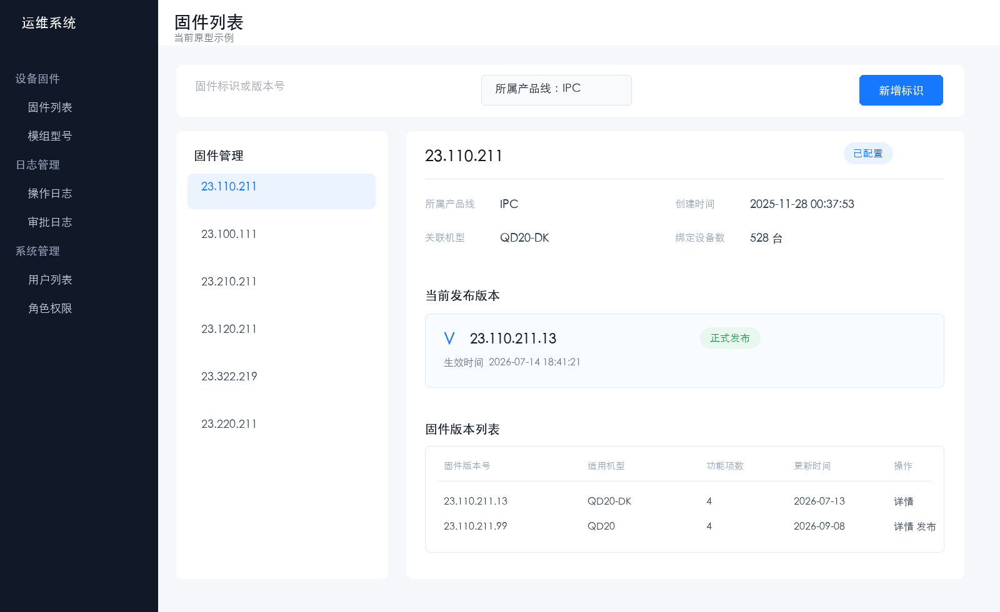
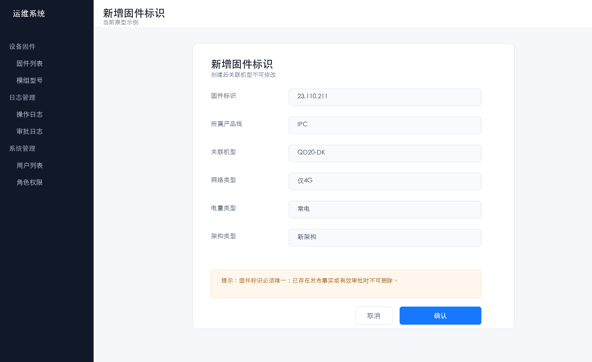
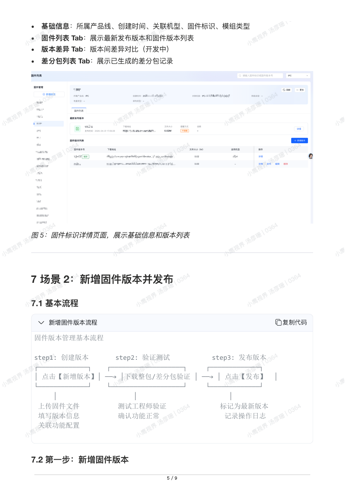
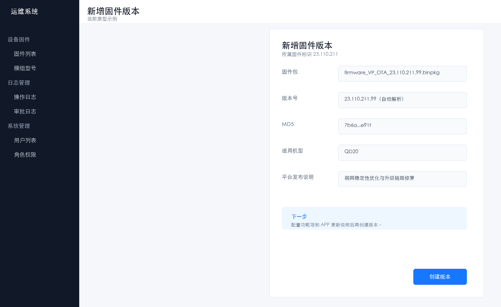
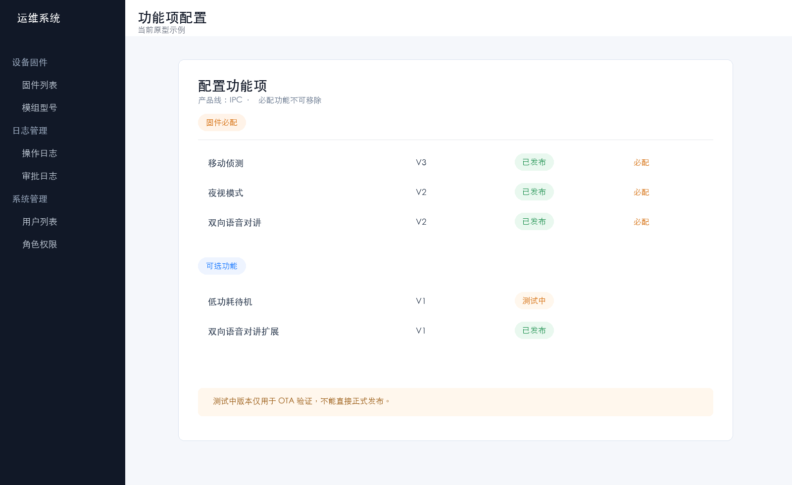
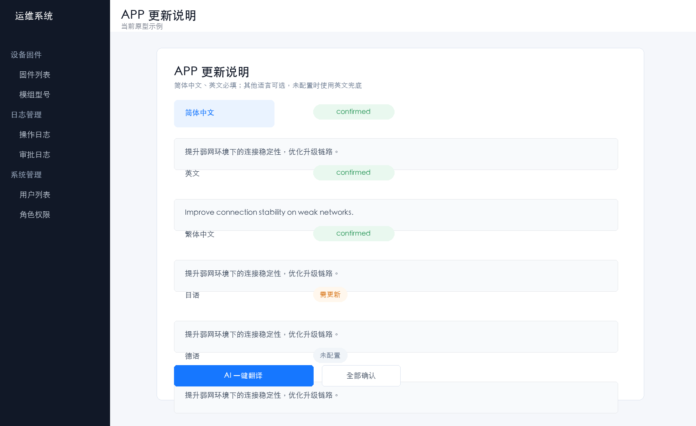
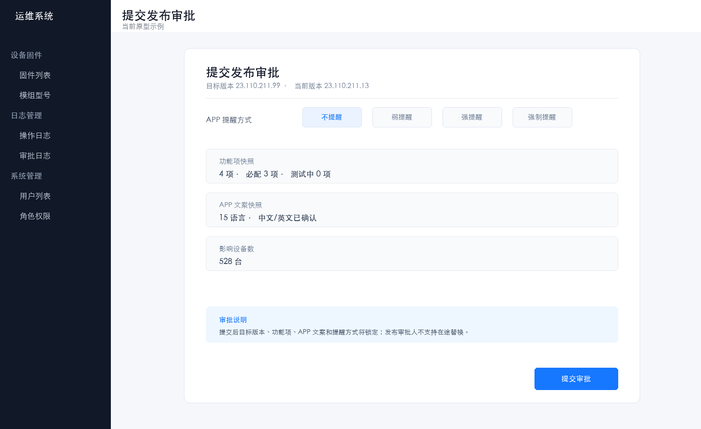
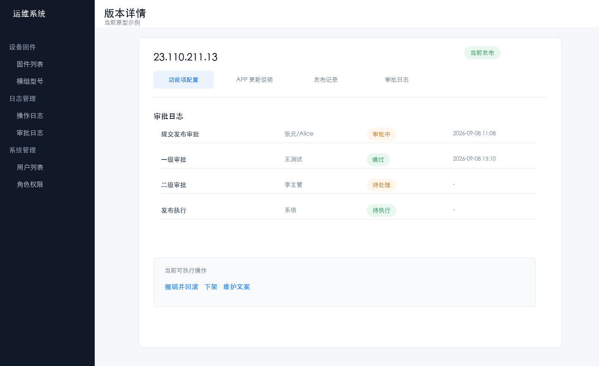
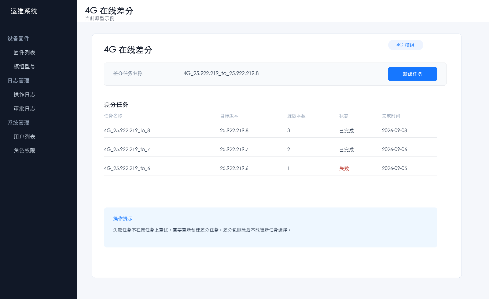
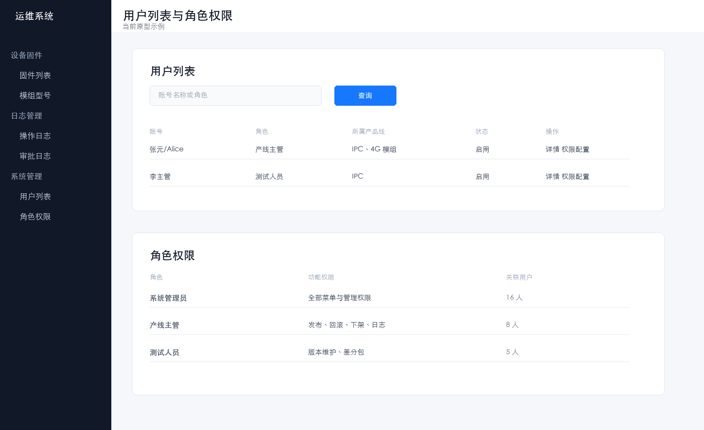

# 固件管理

> 文档版本：20260928
>
> 适用版本：固件发布平台本期迭代原型
>
> 更新说明：本手册在上一版《固件管理》基础上更新，保留原有“背景信息、适用范围、名词解释、前提条件、操作说明、后续操作”结构，补充本期的功能项配置、APP 多语言、平台审批中心、回滚、下架、版本记录、日志与权限闭环。
>
> 范围说明：本手册不包含“审批配置”模块的维护操作，仅说明审批在固件发布、回滚、下架业务中的使用方式。

> **审批口径更新（2026-10-24）**：审批以《多级审批发布回滚下架_需求迭代范围与业务闭环_V1.0.md》V1.3 为准。平台审批中心负责创建、处理和留痕，钉钉仅发送通知；本文中“钉钉审批”属于历史称呼，不能理解为在钉钉内完成审批。

## 使用前先看

本期最重要的变化是：**发布、回滚、下架都不再直接生效，必须提交平台审批中心审批；审批提交时会冻结目标版本快照，发布审批期间不允许替换审批人。钉钉只发送通知。**

本手册中的图片分为两类：

- “当前原型示例”：根据当前原型页面状态整理的界面示例，用于说明本期交互和字段。
- “上一版原图”：从原《固件管理》PDF 截取的页面图，仅用于帮助熟悉原入口；如果与文字说明冲突，以本手册的本期规则为准。

## 一、版本范围

### 1. 本期包含的功能

1. 固件标识维护：新增、查询、编辑、删除。
2. 固件版本维护：上传固件包、新增版本、编辑非当前版本、删除未发布版本。
3. 功能项配置：按产品线加载必配和可选功能项，配置功能版本并保存快照。
4. APP 更新说明：维护 15 种语言，支持 AI 翻译、人工确认、英文兜底和文案修订记录。
5. 固件正式发布：选择版本、配置 APP 提醒方式、提交平台审批中心审批并执行发布。
6. 当前版本回滚：仅对当前发布事件的唯一前序版本发起回滚审批。
7. 当前版本下架：提交下架审批，审批通过后进入“暂无当前发布版本”。
8. 版本详情：在一个详情抽屉内查看功能项、APP 更新说明、发布记录和审批日志。
9. 发布日志：按时间线查看发布、回滚、下架和审批结果。
10. 4G 模组在线差分：创建差分任务、查看差分结果。
11. 4G 模组差分包：查看、下载和删除差分包。
12. 模组型号：查询模组、SOC、关联固件和 FOTA 工具信息。
13. 用户列表与角色权限：维护平台用户状态、产线范围、角色及角色功能权限。

### 2. 本期不包含的功能

- 审批方案配置、审批级数和审批节点维护。
- 同一级审批节点多人会签或或签。
- 固件测试升级、灰度发布、放量策略。
- 任意历史版本回滚和系统自动回滚。
- 已保存固件包的替换；需要更换固件包时请新建版本号。
- 方案启用/停用状态；本期只记录审批方案和固件版本的变更记录。

## 二、页面导航

左侧菜单分为三组：

### 1. 设备固件

- **固件列表**：维护固件标识、固件版本、发布、回滚、下架和 4G 差分。
- **模组型号**：查询模组型号与关联固件。

### 2. 日志管理

- **操作日志**：查询平台写操作及成功、失败、阻止原因。
- **审批日志**：查询发布、回滚、下架审批及执行结果。

### 3. 系统管理

- **用户列表**：查询用户、产线、账号状态和角色，维护用户权限范围。
- **角色权限**：新增自定义角色，维护角色权限和查看关联用户。
- **审批配置**：当前版本不纳入本手册的操作范围。

## 三、名词解释

| 名词 | 说明 |
| --- | --- |
| 固件标识 | 固件的唯一标识记录，包含产品线、关联机型或模组型号等基础信息；一个标识下可管理多个版本。 |
| 固件版本 | 固件标识下的具体固件文件记录，包含版本号、固件包、MD5、适用机型和说明。 |
| 当前发布版本 | 当前对设备侧生效的唯一版本。一个固件标识同一时间只允许存在一个当前发布版本。 |
| 历史发布版本 | 曾经发布过、当前已被新版本替代的版本。 |
| 已撤回版本 | 被回滚流程撤回的原当前版本，保留包和记录，不能当作当前版本直接使用。 |
| 已下架版本 | 下架审批通过后的版本；下架清空当前发布指针，但保留固件包和历史记录。 |
| 功能项 | 当前产品线支持的设备能力配置。必配功能不可移除，可选功能可按版本选择。 |
| 记录版本 | 同一个固件版本每次保存后的递增记录号，用于区分版本内容快照；不会改变固件版本号。 |
| 审批快照 | 提交审批时冻结的版本、功能项、APP 文案、提醒方式和审批节点数据。 |
| 文案修订记录 | 对当前正式发布版本维护 APP 更新说明后生成的独立记录，包含操作人、时间、原因和修订版本。 |
| 差分包 | 基于源版本和目标版本生成的增量升级包，用于减少设备端 FOTA 升级流量。 |

## 四、前提条件

在进行固件发布管理操作前，请确认：

- 已拥有平台账号，并具备对应页面、操作和所属产线的数据范围权限。
- 4G 模组产线已经配置模组型号、配置文件和 FOTA 工具信息。
- 固件包为 `.bin` 或 `.binpkg`，包名不含中文和空格，且版本号可被系统成功解析。
- 发布前已完成设备验证、功能项确认和 APP 文案校对。
- 审批方案由系统管理员维护；本手册只说明业务侧如何提交和跟踪审批。

## 五、操作说明总览

### 1. 固件发布全链路

```text
新增固件标识
    -> 新增固件版本
    -> 配置功能项与 APP 更新说明
    -> 下载整包/差分包测试
    -> 提交钉钉发布审批
    -> 审批节点串行处理
    -> 系统复检审批快照
    -> 发布成功，更新当前发布指针
    -> 发布日志与审批日志留痕
```

### 2. 版本状态与可操作性

| 状态 | 可编辑 | 可删除 | 可发布 | 可回滚 | 可下架 |
| --- | --- | --- | --- | --- | --- |
| 未发布 | 是 | 是 | 是 | 否 | 否 |
| 审批中 | 否，快照锁定 | 否 | 否，禁止重复提交 | 否 | 否 |
| 当前发布 | 仅可维护 APP 文案 | 否 | 否 | 有唯一前序时可发起 | 可发起 |
| 历史发布 | 是，保存时生成新记录版本 | 否 | 是 | 否，不能任意选历史版本 | 否 |
| 已撤回 | 是 | 否 | 是 | 否 | 否 |
| 已下架 | 是 | 否 | 是 | 否 | 否 |

### 3. 通用操作规则

1. 页面上的操作入口会同时受到角色权限、所属产线、版本状态和审批并发锁控制。
2. 审批期间目标版本会锁定，不能编辑、删除或重复提交新的审批。
3. 版本号和已保存固件包不可修改；版本内容变更通过递增记录版本号保存。
4. 查询条件输入后按 **Enter** 或点击“查询”生效；日期范围的开始日期不能晚于结束日期。
5. 页面提示“无权限”“版本已锁定”或“审批冲突”时，应先处理对应状态，不要重复点击提交。

## 六、场景 1：新增固件标识

### 6.1 第一步：进入固件列表

1. 登录固件发布管理平台，在左侧导航选择 **设备固件 > 固件列表**。
2. 页面左侧展示固件标识列表，右侧展示当前选中标识的概览、当前发布版本和版本列表。
3. 通过顶部“所属产品线”切换 IPC、NVR、车载、AI 玩具、婴儿看护、4G 模组等产线。



图 1：当前原型的固件列表首页。左侧先选择固件标识，右侧集中展示标识概览、当前发布版本和固件版本列表。

### 6.2 第二步：新增固件标识

1. 在固件列表区域点击 **新增标识**。
2. 填写固件标识，格式为三个数字段，例如 `23.110.211`。
3. 选择所属产品线并填写关联机型。
4. 如果选择的是 4G 模组产线，继续选择模组型号；系统会自动带出配置文件和 FOTA 工具版本。
5. 确认信息完整后点击 **确认**。



图 2：新增固件标识示例。固件标识必须唯一，关联机型创建后不允许在详情中二次修改。

| 字段 | 是否必填 | 说明 |
| --- | --- | --- |
| 固件标识 | 是 | 系统内唯一，不能重复。 |
| 所属产品线 | 是 | 选择已创建的产品线；创建后作为业务数据范围。 |
| 关联机型 | 是 | 选择当前产品线下可用机型；创建后不可二次修改。 |
| 模组型号 | 4G 模组必填 | 选择后自动加载配置文件和 FOTA 工具版本。 |
| 配置文件 | 否 | 由模组型号自动回填，不支持手动修改。 |

**重点说明**

- 固件标识创建成功后，所属产品线决定可加载的功能项来源和后续操作数据范围。
- 如果提示“固件标识已存在”，请改用新的标识，不要复用已有记录。
- 4G 模组的模组型号、配置文件和 FOTA 工具信息会影响在线差分任务，请在创建时核对。

### 6.3 第三步：查看固件详情

选中固件标识后，右侧详情区域展示：

- 基础信息：所属产品线、创建时间、关联机型、网络类型、电量类型和架构类型。
- 当前发布版本：版本号、上一个发布版本、发布时间、提醒方式和下载地址。
- 固件版本列表：版本号、固件包、适用机型、关联设备数、功能项数、创建人和操作入口。
- 4G 模组标识额外展示在线差分任务和差分包入口。

上一版入口截图（用于熟悉原页面位置）：



图 3：上一版固件标识详情原图。当前版本仍保留“左侧标识、右侧详情”的工作台结构，但版本详情、功能项和审批日志已统一到详情抽屉中。

### 6.4 编辑和删除固件标识

**编辑**

1. 选中固件标识，点击右侧 **更多 > 编辑**。
2. 可按权限调整产品线、网络类型、电量类型和架构类型。
3. 固件标识和已创建时的关联机型为只读信息。
4. 保存后写入操作日志。

**删除**

1. 选中固件标识，点击 **更多 > 删除**。
2. 确认删除范围后提交。

删除限制：至少保留一个固件标识；仍被模组型号关联、存在发布事实或存在有效审批的标识不可删除。

## 七、场景 2：新增固件版本并配置

### 7.1 基本流程

```text
step 1  上传固件包并创建版本
    -> step 2  配置适用机型、功能项和 APP 更新说明
    -> step 3  下载整包/差分包进行验证
    -> step 4  提交钉钉发布审批
    -> step 5  审批通过后执行发布
```

### 7.2 第一步：新增固件版本

1. 在固件标识的“固件版本列表”区域点击 **新增版本**。
2. 上传 `.bin` 或 `.binpkg` 固件包，等待系统解析版本号、MD5 和文件大小。
3. 选择适用机型并填写“平台发布说明”。
4. 点击 **配置功能项**，完成必配和可选功能项配置。
5. 填写 APP 更新说明，至少完成简体中文和英文。
6. 点击 **创建版本**。



图 4：新增固件版本示例。固件标识和解析后的版本号为只读信息，固件包上传成功后才允许继续配置。

| 字段 | 是否必填 | 说明 |
| --- | --- | --- |
| 固件标识 | 是 | 自动回填当前标识，不可编辑。 |
| 固件版本号 | 是 | 上传后自动解析，不可手工改写。 |
| 固件包 | 是 | 仅支持 `.bin`、`.binpkg`；已保存包不能替换。 |
| MD5 值 | 是 | 上传后自动生成，不可手工修改。 |
| 适用机型 | 是 | 至少选择一个有效机型。 |
| 平台发布说明 | 是 | 用于版本列表、详情和审批快照。 |

**重点说明**

- 每上传一个固件文件即新建一个版本，版本号在同一固件标识下必须唯一。
- 如果需要更换固件包，必须新建版本号，不能覆盖已保存包。
- 当前正式发布版本不能完整编辑；只能在详情页维护 APP 更新说明。
- 非当前版本编辑后会生成新的 `recordVersion`，保留变更前快照。

### 7.3 第二步：配置功能项

1. 功能项来源于当前固件标识所属产品线的功能管理目录。
2. 必配功能项由系统自动加载，不能移除；可更换其配置版本。
3. 可选功能项支持搜索、按分类筛选、批量选择或移除。
4. 功能版本可以选择“已发布”或“测试中”。
5. 测试中版本仅用于 OTA 指定设备验证，不能直接通过正式发布校验。
6. 保存时系统记录功能项名称、分类、配置版本、版本状态和版本说明快照。



图 5：功能项配置示例。当前版本统一使用“功能项”文案，必配项和可选项分区展示，避免把功能标识暴露给日常操作人员。

**常见校验**

- 必配功能项缺少有效的已发布功能版本时，不能创建或发布固件版本。
- 同一个功能项不能重复配置。
- 测试中功能版本不允许直接正式发布。
- 删除可选功能项只影响当前版本快照，不会删除产品线功能目录中的能力。

### 7.4 第三步：维护 APP 更新说明

系统固定支持 15 种语言：简体中文、英文、繁体中文、越南语、泰语、日语、韩语、俄语、德语、法语、西班牙语、意大利语、荷兰语、波兰语、葡萄牙语。

- 简体中文和英文为必填语言。
- 其余语言可选，未配置语言使用英文兜底。
- 简体中文、繁体中文、日语、韩语最多 80 字；英文及其他语言最多 160 个字符。
- 不允许输入 HTML 或脚本内容。



图 6：APP 更新说明示例。中文源文案修改后，已启用的 AI 译文会标记为“需更新”，人工译文不会被静默覆盖。

**AI 翻译操作**

1. 先填写或修改简体中文源文案。
2. 点击 **选择适配语言**，勾选需要生成的目标语言。
3. 点击 **AI 一键翻译**。
4. 检查每种语言的 AI 草稿。
5. 逐项点击 **确认当前**，或点击 **全部确认**。
6. 确认无误后保存版本。

**当前发布版本的文案修订**

1. 打开当前发布版本的 **详情**。
2. 切换到 **APP 更新说明**。
3. 点击 **维护文案**。
4. 修改语言内容并填写修改原因。
5. 点击 **保存修订**。

当前版本的文案维护不需要重新发起固件发布审批，但会生成独立的文案修订记录。详情页会展示操作人、时间、修改原因和修订版本，解决“修改成功但修订记录不更新”的追溯问题。

### 7.5 编辑非当前版本与记录版本

1. 在版本列表中找到未发布、历史发布、已撤回或已下架版本。
2. 点击 **编辑**，修改适用机型、平台发布说明、功能项或 APP 更新说明。
3. 点击 **保存并生成 Rn+1**。

编辑限制：当前正式发布版本不可完整编辑；正在审批的目标版本不可编辑；版本号和固件包不可替换。每次保存都会递增记录版本号并保留变更前快照。

## 八、场景 3：发布固件版本与平台审批中心

### 8.1 发起前检查

提交发布审批前，系统会检查：

- 固件包是否解析成功，版本号是否唯一。
- 适用机型是否完整。
- 必配功能项是否存在有效版本。
- 测试中功能版本是否误用于正式发布。
- 简体中文和英文 APP 更新说明是否完整、长度是否合规。
- 当前固件标识是否存在其他发布、回滚或下架审批。
- 目标版本是否已经被其他审批锁定。

### 8.2 第一步：提交发布审批

1. 在版本列表点击目标版本的 **发布**，或在暂无当前版本时点击 **选择版本发布**。
2. 确认目标版本、当前发布版本和适用机型。
3. 选择 APP 提醒方式：不提醒、弱提醒、强提醒或强制提醒。
4. 查看影响设备数、功能项和 APP 多语言快照。
5. 在右侧 APP 模拟器切换提醒方式和语言，确认用户看到的效果。
6. 点击 **提交发布审批**。



图 7：发布审批示例。提交前同时展示版本、功能项、APP 多语言和提醒方式，提交后这些内容按快照锁定。

### 8.3 第二步：审批处理

1. 提交后版本进入 **审批中**，当前版本继续生效。
2. 审批节点按系统管理员维护的审批方案依次串行处理。
3. 发布审批人不支持在途替换；审批人以提交时的审批快照为准。
4. 当前节点通过后进入下一级；驳回或发起人撤回后，本次审批结束并释放版本锁；发起人仅从“我发起的”按需催办，系统管理员后台兜底。
5. 审批通过后系统再次复检当前版本指针、快照和业务状态。
6. 复检通过后执行发布；执行结果和节点结果同时写入日志。

### 8.4 审批结果与处理方式

| 结果 | 页面状态 | 处理方式 |
| --- | --- | --- |
| 审批中 | 目标版本锁定，当前版本继续生效 | 等待审批人在平台处理（钉钉仅发送通知），不重复提交。 |
| 审批驳回 | 当前版本不变，目标版本恢复提交前状态 | 修改版本内容后重新提交。 |
| 审批中未处理 | 审批保持审批中，版本锁继续有效 | 发起人从“我发起的”催办当前节点未处理审批人，同一节点 30 分钟内最多一次；管理员后台兜底。 |
| 审批通过、执行失败 | 审批结果保留，执行状态失败 | 系统管理员可重试执行或转人工补偿。 |
| 执行成功 | 目标版本成为唯一当前发布版本 | 在发布日志和审批日志中追溯。 |

**审批锁定期间不允许的操作**

- 编辑、删除目标版本。
- 替换发布审批人。
- 重复提交同一版本的发布审批。
- 修改功能项、APP 文案或提醒方式后继续沿用原审批。

## 九、场景 4：回滚当前发布版本

1. 在“当前发布版本”卡片点击 **撤销并回滚**。
2. 查看当前版本与唯一回滚目标的版本、机型、功能项和 APP 说明差异。
3. 选择本次 APP 提醒方式并填写回滚原因。
4. 点击 **提交回滚审批**。
5. 在平台审批中心按节点跟踪审批结果，钉钉仅作为通知入口。



图 8：版本详情与回滚入口示例。回滚目标由当前发布事件唯一确定，不支持手工选择任意历史版本。

**回滚规则**

- 只能回滚当前发布事件对应的唯一前序版本。
- 回滚审批期间当前版本继续生效，目标版本和审批快照锁定。
- 回滚审批通过后，原当前版本标记为“已撤回”，目标版本恢复为当前发布版本。
- 回滚成功后关闭连续回滚入口，不支持连续反复回滚。
- 回滚不会自动发送公告通知。
- 回滚审批以提交时审批人快照为准，本期不支持在途替换、重新分派或临时代理；可按需人工催办。

## 十、场景 5：下架当前发布版本

1. 在“当前发布版本”卡片点击 **下架**。
2. 选择下架原因类型。
3. 填写具体说明，长度为 10 至 500 个字符。
4. 点击 **提交下架审批**。
5. 审批通过后确认下架结果。

**下架结果**

- 下架成功后清空当前发布版本指针，页面显示“暂无当前发布版本”。
- 固件包、历史记录和已升级设备不受影响。
- 已创建的 OTA 任务不由本平台自动停止，需要按现场策略单独处理。
- 下架版本仍可编辑并重新发起发布审批，但不可删除。
- 下架审批以提交时审批人快照为准，本期不支持在途替换、重新分派或临时代理；可按需人工催办。

## 十一、版本详情与发布日志

### 11.1 查看版本详情

点击版本列表中的 **详情**，在同一个详情抽屉中查看：

- **功能项配置**：发布时冻结的功能名称、分类、配置版本、版本状态和说明。
- **APP 更新说明**：当前保存的语言文案、语言状态和文案修订记录。
- **发布记录**：发布、回滚、下架的生效或退出记录。
- **审批日志**：审批类型、产品线、策略版本、节点链路、审批状态和执行状态。

详情抽屉中的页签切换不会离开当前版本。

### 11.2 查看发布日志

1. 在固件列表切换到 **发布日志**。
2. 使用“搜索版本号或操作人”定位事件。
3. 选择“今天”“近 7 天”“全部”或自定义日期范围。
4. 点击发布事件展开审批、发布生效、回滚生效或下架生效等过程节点。

发布日志为只读审计视图，按日期分组；当前生效事件默认展开，同一时间只展开一条事件链路。

## 十二、4G 模组在线差分与差分包

### 12.1 创建在线差分任务

1. 选择 **4G 模组** 产品线和目标固件标识。
2. 切换到 **在线差分**，点击 **差分任务**。
3. 填写差分任务名称，最多 50 个字符。
4. 选择一个目标版本。
5. 选择一个或多个源版本，源版本不能与目标版本相同。
6. 模组型号由固件标识自动带出。
7. 点击 **确认**。



图 9：4G 在线差分示例。任务结果展示状态、成功率、差分包数量、完成时间和每个源版本的结果。

失败任务不在原任务上重试，需要重新创建差分任务。

### 12.2 查看、下载和删除差分包

1. 切换到 **差分包列表**。
2. 按目标版本查看差分包分组。
3. 点击展开按钮查看源版本、差分包大小和包名称。
4. 点击 **下载** 获取差分包。
5. 在差分包明细中点击 **删除**，阅读影响提示并二次确认。

删除后，该差分包不能再被后续 OTA 任务选择；已经创建的任务不受影响。

## 十三、模组型号

1. 进入 **设备固件 > 模组型号**。
2. 输入模组型号或 SOC 型号，按 **Enter** 查询。
3. 查看模组型号、SOC、关联固件数、FOTA 工具版本、配置文件和创建时间。
4. 点击“关联固件数”查看该模组关联的固件标识、所属产品线和关联时间。

## 十四、操作日志与审批日志

### 14.1 操作日志

1. 进入 **日志管理 > 操作日志**。
2. 输入固件版本号，或选择开始日期和结束日期。
3. 点击 **查询**；需要恢复默认条件时点击 **重置**。
4. 查看操作时间、操作人、角色、模块、动作、资源、结果和事件描述。

操作日志会记录版本新增、编辑、删除、发布、回滚、下架、差分、权限和用户变更，以及被权限、状态或审批锁阻止的操作。

### 14.2 审批日志

1. 进入 **日志管理 > 审批日志**。
2. 按固件版本号和提交日期查询。
3. 查看审批类型、所属产品线、策略版本、提交人、当前审批人和节点级数。
4. 查看审批状态与执行状态。
5. 点击 **详情** 查看审批快照、串行节点、人工催办记录、审批结果和执行结果。

审批日志中的节点为提交时快照。发布、回滚和下架审批均以提交时审批人快照为准，本期不支持在途替换或临时代理；可按需人工催办。

## 十五、用户列表

### 15.1 查询用户

1. 进入 **系统管理 > 用户列表**。
2. 输入账号名称或角色，按 **Enter** 或点击 **查询**。
3. 使用所属产品线筛选按钮选择一个或多个产品线。
4. 点击 **重置** 恢复默认列表。

### 15.2 查看用户详情

点击 **详情**，查看账号名称、用户 ID、角色、账号状态、所属产品线标签、创建时间、备注、角色权限和变更日志。

用户详情中的所属产品线只以标签展示，不通过详情页再次配置审批资格；审批节点用户直接在审批配置中映射到现有平台用户。

### 15.3 维护用户权限

1. 点击 **权限配置**。
2. 修改账号状态、所属产品线、备注和关联角色。
3. 查看角色权限预览。
4. 点击 **完成**。

停用用户不能被新的审批策略选择；如果用户仍承担进行中的发布审批节点，发布审批不允许在途替换审批人。用户状态和所属产品线变更会写入操作日志。



图 10：用户与角色权限示例。用户详情展示所属产品线标签，角色页面展示功能操作权限和关联用户，避免重复维护审批资格。

## 十六、角色权限

### 16.1 新增自定义角色

1. 进入 **系统管理 > 角色权限**。
2. 点击 **新增角色**。
3. 填写角色名称、角色编码和备注。
4. 保存后在角色列表中选择新角色。

### 16.2 编辑角色权限

1. 选择自定义角色。
2. 点击 **编辑权限**。
3. 按菜单、页面和功能操作勾选或取消权限。
4. 点击 **保存权限**。

权限生效按以下顺序校验：页面权限 -> 功能操作权限 -> 数据范围 -> 版本状态 -> 审批并发锁。系统管理员专属操作不能授予普通角色。

### 16.3 查看关联用户

1. 选择角色后切换到 **关联用户**。
2. 可按所属产品线筛选用户。
3. 查看账号名称、所属产品线和备注。

### 16.4 删除自定义角色

1. 选择没有关联用户的自定义角色。
2. 点击 **更多 > 删除**。
3. 确认删除。

仍有关联用户的角色不能删除，请先在用户权限中调整关联角色。系统默认角色不可删除。

## 十七、常见问题处理

| 页面提示 | 处理方式 |
| --- | --- |
| 当前正式发布版本不可完整编辑 | 进入版本详情，在“APP 更新说明”中使用“维护文案”入口。 |
| 该版本正在审批，审批快照已锁定 | 等待审批结束、驳回或撤回后再编辑；发起人从“我发起的”按需催办。 |
| 发布审批人不能替换 | 发布审批以提交时节点快照为准；如需变更审批人，结束本次审批后由系统管理员维护后重新提交。 |
| 只有未发布版本可以删除 | 只能删除尚未形成发布事实的版本。 |
| 当前固件标识已有发布、回滚或下架审批 | 先处理已有审批，不重复提交。 |
| 缺少有效的中英文 APP 更新说明 | 补齐简体中文和英文并检查字数限制。 |
| 测试中功能版本不能发布 | 将功能项切换为已发布版本后再提交审批。 |
| 当前没有可用的一次性回滚目标 | 只能对有唯一前序版本的当前事件执行回滚。 |
| 当前没有可下架的正式发布版本 | 先确认该固件标识存在当前发布版本。 |
| 下架后仍有历史版本 | 这是正常行为；下架只清空当前发布指针，不删除包和记录。 |
| 该角色仍关联用户，不能删除 | 先调整用户关联角色，再删除角色。 |
| 开始日期不能晚于结束日期 | 修改日期范围后重新查询。 |

## 十八、操作结果与审计留痕

以下关键动作均会形成操作日志或审批日志：

- 固件标识新增、编辑、删除。
- 固件版本新增、编辑、删除及记录版本递增。
- APP 文案维护、文案修订记录生成。
- 发布、回滚、下架审批提交、通过、驳回、撤回、催办和执行结果。
- 角色新增、编辑、删除、权限保存。
- 用户状态、产品线、角色和备注变更。
- 在线差分任务创建、差分包下载和删除。

遇到业务争议时，优先通过 **版本详情 -> 发布记录 -> 审批日志 -> 操作日志** 按版本号和审批 ID 进行交叉核对。审批快照用于回答“提交审批时系统看到了什么”，操作日志用于回答“谁在什么时候进行了什么操作”。

## 十九、快速操作清单

### 发布

固件列表 -> 选择固件标识 -> 新增/编辑版本 -> 配置功能项 -> 完成中英文 APP 文案 -> 测试验证 -> 发布 -> 预览平台审批任务 -> 提交审批 -> 查看审批中心和审批日志 -> 发布成功。

### 回滚

当前发布版本 -> 撤销并回滚 -> 查看唯一前序版本 -> 填写原因 -> 提交回滚审批 -> 审批通过 -> 查看回滚生效日志。

### 下架

当前发布版本 -> 下架 -> 选择原因并填写说明 -> 提交下架审批 -> 审批通过 -> 确认暂无当前发布版本。

### 文案修订

当前发布版本详情 -> APP 更新说明 -> 维护文案 -> 修改语言内容和原因 -> 保存修订 -> 查看文案修订记录。

## 二十、与上一版手册的更新对照

| 上一版口径 | 本期更新口径 |
| --- | --- |
| 发布后直接标记为最新版本 | 提交平台审批中心审批，审批通过后才执行发布。 |
| 关联功能 | 功能项配置；必配项不可移除，可选项可维护。 |
| 版本差异页签 | 以版本详情抽屉、发布记录和审批日志为主要追溯入口。 |
| 只描述最新发布版本 | 增加未发布、审批中、当前发布、历史发布、已撤回、已下架状态。 |
| 没有回滚与下架流程 | 回滚、下架均提交审批，并保留执行结果和日志。 |
| 没有 APP 多语言记录 | 增加 15 语言规则、AI 翻译、英文兜底和文案修订记录。 |
| 只描述删除固件标识 | 增加“存在发布事实、审批或模组关联时不可删除”的限制。 |

