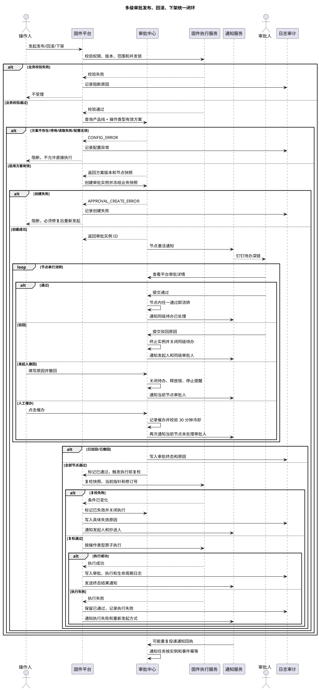
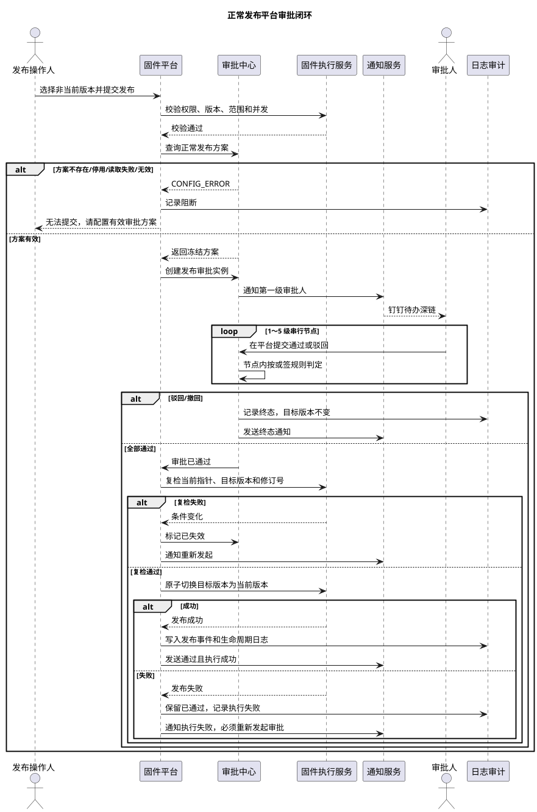
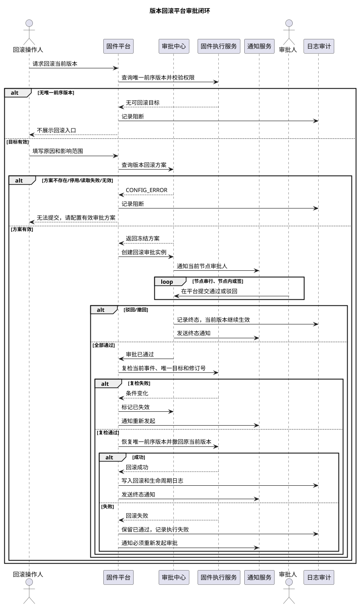
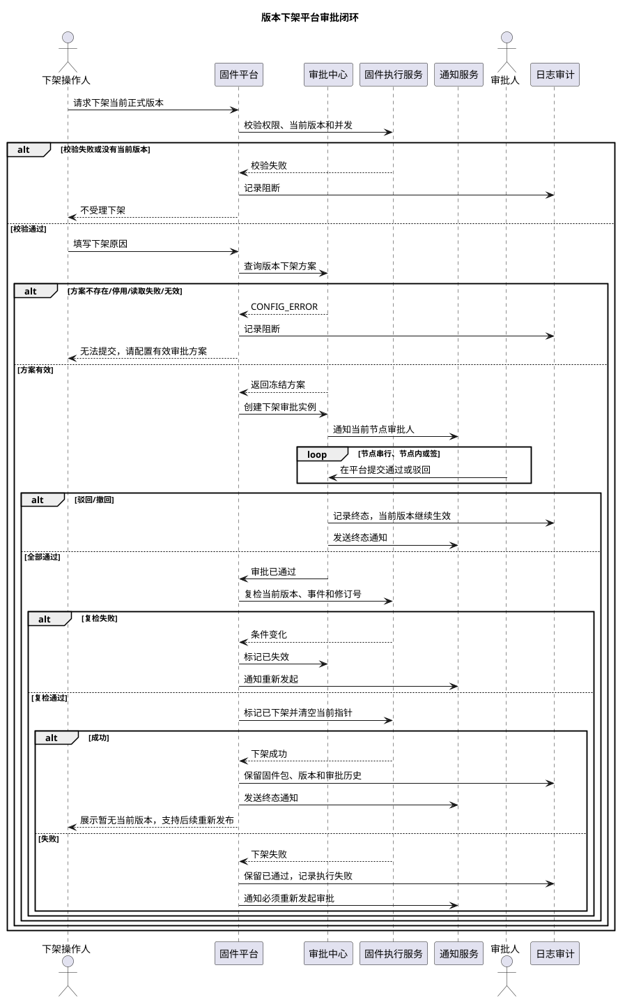

# 多级审批发布、回滚、下架需求迭代范围与业务闭环

> 文档版本：V1.3
> 编写日期：2026-10-23
> 适用模块：固件发布平台、审批配置、发布日志、审批日志  
> 文档定位：本期多级审批能力的产品需求、研发评审和联调验收基线  
> 复制说明：本文使用 Markdown 标题、表格、PlantUML 代码块和纯文本代码块编排，可直接复制到钉钉文档、群聊或评审纪要中。需要渲染 UML 时，请完整复制每个 `@startuml` 至 `@enduml` 的代码块；钉钉无法渲染 PlantUML 时，使用同章的纯文本版。

## 1. 需求背景

固件平台已有正常发布、版本回滚和版本下架能力，但审批配置、审批实例、固件执行和审计记录之间需要形成统一闭环。本期以“一个产品线的一项审批操作对应唯一一套审批方案”为基础，建立发布、回滚、下架三类操作的多级串行审批能力。

本期解决的问题：

1. 管理员能够清楚知道每个产品线的正常发布、版本回滚、版本下架是否配置审批方案。
2. 每项操作只有一套当前审批方案，方案修改通过版本记录追溯，不再维护可复用的多操作方案列表。
3. 服务端根据产品线、操作类型和当前有效方案决定“必须审批”或“配置异常阻断”，不允许通过直达路径绕过审批。
4. 审批任务使用提交时冻结的方案版本和业务快照，配置后续变化不改写在途审批。
5. 审批通过后仍然进行执行前复检，避免旧审批覆盖新的版本状态。
6. 审批驳回、发起人撤回、配置异常、任务创建失败、执行失败均有明确结果和后续动作。
7. 审批状态、业务执行状态、版本状态和操作日志可以相互关联并追溯。

## 2. 本期结论与产品原则

### 2.1 核心结论

| 结论 | 本期规则 |
| --- | --- |
| 方案归属 | `产品线 + 审批操作` 唯一确定一套审批方案 |
| 审批操作 | 正常发布、版本回滚、版本下架三类操作分别配置 |
| 审批承载 | 平台审批中心创建审批实例、承载审批和保存审批事实；钉钉只负责待办通知、提醒和结果通知 |
| 管理入口 | 审批配置页面保留三张操作卡片；审批中心提供待我处理、我发起的、抄送我的、已处理和异常中心入口 |
| 版本管理 | 新建保存生成 V1，编辑保存生成递增版本；当前生效版本由方案指针确定 |
| 生效范围 | 新版本只影响后续新申请；已受理审批继续使用提交时冻结的方案、审批人和业务快照 |
| 审批节点 | 1 至 5 级串行节点；每个节点可配置 1 至多名启用平台用户，采用“或签” |
| 节点决策 | 同一节点任一审批人通过即进入下一节点；任一审批人驳回即终止审批并关闭同级待办 |
| 审批人约束 | 同一方案内审批人不能跨节点重复；发起人不能担任本次审批链审批人；不支持会签、动态分支、加签 |
| 审批动作 | 本期只有“通过”和“驳回”；发起人可撤回未完成审批，撤回必须填写原因 |
| 人工催办 | 不设置审批截止时间；普通审批中心仅在“我发起的”提供催办，系统管理员保留后台兜底，审批保持“审批中”直到通过、驳回或撤回 |
| 配置异常 | 方案不存在、已停用、读取失败、节点无效或审批任务创建失败，统一阻断，不允许直接执行或自动免审 |
| 回滚范围 | 仅允许回滚当前发布事件的唯一前序版本，不支持任意历史版本回滚 |
| 下架结果 | 清空当前发布版本指针，保留固件包、版本记录和历史审批记录 |

### 2.2 与当前原型的口径差异

当前原型和早期文档仍可能出现过时的审批承载、单人节点、细分失效状态或无方案直达文案。本需求以本版为准：平台审批中心是唯一审批事实源；钉钉不承载审批决策；同级多人采用或签；只支持人工催办；统一使用“已失效”并在详情记录原因；所有配置异常均阻断。研发实现时必须同步更新前端文案、状态枚举、审批回调校验和验收数据。

### 2.3 产品原则

- 平台审批中心是审批状态、节点处理人、审批意见和时间线的唯一事实源，钉钉消息只作为通知入口。
- 服务端是审批和执行决策的唯一来源，前端展示状态不能绕过服务端。
- 一次固件操作只能进入审批中、已阻断或已执行等确定路径，不能先执行后补审批。
- 审批通过不等于业务执行成功，审批状态、执行状态和通知状态分开记录。
- 审批人配置变更不影响在途审批；在途审批使用提交时冻结的方案版本和业务快照。
- 发起人撤回、审批人驳回和执行前复检失败都必须释放业务锁，并保留可审计原因。
- 任何配置异常都不能静默降级为免审批。
- 每个关键状态变化都必须关联审批实例 ID、业务操作 ID、操作人、时间和原因。

## 3. 迭代范围

### 3.1 本期包含

| 编号 | 模块 | 需求范围 | 优先级 |
| --- | --- | --- | --- |
| POL-01 | 审批配置页面 | 按产品线查看正常发布、版本回滚、版本下架三张操作卡片 | P0 |
| POL-02 | 唯一方案约束 | 每个产品线的每项操作只允许一套当前方案，后端拒绝第二套方案 | P0 |
| POL-03 | 方案新建 | 从操作卡片进入新建抽屉，保存成功生成 V1，并默认启用 | P0 |
| POL-04 | 方案编辑 | 编辑只影响后续新申请，保存生成递增版本，保留完整快照 | P0 |
| POL-05 | 多级节点 | 支持 1 至 5 级串行节点，每级配置 1 至多名审批人并采用或签 | P0 |
| POL-06 | 审批人校验 | 只能选择当前产品线下的启用平台用户；同一方案不得跨节点重复；发起人不得入链 | P0 |
| POL-07 | 人工催办 | 普通审批中心仅“我发起的”可按需催办当前节点；系统管理员后台保留兜底；同一节点 30 分钟内最多一次 | P0 |
| POL-08 | 撤回与终态抄送 | 发起人可撤回未完成审批；支持配置结果抄送人，抄送人不参与审批 | P0 |
| POL-09 | 版本记录 | 版本记录使用只读抽屉，展示方案、审批人、催办规则和变更说明 | P0 |
| POL-10 | 审批中心 | 待我处理、我发起的、抄送我的、已处理、异常中心、筛选、排序和连续处理 | P0 |
| POL-11 | 服务端决策 | 根据方案查询结果决定审批必需或配置异常阻断，不允许直达降级 | P0 |
| POL-12 | 审批快照 | 冻结方案版本、节点审批人、目标版本、当前指针、记录修订号和业务字段 | P0 |
| PUB-01 | 正常发布审批 | 支持审批、驳回、撤回、人工催办、通过后复检和发布执行 | P0 |
| RBK-01 | 版本回滚审批 | 支持唯一前序目标、差异确认、审批和恢复执行 | P0 |
| DEL-01 | 版本下架审批 | 支持当前版本下架审批、清空指针和重新发布入口 | P0 |
| NOT-01 | 通知与提醒 | 平台节点激活通知、人工催办、终态通知和失败补偿 | P0 |
| AUD-01 | 日志审计 | 发布、回滚、下架的审批记录、执行记录、通知记录和阻断原因可追溯 | P0 |
| CON-01 | 并发与幂等 | 防止重复提交、重复回调、重复点击、多标签页操作和错误覆盖 | P0 |
| QA-01 | 联调验收 | 覆盖三类操作的正向、驳回、撤回、催办、异常、并发和重复回调场景 | P0 |

### 3.2 本期不包含

| 编号 | 不包含项 | 处理方式 |
| --- | --- | --- |
| OUT-01 | 多个操作共用一套审批方案 | 不支持；每项操作独立维护 |
| OUT-02 | 会签、动态分支、加签和批量通过 | 不支持；节点内只采用或签，审批仍逐条形成独立决策 |
| OUT-03 | 在途审批人替换、重新分派和临时代理 | 本期不支持；审批人以提交时快照为准 |
| OUT-04 | 任意历史版本回滚 | 仅支持当前发布事件的唯一前序版本 |
| OUT-05 | 系统自动回滚 | 由有权限人员发起回滚审批 |
| OUT-06 | 审批时效与自动终止 | 本期不设置审批截止时间，不自动终止；普通用户从“我发起的”催办，系统管理员仅在后台异常场景兜底 |
| OUT-07 | 审批配置异常自动免审 | 配置异常直接阻断执行 |
| OUT-08 | 审批节点并行流转 | 节点之间固定串行 |
| OUT-09 | 固件测试、灰度和放量策略 | 继续由 OTA 系统承担 |
| OUT-10 | 下架后自动停止已有 OTA 任务 | 本平台只停止新升级检查返回，不承诺取消已有任务 |

## 4. 角色与权限

| 角色 | 主要职责 | 本期关键权限 |
| --- | --- | --- |
| 系统管理员 | 维护审批方案、查看异常和重发通知 | 查看、新建、编辑、启停方案；查看版本记录、审批日志和通知日志；在具备产品线数据范围及对应发布/回滚/下架权限、且新方案无自审冲突时，可查看异常并核对后重新发起审批 |
| 产品线负责人（原型角色：产线主管） | 发起业务操作并跟进结果，也可作为审批人处理被分配的节点 | 在所属产品线发起发布、回滚、下架；查看审批和执行结果；处理分配给自己的当前节点；在未完成时撤回自己发起的审批 |
| 审批人 | 在平台审批中心处理当前节点任务 | 仅处理分配给自己的当前节点；通过或驳回；查看业务快照和历史节点结果 |
| 结果抄送人 | 接收终态结果 | 只读查看已通过、已驳回、已撤回、已失效及执行结果，不参与审批 |
| 只读用户 | 查询状态和历史 | 查看配置、审批中心、版本记录、审批日志、通知日志和发布日志，不允许写操作 |

权限校验顺序：

```text
页面权限
  -> 操作权限
  -> 产品线数据范围
  -> 版本状态与当前指针
  -> 同一固件标识的审批并发锁
  -> 业务字段校验
  -> 查询有效审批方案
  -> 平台创建审批实例或返回配置异常
```

## 5. 审批配置页面需求

### 5.1 页面布局

1. 页面左侧选择产品线，主区域展示正常发布、版本回滚、版本下架三张操作卡片。
2. 每张卡片只呈现当前操作的一套方案，不展示跨操作方案列表。
3. 状态标签固定在卡片右上角，使用“已启用”“已停用”“未配置”区分配置状态；“已停用”代表新申请阻断，不代表可直达。
4. 未配置卡片展示配置引导和“配置审批方案”按钮。
5. 已配置卡片展示方案名称、方案说明、节点数、审批人数量、当前版本、更新时间和更新人。
6. 卡片底部提供“版本记录”“启用/停用”“编辑配置”等操作，操作按钮按权限展示。
7. 版本记录使用侧边抽屉：左侧只列 V1、V2、V3 等版本号，右侧展示只读快照。
8. 新建和编辑使用全屏侧边抽屉，表单区与审批中心任务预览区分栏；移动端纵向排列。

### 5.2 新建方案

| 字段 | 规则 |
| --- | --- |
| 方案名称 | 必填；同一产品线和操作下不能与已有方案冲突 |
| 所属产品线 | 由当前页面上下文确定，不支持在抽屉内切换 |
| 审批操作 | 由进入卡片确定，不支持一个方案勾选多个操作 |
| 审批节点 | 1 至 5 级串行；每级可选 1 至多名启用平台用户；同一方案内不得跨节点重复；发起人提交时不得在任一节点 |
| 节点决策 | 或签：任一审批人通过即流转；任一审批人驳回即终止；其余待办显示“已由某某处理” |
| 审批催办 | 普通审批中心仅“我发起的”可按需催办；系统管理员后台保留兜底；同一节点 30 分钟内最多一次，仅通知当前节点未处理审批人 |
| 终态抄送 | 可选；只接收终态结果，不参与审批 |
| 保存结果 | 生成 V1，当前版本指针指向 V1，状态默认已启用 |

保存前必须校验：审批节点数量、节点审批人数量、启用状态、同方案重复审批人、发起人冲突、催办规则和方案唯一性。校验失败不得保存。

### 5.3 编辑方案

1. 编辑打开当前方案的可编辑草稿，不直接修改历史版本。
2. 编辑保存必须填写变更说明。
3. 保存成功后生成递增版本，并将当前版本指针切换到新版本。
4. 新版本默认处于启用状态，后续新审批读取新版本。
5. 已进入审批的请求继续使用提交时的方案、审批人和业务快照。
6. 编辑失败不得覆盖当前生效版本。

### 5.4 启停方案

- 停用方案后，后续新申请统一返回 `CONFIG_ERROR`，不允许直接执行。
- 停用不删除方案版本、不影响历史审批、不改写在途审批。
- 重新启用使用当前最新版本，不生成新版本；启用前重新校验节点、审批人和催办规则。
- 启停操作需要二次确认并写入操作日志。

### 5.5 版本记录

版本详情至少展示：

- 版本号、创建时间、创建人、变更说明。
- 方案名称、产品线、审批操作。
- 审批节点顺序、每个节点的审批人、或签规则、人工催办规则。
- 终态结果抄送人员和通知策略。
- 当前是否为生效版本。

历史版本只读，不提供直接编辑、删除或单独启用入口。需要恢复历史配置时，通过编辑当前方案生成新版本，避免修改历史事实。

## 6. 审批中心与服务端审批执行决策

### 6.1 审批中心页面结构

审批中心是审批人的主工作台，按“需要我现在做什么”组织任务，默认进入“待我处理”。五个一级视图如下：

| 视图 | 数据范围 | 可执行动作 |
| --- | --- | --- |
| 待我处理 | 当前用户作为当前节点审批人的有效任务 | 查看详情、通过、驳回、标记已读；非末级通过后可连续处理，终态停留详情 |
| 我发起的 | 当前用户发起的全部审批，含审批进度、撤回入口、执行结果和失败原因 | 查看进度；对未完成审批填写原因并撤回 |
| 抄送我的 | 当前用户被配置为终态抄送人的审批 | 只读查看详情、时间线、审批结果和执行结果 |
| 已处理 | 当前用户实际通过或驳回过节点且无业务异常的记录；多级审批在本人节点完成后即可进入，整单仍可显示“审批中” | 只读查看详情和审批结果；不包含已失效、执行失败、通知失败、撤回及被关闭的同级待办 |
| 异常中心 | 默认展示当前身份可跟进的执行失败、通知失败和已失效审批单；系统管理员可切换“全部异常”查看权限范围内的历史异常 | 查看异常原因、审批/执行结果、处理责任和下一步；通知失败由管理员补发，业务异常由原发起人或具备对应业务操作权限的管理员重新核对后发起 |

异常中心的口径：

- “待我处理”只返回当前身份可执行后续动作的异常审批单；当前方案缺失、已停用、无效或存在发起人自审冲突时，不计入该身份可直接处理的数量，原因和后续指引在管理员“全部异常”中保留。
- 系统管理员“全部异常”仍受产品线数据权限约束，包含已关联新申请和通知已补发的历史记录；普通审批人只看到与自己有关且可操作的异常。
- 业务异常范围为执行失败、已失效；驳回和撤回是正常终态，不作为异常。审批长时间未处理通过人工催办推进，不单独生成异常。通知失败可与任一业务状态并存，不改变审批/执行结果。
- 已关联新申请表示旧异常“已跟进”，不表示新业务操作已成功；新申请失败时形成新异常，沿关联链继续跟进。取消草稿、校验失败均不清除原异常。
- 尚未生成审批单的配置异常、审批创建失败在发起页阻断并记录日志，不伪造审批实例或审批状态。

### 6.2 待办队列与连续处理

1. 顶部展示待办总数、今日已处理数和“待处理异常”数；待处理异常只计当前身份实际可执行后续动作的审批单，同一审批单多种异常去重，已读不减计数；数字必须来自平台实时查询。Tab 栏固定提供“已处理”入口，列表展示当前用户实际通过或驳回过节点且无业务异常的记录，多级审批在本人节点完成后即可进入，即使整单仍为“审批中”；顶部“今日已处理”仅统计其中本日完成的节点。已失效、执行失败、通知失败、撤回及被关闭的同级待办不计入，统一在异常中心或对应审批记录中查看。
2. 默认排序为：影响范围降序 → 提交时间升序；支持按提交时间、影响范围和当前节点切换排序，但不能改变服务端状态。
3. 支持按产品线、操作类型、操作版本（发布/回滚目标版本或下架版本）、影响设备数、提交人和审批方案版本筛选；筛选不丢失已选条件，基础条件直接展示，其余收纳在“更多条件”中并提示已生效条件数。
4. 列表行直接显示操作类型、产品线、目标版本、影响设备数、当前节点、节点审批人数量、提交人、审批状态和风险摘要。
5. 点击一条进入详情页，右侧固定展示“通过”“驳回”操作区；审批意见为必填或选填规则由审批动作配置确定，本期驳回必须填写原因。
6. 当前节点通过且审批仍在进行时，可按当前筛选排序自动进入下一条有效待办；最终审批、驳回、撤回或执行结果形成后停留详情，用户点击“下一条”再继续；若当前任务已被他人处理，提示处理结果并自动跳过。
7. 本期审批中心仅支持逐条查看、逐条处理和“下一条”连续处理；不提供多选框、批量查看、批量标记已读、聚合阅读、批量通过或批量驳回，避免将多个独立业务操作混在一次处理内。打开详情即自动标记已读。
8. 相同发布批次可在列表中聚合展示，但每条审批仍有独立审批实例、独立决策、独立锁和独立审计记录。

### 6.3 详情页交互与状态反馈

- 详情页首屏先展示业务摘要：产品线、操作类型、目标版本、当前版本、影响设备数、提交人、原因和风险提示。
- 下方展示固定时间线：已提交 → 当前节点 → 后续节点 → 执行前复检 → 执行结果；本期审批中心不单独展示“通知记录”分区，钉钉仅作为通知渠道，不替代审批时间线。
- 当前节点多人或签时，展示“本节点 N 人，任一人通过即可流转”；某人处理后其他人看到“已由某某通过/驳回”，不可继续操作。
- 发起人对未完成审批显示“撤回”，点击后必须填写撤回原因；撤回后关闭当前节点全部待办、释放业务锁、停止提醒并通知当前节点全部审批人。
- 审批通过后明确显示“审批已通过，等待/正在执行”，执行成功后才显示业务完成。
- 已失效、已撤回等状态显示具体原因和“核对并重新发起”入口；原发起人或具备对应业务操作权限的管理员可以重新核对当前版本、目标版本、影响范围、材料和当前审批方案，提交成功后生成新的审批实例并关联旧实例，不复用旧快照。
- 异常中心按审批单去重统计待处理数量；旧审批结果保持只读。已关联新申请的业务异常从“待我处理”移出，但仍可在管理员“全部异常”中追溯。
- 通知补发不修改原失败记录；系统管理员按当前审批进度补发有效通知，并追加补发记录。通知补发不改变审批或执行事实。

### 6.4 通知、提醒与时间规则

| 触发时点 | 平台行为 | 钉钉行为 |
| --- | --- | --- |
| 节点激活 | 记录节点激活时间，创建当前节点全部待办 | 立即发送待办通知，附平台审批中心深链 |
| 普通待办变化 | 进入 30 分钟聚合窗口，按审批人和产品线合并摘要 | 每 30 分钟最多发送一条聚合通知 |
| 发起人从“我发起的”或管理员后台点击催办 | 记录催办人、时间和当前节点；同一节点 30 分钟内最多一次 | 再次通知当前节点未处理审批人 |
| 终态形成 | 写入审批结果和执行结果 | 通知发起人、当前节点审批人和配置的抄送人 |
| 通知失败 | 保留待发送/发送失败状态，进入异常中心 | 管理员按当前进度补发有效通知；原失败记录保留，通知失败不改变审批事实 |

节点时钟从平台激活节点时开始，按 Asia/Shanghai 自然时间计算，不以钉钉发送成功、用户读消息或点击深链为起点。重复提醒必须幂等。

### 6.5 服务端决策矩阵

| 配置查询结果 | 服务端决策 | 后续处理 |
| --- | --- | --- |
| 明确不存在方案 | `CONFIG_ERROR` | 阻止执行，提示管理员配置审批方案 |
| 方案存在且已停用 | `CONFIG_ERROR` | 阻止执行，不允许直达或自动免审 |
| 方案存在且已启用且有效 | `APPROVAL_REQUIRED` | 平台创建审批实例，冻结方案和业务快照 |
| 方案已启用但节点或审批人无效 | `CONFIG_ERROR` | 返回异常，禁止执行 |
| 配置查询失败或响应超时 | `CONFIG_ERROR` | 返回异常，禁止执行 |
| 平台审批实例创建失败 | `APPROVAL_CREATE_ERROR` | 保持未执行，不得自动改为直接执行 |
| 审批通过后执行前复检不通过 | `APPROVAL_INVALID` | 审批状态置为“已失效”，不执行操作 |

### 6.6 强制约束

1. 服务端依据产品线、操作类型和有效方案执行判断，前端不能自行决定直达。
2. 同一固件标识同一时间最多一条进行中的发布、回滚或下架审批。
3. 发起人不能出现在本次审批链的任何节点；同一审批人不能跨节点重复。
4. 节点之间固定串行；节点内为或签，任一通过流转，任一驳回终止。
5. 同一请求只允许确定一种执行路径，不能先直接执行后补审批。
6. 审批通过后仍须执行必要的业务有效性复检。
7. 审批人不能被重新分派或临时替换；审批链内没有代理规则。
8. 审批回调、通过/驳回、撤回、催办和执行请求必须按实例及事件幂等处理。

## 7. 三类操作的完整业务流程

### 7.1 正常发布

#### 发起前

1. 操作人选择非当前版本，确认适用机型、功能项、APP 文案和发布说明。
2. 服务端校验目标版本可发布、无其他进行中审批、版本记录未发生冲突。
3. 服务端查询当前产品线“正常发布”方案；无方案、已停用或查询失败均阻断。
4. 启用且有效时，冻结审批方案版本、节点审批人、目标版本、当前指针、影响范围和业务字段。
5. 平台创建审批实例并激活第一个节点；钉钉仅发送通知。

#### 审批中

- 目标版本锁定，不允许编辑、删除、替换固件包或继续提交同一操作。
- 当前正式版本继续生效，不因目标版本审批中而切换。
- 当前节点多名审批人采用或签：任一人通过即进入下一节点；任一人驳回即终止审批，关闭同级其他待办。
- 不设置审批截止时间；普通用户仅在“我发起的”按需催办，管理员只在后台兜底，最终通过、驳回或撤回后释放审批锁。
- 发起人可在未完成时主动撤回，填写原因后关闭当前节点全部待办、停止提醒并通知当前节点审批人。

#### 审批通过与执行

1. 平台所有节点通过后，将审批状态置为“已通过”，并执行执行前复检。
2. 若当前版本指针、目标版本状态、记录修订号或快照约束变化，审批状态置为“已失效”，记录具体原因，不执行。
3. 复检通过后，在同一事务内切换当前版本指针、更新目标状态并生成发布事件。
4. 发布事件成功后记录审批日志、操作日志、版本生命周期日志和通知记录。
5. 若业务执行失败，执行状态标记“执行失败”，旧审批实例只读保留；不得在原审批实例上重试，必须重新发起审批。

### 7.2 版本回滚

#### 回滚目标

- 仅当前发布事件存在唯一前序版本时展示回滚入口。
- 回滚目标由服务端根据当前发布事件确定，不允许手工选择任意历史版本。
- 回滚审批期间当前版本继续生效，目标版本和快照锁定。

#### 审批与执行

1. 操作人查看当前版本与唯一前序版本的差异，填写回滚原因并确认影响范围。
2. 服务端查询“版本回滚”方案；无方案、停用或读取失败均阻断。
3. 启用且有效时，平台冻结回滚快照并创建审批实例，钉钉只发送通知。
4. 审批驳回或发起人撤回：当前版本继续生效，释放锁并记录原因；审批未完成时可人工催办。
5. 所有节点通过后复检当前版本、唯一前序版本、发布事件 ID 和记录修订号。
6. 复检通过后恢复唯一前序版本为当前版本，原当前版本标记为“已撤回”。
7. 回滚成功后关闭连续回滚入口，不支持连续反向回滚。
8. 回滚审批和执行结果写入平台日志，并按通知策略发送钉钉结果通知。
9. 回滚执行失败只能重新发起新的回滚审批，旧实例只读保留。

### 7.3 版本下架

#### 发起前

1. 只有当前正式发布版本可以发起下架。
2. 操作人填写下架原因类型和具体说明。
3. 服务端查询“版本下架”方案；无方案、停用或读取失败均阻断。
4. 启用且有效时冻结下架快照并创建平台审批实例；审批中当前版本继续作为升级检查目标，不能重复下架。

#### 审批通过与执行

1. 所有节点通过后复检当前版本、版本记录号、当前发布事件 ID 和审批快照。
2. 复检失败时审批置为“已失效”，不清空当前版本。
3. 复检通过后在事务内将版本标记为“已下架”，清空当前发布版本指针。
4. 固件包、版本详情、审批记录和发布日志保留。
5. 已升级设备不受本次下架影响，已有 OTA 任务不承诺由本平台自动取消。
6. 页面展示“暂无当前发布版本”，用户可从非当前版本中重新发起正常发布。
7. 下架执行失败只能重新发起新的下架审批，旧实例只读保留。

## 8. 审批状态、执行状态与版本状态

### 8.1 审批实例状态

| 状态 | 含义 | 是否可继续审批 | 是否可执行 |
| --- | --- | --- | --- |
| 审批中 | 已创建平台审批实例，等待当前节点处理 | 是 | 否 |
| 已通过 | 所有节点已通过，等待或已完成执行 | 否 | 需通过执行前复检 |
| 已驳回 | 任一节点驳回，审批终止 | 否 | 否 |
| 已撤回 | 发起人撤回未完成审批 | 否 | 否 |
| 已失效 | 审批通过后复检失败或其他业务失效原因 | 否 | 否 |

“已失效”不再拆分为其他具体状态名；详情、原因字段和日志必须记录实际原因，例如“目标版本修订号变化”“当前版本已被其他操作切换”。

### 8.2 执行状态

| 状态 | 含义 |
| --- | --- |
| 未执行 | 审批中、已驳回、已撤回或已失效，尚未进入业务执行 |
| 执行中 | 已开始进行版本切换、回滚或下架事务 |
| 执行成功 | 业务状态已完成切换 |
| 执行失败 | 审批结果保留，但业务执行未完成；必须重新发起审批 |
| 已终止 | 业务方确认不再继续处理；重新操作仍须新建审批 |

### 8.3 通知状态

| 状态 | 含义 |
| --- | --- |
| 待发送 | 平台已生成通知任务，等待发送 |
| 已发送 | 已提交给钉钉通知通道 |
| 已读 | 通道返回已读或平台确认用户打开通知 |
| 发送失败 | 通知通道失败，进入异常中心；管理员按当前进度补发，追加记录并保留原失败事实 |

### 8.4 版本状态

| 状态 | 发布 | 回滚目标 | 下架 | 编辑 |
| --- | --- | --- | --- | --- |
| 未发布 | 可发起 | 不可作为回滚目标 | 不可 | 可 |
| 审批中 | 锁定 | 锁定 | 锁定 | 不可 |
| 当前发布 | 不可重复发布 | 可作为当前事件来源 | 可 | 不可 |
| 历史发布 | 可重新发布 | 不可任意指定 | 不可 | 可 |
| 已撤回 | 可重新发布 | 不可任意指定 | 不可 | 可 |
| 已下架 | 可重新发布 | 不可任意指定 | 不可 | 可 |

## 9. 版本、快照与并发规则

### 9.1 方案版本

| 场景 | 版本变化 | 对新审批的影响 | 对在途审批的影响 |
| --- | --- | --- | --- |
| 首次创建并保存 | 生成 V1，默认启用 | 使用 V1 | 无在途审批 |
| 编辑已启用方案 | Vn → Vn+1 | 使用 Vn+1 | 继续使用原方案版本和审批人快照 |
| 停用方案 | 版本不变 | 新申请返回 `CONFIG_ERROR` | 不改写已受理路径 |
| 重新启用方案 | 版本不变 | 使用当前最新版本 | 不改写已受理路径 |
| 查看历史版本 | 版本不变 | 不影响 | 只读查看 |

### 9.2 审批快照字段

审批实例至少冻结以下字段：

- 审批实例 ID、幂等键、产品线、操作类型。
- 方案 ID、方案版本号、方案名称、方案状态。
- 审批节点顺序、节点审批人列表、或签规则、人工催办规则。
- 固件标识、来源版本、目标版本、目标记录修订号。
- 当前发布指针、唯一前序事件 ID 或当前发布事件 ID。
- 适用机型、影响设备数、功能项配置版本、APP 更新说明、发布/回滚提醒设置。
- 发起人、发起时间、业务原因、终态抄送人员和通知策略。

### 9.3 并发约束

1. 保存版本和更新当前版本指针必须在服务端事务边界内保持一致。
2. 保存新版本不得意外改变历史版本；启停方案不得覆盖方案版本内容。
3. 同一配置版本被两名管理员同时编辑时，使用修订号或乐观锁拒绝静默覆盖。
4. 同一固件标识同一时间只允许一个进行中的生效审批；发布、回滚、下架共用同一业务锁。
5. 同级多人同时操作时，以服务端首个有效操作为准，后续请求返回“当前节点已由某某处理”。
6. 重复保存、重复审批回调、重复点击、重复通知和重复执行请求必须幂等。
7. 发起人撤回、驳回和失效都必须关闭相关待办并释放锁；审批中由发起人从“我发起的”催办，管理员后台兜底。
8. 缓存失效、配置读取异常和数据库响应超时不得被误判为“无审批方案”。

## 10. 日志与打点批注需求

### 10.1 操作日志

至少记录：

- 新建方案、编辑方案、启用方案、停用方案。
- 方案版本号、操作类型、产品线、变更说明、操作人和时间。
- 审批配置查询失败、方案不存在、方案停用、启用方案无效和重复方案创建被阻止。
- 发布、回滚、下架发起、审批通过、审批驳回、发起人撤回、审批失效、执行成功和执行失败。
- 重复提交、快照冲突、并发冲突、任务创建失败、通知失败和执行前复检失败。

### 10.2 审批日志

至少记录：

- 审批实例 ID、方案版本、业务操作和目标版本。
- 提交人、每级审批人列表、节点状态、首个有效操作人、处理时间和审批意见。
- 平台节点激活时间、人工催办时间、催办人和通知对象。
- 审批通过、驳回、撤回和已失效的具体原因。
- 执行状态、业务事件 ID、通知状态、失败原因和重新发起关联关系。

### 10.3 页面需求批注点

| 批注编号 | 页面位置 | 批注说明 |
| --- | --- | --- |
| POL-R01 | 审批配置页面标题 | 按产品线查看三类审批操作的配置覆盖情况 |
| POL-R02 | 未配置/已停用卡片 | 未配置或停用均阻断新申请，不允许直达；引导管理员配置或启用 |
| POL-R03 | 编辑配置按钮 | 编辑仅影响后续新申请，已提交审批使用原快照 |
| POL-R04 | 操作卡片与表单 | 产品线与审批操作固定绑定，不支持跨操作复用 |
| POL-R05 | 审批节点 | 支持 1 至 5 级串行节点，节点内支持多人或签 |
| POL-R06 | 审批人选择器 | 只能选择启用平台用户；方案内不得跨节点重复；发起人不得入链 |
| POL-R07 | 人工催办 | 普通用户仅在“我发起的”按需催办；管理员后台兜底；同一节点 30 分钟内最多一次 |
| POL-R08 | 终态结果抄送 | 抄送人只接收终态结果，不参与审批 |
| POL-R09 | 版本记录区域 | 新建保存生成 V1，编辑保存递增版本并保留完整快照 |
| POL-R10 | 启停按钮 | 停用后新申请返回配置异常；重新启用前重新校验方案 |
| POL-R11 | 审批中心待办 | 按影响范围、提交时间和当前节点排序，支持筛选、人工催办和连续处理 |
| POL-R12 | 审批中心详情 | 平台时间线为事实源；本期仅展示业务快照、审计材料和审批流转，钉钉通知不单独形成详情分区 |
| POL-R13 | 撤回入口 | 发起人仅可撤回未完成审批，必须填写原因并通知当前节点全部审批人 |
| POL-R14 | 通知状态 | 通知由钉钉渠道发送；发送失败仅在异常中心提供跟进入口，不改变审批状态 |
| EXEC-R01 | 发布/回滚/下架提交按钮 | 服务端决策后明确展示审批中或配置异常，不允许绕过审批 |
| EXEC-R02 | 审批结果区 | 审批状态和执行状态分开展示；通知异常在异常中心提示 |
| EXEC-R03 | 异常结果区 | 配置、通知、复检、执行失败均提示具体原因和重新发起方式 |

## 11. 端到端闭环 UML 时序图与备用流程图

以下图示统一表达：平台审批中心负责创建实例、节点流转、状态判断和审计；钉钉只负责通知、提醒和结果通知。所有 `@startuml` 至 `@enduml` 代码块可复制到支持 PlantUML 的工具中。

### 11.1 PlantUML 总体审批执行闭环时序图



### 11.2 PlantUML 正常发布时序图



### 11.3 PlantUML 版本回滚时序图



### 11.4 PlantUML 版本下架时序图



### 11.5 可直接复制到钉钉文档的纯文本总流程图

```text
【审批配置与固件执行闭环】

管理员选择产品线
  ↓
分别维护：正常发布 / 版本回滚 / 版本下架
  ↓
每个操作只能有一套当前审批方案；首次保存 V1，编辑生成 Vn
  ↓
用户发起业务操作
  ↓
服务端校验：权限 → 产品线范围 → 版本状态 → 并发锁 → 业务字段
  ↓
查询“产品线 + 操作类型”的有效审批方案
  ├─ 无方案 / 已停用 / 查询失败 / 配置无效
  │    ↓
  │  CONFIG_ERROR，阻止执行，不允许直达或自动免审
  │
  └─ 方案启用且有效
       ↓
     平台审批中心冻结方案、节点审批人和业务快照，创建审批实例
       ↓
     钉钉只发送通知；审批人在平台处理
       ├─ 节点内任一人通过 → 流转下一节点
       ├─ 任一人驳回 → 终止审批，关闭同级待办
       ├─ 发起人撤回 → 关闭待办、释放锁、停止提醒
       ├─ 审批未完成 → 发起人从“我发起的”催办；管理员后台兜底
       └─ 通过 / 驳回 / 撤回 → 进入对应终态
       └─ 全部节点通过 → 执行前复检
                                  ├─ 复检失败 → 已失效，不执行
                                  └─ 复检通过 → 按操作类型原子执行

审批中心提供：待我处理 / 我发起的 / 抄送我的 / 已处理 / 异常中心（待我处理 / 全部异常）
默认按影响范围、提交时间和当前节点排序，支持筛选、人工催办和连续处理

最终统一写入：审批日志 + 执行日志 + 版本生命周期事件 + 通知日志
执行失败必须新建审批实例；旧实例只读保留并关联新实例
```

### 11.6 纯文本正常发布流程图

```text
选择非当前版本
  ↓
填写发布参数并完成原有业务校验
  ↓
查询“正常发布”审批方案
  ├─ 无方案 / 已停用 / 查询失败 / 无效 → CONFIG_ERROR，阻止提交
  └─ 启用且有效 → 冻结快照 → 平台创建审批
                         ↓
                  钉钉通知，审批人在平台处理
                         ↓
                  1～5 级串行，节点内或签
                  ├─ 任一通过 → 下一节点
                  ├─ 任一驳回 → 终止，目标版本不变
                  ├─ 发起人撤回 → 终止，释放锁
                  ├─ 人工催办 → 再次通知当前节点未处理审批人
                  └─ 通过 / 驳回 / 撤回 → 进入对应终态
                  └─ 全部通过 → 复检当前指针、目标版本和修订号
                                   ├─ 失败 → 已失效，不执行
                                   └─ 通过 → 原子切换当前版本
                                              ↓
                                      发布成功并写入日志
```

### 11.7 纯文本版本回滚流程图

```text
当前发布版本
  ↓
是否存在唯一前序版本？
  ├─ 否 → 不展示回滚入口
  └─ 是 → 展示差异并填写回滚原因
                ↓
          查询“版本回滚”审批方案
          ├─ 无方案 / 已停用 / 查询失败 / 无效 → CONFIG_ERROR，阻止提交
          └─ 启用且有效 → 冻结快照 → 平台创建审批
                                   ↓
                           钉钉通知，审批人在平台处理
                                   ↓
                           驳回 / 撤回 → 当前版本继续生效
                                   ↓
                           全部通过 → 复检当前事件和唯一目标
                                   ├─ 失败 → 已失效
                                   └─ 通过 → 恢复唯一前序版本
                                              原当前版本标记已撤回
                                              关闭连续回滚入口
```

### 11.8 纯文本版本下架流程图

```text
当前正式发布版本
  ↓
填写下架原因类型和具体说明
  ↓
查询“版本下架”审批方案
  ├─ 无方案 / 已停用 / 查询失败 / 无效 → CONFIG_ERROR，阻止提交
  └─ 启用且有效 → 冻结快照 → 平台创建审批
                                   ↓
                           钉钉通知，审批人在平台处理
                                   ↓
                           驳回 / 撤回 → 当前版本继续生效
                                   ↓
                           全部通过 → 复检当前版本、事件和修订号
                                   ├─ 失败 → 已失效，不清空指针
                                   └─ 通过 → 标记版本已下架
                                              清空当前版本指针
                                              保留固件包与历史记录
                                              展示暂无当前版本，支持后续重新发布
```

## 12. 关键异常与处理闭环

| 异常场景 | 页面结果 | 服务端结果 | 后续动作 |
| --- | --- | --- | --- |
| 无审批方案 | 显示未配置，禁止提交 | `CONFIG_ERROR`，不执行 | 管理员配置并启用有效方案后重新发起 |
| 方案已停用 | 显示已停用，禁止提交 | `CONFIG_ERROR`，不执行 | 管理员重新启用并通过校验后重新发起 |
| 启用方案节点无效 | 显示配置异常 | `CONFIG_ERROR`，不执行 | 管理员修复方案 |
| 配置查询超时 | 显示暂不可执行 | `CONFIG_ERROR`，不执行 | 重试查询或联系管理员 |
| 审批任务创建失败 | 显示提交失败 | 不创建业务执行任务 | 修复审批服务后重新发起 |
| 审批驳回 | 显示已驳回 | 当前版本不变，关闭同级待办并释放锁 | 修改业务内容后重新发起 |
| 发起人撤回 | 显示已撤回 | 关闭当前节点全部待办、停止提醒、释放锁 | 修改业务内容后重新发起 |
| 审批长时间未处理 | 显示审批中 | 发起人从“我发起的”催办；系统管理员仅在后台异常场景兜底 | 继续等待通过、驳回或撤回 |
| 审批通过但复检失败 | 显示已失效并展示原因 | 不执行版本切换 | 重新确认当前状态后发起新审批 |
| 审批通过但执行失败 | 显示执行失败 | 保留审批结果，禁止原实例重试 | 必须重新发起审批 |
| 通知发送失败 | 异常中心显示“通知发送失败”，同时展示审批和执行结果 | 审批事实不变；保留失败记录和补发记录 | 系统管理员按当前审批进度补发有效通知 |
| 异常已关联新申请 | 原异常显示“已跟进”，保留原审批只读详情和关联新申请入口 | 不修改旧审批状态；新申请独立执行审批和审计 | 从“待我处理”移出；管理员可在“全部异常”追溯 |
| 同级并发操作 | 后到者提示当前节点已处理 | 以服务端首个有效操作为准，关闭其余待办 | 查看已处理结果 |
| 重复审批回调 | 页面状态不重复变化 | 幂等返回已有结果，不重复执行 | 保留一次业务结果 |
| 并发保存冲突 | 保存失败提示版本已变化 | 拒绝静默覆盖 | 重新加载最新版本后再编辑 |

## 13. 数据对象建议

### 13.1 审批方案

```text
ApprovalPolicy
  id
  productLine
  operation                 // publish | rollback | delist
  status                    // enabled | disabled
  currentVersionId
  revision
  createdBy
  createdAt
  updatedBy
  updatedAt
```

### 13.2 审批方案版本

```text
ApprovalPolicyVersion
  id
  policyId
  versionNumber             // V1, V2...
  name
  description
  nodes[]                   // sequence, approverIds[], decision=OR；本期无审批截止时间
  copyUserIds[]
  reminderPolicy            // 业务提醒策略；审批催办由平台人工触发
  changeReason
  createdBy
  createdAt
```

### 13.3 审批实例

```text
ApprovalInstance
  id
  idempotencyKey
  productLine
  operation
  policyId
  policyVersion
  approvalStatus            // 审批中、已通过、已驳回、已撤回、已失效
  executionStatus           // 未执行、执行中、执行成功、执行失败、已终止
  snapshot                  // 目标版本、当前指针、修订号、业务字段、影响范围
  nodes[]                   // 节点审批人快照、激活时间、人工催办记录、处理结果
  submitter
  submitTime
  withdrawReason
  terminalReason
  approveTime
  businessEventId
  relatedApprovalId         // 执行失败后新建审批的关联关系
```

### 13.4 通知任务

```text
NotificationTask
  id
  approvalInstanceId
  eventType                 // node_activated | digest | warn_50 | warn_20 | terminal
  recipientIds[]
  channel                   // dingtalk
  status                    // 待发送、已发送、已读、发送失败
  aggregateWindowStart
  sentAt
  readAt
  failureReason
```

## 14. 联调验收场景

| 编号 | 测试条件 | 预期结果 |
| --- | --- | --- |
| IT-01 | 正常发布未配置方案 | 返回 `CONFIG_ERROR`，不得直接执行 |
| IT-02 | 正常发布方案已停用 | 返回 `CONFIG_ERROR`，不得直接执行 |
| IT-03 | 正常发布方案已启用且有效 | 平台创建多级审批，钉钉只收到通知，审批通过后执行 |
| IT-04 | 版本回滚方案已启用 | 只对唯一前序版本创建回滚审批 |
| IT-05 | 版本下架方案已启用 | 对当前版本创建下架审批 |
| IT-06 | 同一节点配置多个审批人 | 任一人通过即流转；任一人驳回即终止；其他人显示已由某某处理 |
| IT-07 | 同一方案审批人跨节点重复 | 保存被阻止并提示重复 |
| IT-08 | 发起人配置为审批人 | 提交被阻止并提示发起人不能审批自己 |
| IT-09 | 任一节点审批驳回 | 不执行版本操作，关闭同级待办，当前版本保持不变 |
| IT-10 | 发起人撤回未完成审批 | 必须填写原因，关闭待办、停止提醒、释放锁并通知当前节点审批人 |
| IT-11 | 任一节点长时间未处理 | 审批保持“审批中”，发起人从“我发起的”催办当前节点；管理员后台兜底 |
| IT-12 | 配置查询超时 | 返回配置异常，不自动免审 |
| IT-13 | 启用方案审批人已停用 | 拒绝受理并提示配置异常 |
| IT-14 | 审批期间保存新方案版本 | 原审批继续使用原方案版本和审批人快照 |
| IT-15 | 审批期间停用方案 | 原审批不变，新申请阻断，不转为直接执行 |
| IT-16 | 审批通过时当前版本已变化 | 审批置为“已失效”，不覆盖新的当前版本 |
| IT-17 | 审批任务创建失败 | 不创建业务执行任务，不降级免审 |
| IT-18 | 审批通过但执行失败 | 旧审批只读保留，必须新建审批，不能在原实例重试 |
| IT-19 | 重复审批通过回调 | 不重复执行固件任务 |
| IT-20 | 两名管理员同时保存 | 使用修订号拒绝静默覆盖，已成功版本不丢失 |
| IT-21 | 通知发送失败 | 审批事实不变，进入异常中心；管理员按当前进度补发，原失败记录保留 |
| IT-22 | 30 分钟聚合通知 | 同一审批人同一窗口合并摘要，单窗口不重复发送 |
| IT-23 | 人工催办 | 发起人从“我发起的”或管理员后台点击催办后，再次通知当前节点未处理审批人；同一节点 30 分钟内最多一次 |
| IT-24 | 审批中心连续处理 | 完成一条后按筛选排序打开下一条有效待办 |
| IT-25 | 批量查看和批量标记已读 | 本期不支持；逐条打开详情即自动标记已读 |
| IT-26 | 尝试批量通过 | 页面不提供批量通过入口，单条决策和审计保持独立 |
| IT-27 | 下架审批通过 | 清空当前版本指针，固件包和历史记录保留 |
| IT-28 | 下架后重新发布 | 可从非当前版本选择目标重新走正常发布流程 |
| IT-29 | 三类操作分别配置 | 发布、回滚、下架各自读取对应独立方案 |
| IT-30 | 无权限用户发起操作 | 原权限校验拒绝，并记录阻止原因 |

| IT-31 | 一个审批单同时存在业务失败与通知失败 | 待处理异常按审批单去重；分别展示原因、责任人与动作 |
| IT-32 | 管理员只有查看权限或已移出产品线 | 不提供重新发起动作，不计入其可处理异常；提交端再次校验 |
| IT-33 | 重新发起取消、校验失败或方案含本人 | 不创建新审批、不清除旧异常，提示具体阻断原因 |
| IT-34 | 重新核对并成功提交新申请 | 新旧审批双向关联，旧业务异常移出待我处理；全部异常保留原结果 |
| IT-35 | 业务执行成功但通知失败 | 首要提示通知发送失败，同时明确执行成功；管理员补发后数量减少 |
| IT-36 | 待办通知失败后原节点已结束 | 按当前节点或终态补发有效通知，不向旧节点发送过期待办 |


## 15. 研发评审反馈模板

请研发针对每项反馈填写实际验证结论，不使用单纯的“支持 / 不支持”替代验证：

| 模块 | 现状验证 | 是否改造 | 风险或问题 | 建议方案 | 责任模块 | 预计工作量 | 是否影响本期 |
| --- | --- | --- | --- | --- | --- | --- | --- |
| 审批中心任务模型 | 待核查 | 待评估 | — | — | — | — | — |
| 平台审批事实源与钉钉通知解耦 | 待核查 | 待评估 | — | — | — | — | — |
| 多人或签和同级待办关闭 | 待核查 | 待评估 | — | — | — | — | — |
| 无方案/停用方案阻断 | 待核查 | 待评估 | — | — | — | — | — |
| 配置查询失败阻断 | 待核查 | 待评估 | — | — | — | — | — |
| 审批任务创建失败阻断 | 待核查 | 待评估 | — | — | — | — | — |
| 发起人撤回和锁释放 | 待核查 | 待评估 | — | — | — | — | — |
| 审批快照版本隔离 | 待核查 | 待评估 | — | — | — | — | — |
| 人工催办与 30 分钟冷却 | 待核查 | 待评估 | — | — | — | — | — |
| 人工催办与钉钉通知 | 待核查 | 待评估 | — | — | — | — | — |
| 审批中心连续处理和筛选排序 | 待核查 | 待评估 | — | — | — | — | — |
| 执行失败必须重新审批 | 待核查 | 待评估 | — | — | — | — | — |
| 方案版本历史记录 | 待核查 | 待评估 | — | — | — | — | — |
| 发布/回滚/下架事务 | 待核查 | 待评估 | — | — | — | — | — |
| 审批回调、操作和通知幂等 | 待核查 | 待评估 | — | — | — | — | — |

## 16. 上线前检查清单

### 产品确认

- [ ] 三类操作各自独立配置，确认不存在跨操作共用方案。
- [ ] 平台审批中心是唯一审批事实源，钉钉只负责通知、提醒和结果通知。
- [ ] 每级可配置多名审批人，或签规则、同级待办关闭规则已确认。
- [ ] 发起人撤回规则、审批人不可重复/不可自审规则已确认。
- [ ] 未配置、停用、读取失败和配置无效均阻断，不允许直达。
- [ ] 本期不设置审批时效；审批仅通过、驳回或发起人撤回结束，催办再次通知当前节点未处理审批人。
- [ ] 人工催办规则已确认：同一节点 30 分钟内最多一次，仅通知当前节点未处理审批人。
- [ ] 回滚目标、下架结果、重新发布入口和执行失败重新审批规则已确认。
- [ ] 审批中心五类视图、异常中心待我处理/全部异常、筛选排序、连续处理和批量能力边界已确认。

### 研发确认

- [ ] 服务端决策矩阵已实现，前端不能绕过服务端直接执行。
- [ ] 配置查询失败和任务创建失败不会自动降级免审。
- [ ] 方案版本、节点审批人和审批快照已隔离，配置更新不影响在途审批。
- [ ] 执行前复检、事务边界、业务锁和幂等键已实现。
- [ ] 发起人撤回会关闭全部当前节点待办、停止提醒并释放锁。
- [ ] 同级多人首个有效操作生效，其他操作返回当前节点已处理。
- [ ] 重复回调、通知失败、并发保存和当前指针变化均有安全处理。

### 测试确认

- [ ] 正常发布、回滚、下架各覆盖阻断和审批执行路径。
- [ ] 各类驳回、撤回、催办、配置异常、创建失败和执行失败均覆盖。
- [ ] 多人或签、审批人重复、自审冲突和同级并发均覆盖。
- [ ] 审批通过后当前版本变化时不会误切换。
- [ ] 审批中心连续处理、筛选排序、聚合通知和提醒规则可验证。
- [ ] 执行失败后不能在原审批实例重试，必须关联新审批。
- [ ] 重新发起必须重新核对当前版本、目标版本、影响范围、材料和审批方案；原审批关联新实例后从待处理异常移出。
- [ ] 通知补发保留原失败记录，并按当前进度追加补发记录。
- [ ] 下架后可以重新发起正常发布。
- [ ] 版本记录、审批日志、操作日志、通知日志和页面批注能够对应同一业务链路。
- [ ] 桌面端、平板端和手机端页面均无横向溢出或关键内容遮挡。

## 17. 交付判定

满足以下条件后，才可认为本期多级审批需求形成完整闭环：

```text
每项操作都有唯一且有效的方案
  + 平台审批中心是唯一事实源，钉钉只通知
  + 方案版本、节点审批人和业务快照可追溯
  + 多级串行、节点内多人或签规则明确
  + 待我处理、我发起的、抄送我的、已处理、异常中心可连续处理
  + 通过后执行前复检，执行失败必须重新审批
  + 发起人撤回、驳回、配置异常均阻断执行
  + 人工催办、钉钉通知和终态通知可追踪
  + 发布/回滚/下架状态原子更新
  + 审批、执行、通知、版本和操作日志可关联
  + 下架后可重新发布
  + 联调验收场景全部通过
  = 多级审批发布、回滚、下架业务闭环完成
```
