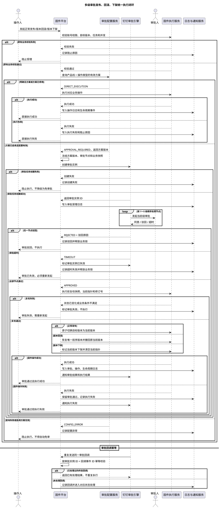
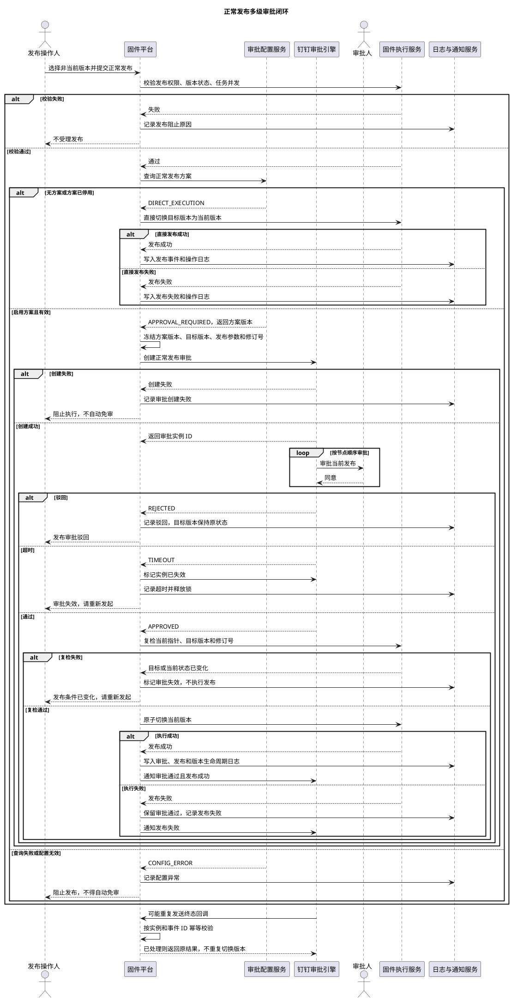
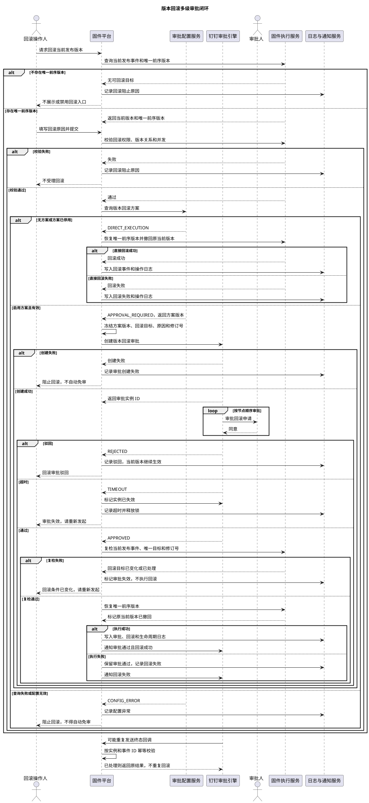
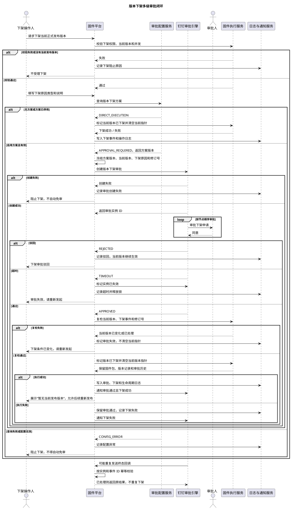

# 多级审批发布、回滚、下架需求迭代范围与业务闭环

> 文档版本：V1.1  
> 编写日期：2026-10-19  
> 适用模块：固件发布平台、审批配置、发布日志、审批日志  
> 文档定位：本期多级审批能力的产品需求、研发评审和联调验收基线  
> 复制说明：本文使用 Markdown 标题、表格、PlantUML 代码块和纯文本代码块编排，可直接复制到钉钉文档、群聊或评审纪要中。需要渲染 UML 时，请完整复制每个 `@startuml` 至 `@enduml` 的代码块；钉钉无法渲染 PlantUML 时，使用同章的纯文本版。

## 1. 需求背景

固件平台已有正常发布、版本回滚和版本下架能力，但审批配置、审批实例、固件执行和审计记录之间需要形成统一闭环。本期以“一个产品线的一项审批操作对应唯一一套审批方案”为基础，建立发布、回滚、下架三类操作的多级串行审批能力。

本期解决的问题：

1. 管理员能够清楚知道每个产品线的正常发布、版本回滚、版本下架是否配置审批方案。
2. 每项操作只有一套当前审批方案，方案修改通过版本记录追溯，不再维护可复用的多操作方案列表。
3. 服务端根据产品线、操作类型和当前有效方案决定“直接执行”或“必须审批”。
4. 审批任务使用提交时冻结的方案版本和业务快照，配置后续变化不改写在途审批。
5. 审批通过后仍然进行执行前复检，避免过期审批覆盖新的版本状态。
6. 审批驳回、超时失效、配置异常、任务创建失败、执行失败均有明确结果和后续动作。
7. 审批状态、业务执行状态、版本状态和操作日志可以相互关联并追溯。

## 2. 本期结论与产品原则

### 2.1 核心结论

| 结论 | 本期规则 |
| --- | --- |
| 方案归属 | `产品线 + 审批操作` 唯一确定一套审批方案 |
| 审批操作 | 正常发布、版本回滚、版本下架三类操作分别配置 |
| 管理入口 | 审批配置页面保留三张操作卡片，不新增独立的审批方案列表页 |
| 版本管理 | 新建保存生成 V1，编辑保存生成递增版本；当前生效版本由方案指针确定 |
| 保存状态 | 首次保存和后续保存成功后，方案默认处于启用状态 |
| 生效范围 | 新版本保存后只影响后续新发起的审批；已受理审批继续使用原快照 |
| 审批级数 | 1 至 5 级单人串行审批，页面顺序即实际流转顺序 |
| 审批超时 | 当前审批实例标记为“已失效（超时）”，禁止继续审批和执行；需要重新发起 |
| 配置异常 | 配置读取失败、启用方案无效、审批任务创建失败均阻止执行，不自动降级为直接执行 |
| 回滚范围 | 仅允许回滚当前发布事件的唯一前序版本，不支持任意历史版本回滚 |
| 下架结果 | 清空当前发布版本指针，保留固件包、版本记录和历史审批记录 |

### 2.2 与当前原型的口径差异

当前原型中仍存在“节点超时后原审批人可继续处理”的演示文案。本需求以本次确认的业务规则为准：审批超时后审批实例失效，不能继续审批，不能执行；需要重新发起新的审批实例。研发实现时应同步更新前端文案、状态枚举、审批回调校验和验收数据。

### 2.3 产品原则

- 服务端是审批执行决策的唯一来源，前端状态只用于展示和发起请求。
- 一次固件操作只能确定一种执行路径：直接执行、审批中或配置异常阻断。
- 审批通过不等于业务执行成功，审批状态和执行状态分开记录。
- 已受理请求不因后续页面配置变化而重新解释执行路径。
- 任何审批异常都不能静默降级为免审批。
- 所有状态变化必须具备可追溯的业务主键、操作人、时间和原因。

## 3. 迭代范围

### 3.1 本期包含

| 编号 | 模块 | 需求范围 | 优先级 |
| --- | --- | --- | --- |
| POL-01 | 审批配置页面 | 按产品线查看正常发布、版本回滚、版本下架三张操作卡片 | P0 |
| POL-02 | 唯一方案约束 | 每个产品线的每项操作只允许一套当前方案，后端拒绝第二套方案 | P0 |
| POL-03 | 方案新建 | 从操作卡片进入新建抽屉，保存成功生成 V1，并默认启用 | P0 |
| POL-04 | 方案编辑 | 编辑只影响后续新申请，保存生成递增版本，保留完整快照 | P0 |
| POL-05 | 多级节点 | 支持 1 至 5 级单人串行节点，审批人不得重复 | P0 |
| POL-06 | 审批人校验 | 只能选择当前产品线下的启用平台用户 | P0 |
| POL-07 | 节点时限 | 每个节点支持小时或自然日；小时 1 至 168，天数 1 至 30 | P0 |
| POL-08 | 终态抄送 | 支持配置结果抄送人，抄送人不参与审批 | P1 |
| POL-09 | 版本记录 | 版本记录使用只读抽屉，左侧仅展示版本号，右侧展示完整快照 | P0 |
| POL-10 | 服务端决策 | 根据方案查询结果决定直接执行、审批必需或配置异常 | P0 |
| POL-11 | 审批快照 | 冻结方案版本、目标版本、当前指针、记录修订号和业务字段 | P0 |
| PUB-01 | 正常发布审批 | 支持审批、驳回、超时失效、通过后复检和发布执行 | P0 |
| RBK-01 | 版本回滚审批 | 支持唯一前序目标、差异确认、审批和恢复执行 | P0 |
| DEL-01 | 版本下架审批 | 支持当前版本下架审批、清空指针和重新发布入口 | P0 |
| AUD-01 | 日志审计 | 发布、回滚、下架的审批记录、执行记录和阻断原因可追溯 | P0 |
| CON-01 | 并发与幂等 | 防止重复提交、重复回调、并发保存和错误覆盖 | P0 |
| QA-01 | 联调验收 | 覆盖三类操作的正向、驳回、失效、异常和重复回调场景 | P0 |

### 3.2 本期不包含

| 编号 | 不包含项 | 处理方式 |
| --- | --- | --- |
| OUT-01 | 多个操作共用一套审批方案 | 不支持；每项操作独立维护 |
| OUT-02 | 同级多人会签、或签、动态分支 | 暂不支持，仅支持单人串行 |
| OUT-03 | 在途审批人替换 | 暂不纳入本期；审批人以提交时快照为准 |
| OUT-04 | 任意历史版本回滚 | 仅支持当前发布事件的唯一前序版本 |
| OUT-05 | 系统自动回滚 | 由有权限人员发起回滚审批 |
| OUT-06 | 审批超时自动通过或自动执行 | 超时实例失效，必须重新发起 |
| OUT-07 | 审批配置异常自动免审 | 配置异常直接阻断执行 |
| OUT-08 | 固件测试、灰度和放量策略 | 继续由 OTA 系统承担 |
| OUT-09 | 下架后自动停止已有 OTA 任务 | 本平台只停止新升级检查返回，不承诺取消已有任务 |

## 4. 角色与权限

| 角色 | 主要职责 | 本期关键权限 |
| --- | --- | --- |
| 系统管理员 | 维护审批方案和处理异常 | 查看、新建、编辑、启停方案；查看版本记录和审批日志；处理执行失败 |
| 产品线负责人 | 发起业务操作并跟进结果 | 在所属产品线发起发布、回滚、下架；查看审批和执行结果 |
| 审批人 | 处理钉钉审批节点 | 仅处理分配给自己的当前节点；通过或驳回 |
| 结果抄送人 | 接收终态结果 | 只读查看驳回、成功或失败结果，不参与审批 |
| 只读用户 | 查询状态和历史 | 查看配置、版本记录、审批日志和发布日志，不允许写操作 |

权限校验顺序：

```text
页面权限
  -> 操作权限
  -> 产品线数据范围
  -> 版本状态与当前指针
  -> 审批并发锁
  -> 业务字段校验
  -> 审批配置决策
  -> 执行或创建审批任务
```

## 5. 审批配置页面需求

### 5.1 页面布局

1. 页面左侧选择产品线，主区域展示三张操作卡片：正常发布、版本回滚、版本下架。
2. 每张卡片只呈现当前操作的一套方案，不展示跨操作方案列表。
3. 状态标签固定在卡片右上角，使用“已启用”“已停用”“未配置”区分状态。
4. 未配置卡片展示配置引导和“配置审批方案”按钮。
5. 已配置卡片展示方案名称、方案说明、审批级数、审批人、当前版本、更新时间和更新人。
6. 卡片底部提供“版本记录”“启用/停用”“编辑配置”等操作，操作按钮按权限展示。
7. 版本记录使用侧边抽屉：左侧只列 V1、V2、V3 等版本号，右侧展示只读快照。
8. 新建和编辑使用全屏侧边抽屉，表单区和钉钉审批模板预览区分栏；移动端纵向排列。

### 5.2 新建方案

| 字段 | 规则 |
| --- | --- |
| 方案名称 | 必填；同一产品线和操作下不能与已有当前方案冲突 |
| 所属产品线 | 由当前页面上下文确定，不支持在抽屉内切换 |
| 审批操作 | 由进入卡片确定，不支持一个方案勾选多个操作 |
| 审批节点 | 1 至 5 级；每级一个启用平台用户；不可重复 |
| 审批时限 | 小时 1 至 168；自然日 1 至 30 |
| 终态抄送 | 可选；只接收终态结果 |
| 保存结果 | 生成 V1，当前版本指针指向 V1，状态默认已启用 |

### 5.3 编辑方案

1. 编辑打开当前方案的可编辑草稿，不直接修改历史版本。
2. 编辑保存必须填写变更说明。
3. 保存成功后生成递增版本，并将当前版本指针切换到新版本。
4. 新版本默认处于启用状态，后续新审批读取新版本。
5. 已进入审批的请求继续使用提交时的旧版本快照。
6. 编辑失败不得覆盖当前生效版本。

### 5.4 启停方案

- 停用启用方案后，后续新操作按原有业务校验直接执行。
- 停用不删除方案版本、不影响历史审批、不改写在途审批。
- 重新启用使用当前最新版本，不生成新版本。
- 启停操作需要二次确认并写入操作日志。

### 5.5 版本记录

版本详情至少展示：

- 版本号、创建时间、创建人、变更说明。
- 方案名称、产品线、审批操作。
- 审批节点顺序、审批人、角色、节点时限。
- 终态结果抄送人员。
- 当前是否为生效版本。

历史版本只读，不提供直接编辑、删除或单独启用入口。需要恢复历史配置时，通过编辑当前方案生成新版本，避免修改历史事实。

## 6. 服务端审批执行决策

### 6.1 决策矩阵

| 配置查询结果 | 服务端决策 | 后续处理 |
| --- | --- | --- |
| 明确不存在方案 | `DIRECT_EXECUTION` | 通过原有权限和业务校验后直接执行 |
| 方案存在且已停用 | `DIRECT_EXECUTION` | 通过原有权限和业务校验后直接执行 |
| 方案存在且已启用且有效 | `APPROVAL_REQUIRED` | 创建审批任务，审批通过后执行 |
| 方案已启用但节点、审批人或时限无效 | `CONFIG_ERROR` | 返回异常，禁止执行 |
| 配置查询超时或失败 | `CONFIG_ERROR` | 返回异常，禁止执行 |
| 审批任务创建失败 | `APPROVAL_CREATE_ERROR` | 保持未执行，不得自动改为直接执行 |
| 执行前复检不通过 | `APPROVAL_INVALID` | 审批标记失效，不执行操作 |

### 6.2 强制约束

1. 服务端依据当前产品线、操作类型和有效方案执行判断。
2. 同一固件标识同一时间最多一条进行中的发布、回滚或下架审批。
3. 同一请求只允许确定一种执行路径，不能先直接执行后补审批。
4. 直接执行仍须经过原有账号权限、版本状态、任务状态、机型范围和其他业务校验。
5. 审批通过后仍须执行必要的业务有效性复检。
6. 审批配置异常不得自动降级为免审批。
7. 审批回调必须按审批实例 ID 幂等处理，重复回调不能重复切换版本或重复创建业务任务。

## 7. 三类操作的完整业务流程

### 7.1 正常发布

#### 发起前

1. 操作人选择非当前版本，确认适用机型、功能项、APP 文案和发布说明。
2. 服务端校验目标版本可发布、无其他进行中审批、版本记录未发生冲突。
3. 服务端查询当前产品线“正常发布”方案。
4. 无方案或方案已停用：进入原有业务校验，校验通过后直接执行。
5. 启用且有效：冻结审批快照并创建钉钉审批实例。

#### 审批中

- 目标版本锁定，不允许编辑、删除、替换固件包或继续提交同一操作。
- 当前正式版本继续生效，不因目标版本审批中而切换。
- 审批人按 1 至 5 级顺序处理。
- 任一节点驳回，审批实例终止，目标版本恢复提交前状态。
- 任一节点超时，审批实例标记“已失效（超时）”，释放审批锁，不得继续审批或执行。

#### 审批通过与执行

1. 服务端复检当前版本指针、目标版本状态、记录修订号和审批快照。
2. 任一条件发生变化，审批实例标记失效，当前版本保持不变。
3. 复检通过后，在同一事务内切换当前版本指针、更新目标状态、生成发布事件。
4. 发布事件成功后记录审批日志、操作日志和版本生命周期日志。
5. 若业务执行失败，保留审批通过结果，执行状态标记失败，由具备权限的管理员重试或人工补偿；不得自动改为免审。

### 7.2 版本回滚

#### 回滚目标

- 仅当前发布事件存在唯一前序版本时展示回滚入口。
- 回滚目标由服务端根据当前发布事件确定，不允许手工选择任意历史版本。
- 回滚审批期间当前版本继续生效，目标版本和快照锁定。

#### 审批与执行

1. 操作人查看当前版本与唯一前序版本的差异。
2. 填写回滚原因，确认本次操作的业务范围。
3. 服务端查询“版本回滚”独立审批方案并按决策矩阵处理。
4. 审批驳回或超时失效：当前版本继续生效，回滚目标不变。
5. 审批通过后复检当前版本、唯一前序版本、发布事件 ID 和记录修订号。
6. 复检通过后恢复唯一前序版本为当前版本，原当前版本标记为“已撤回”。
7. 回滚成功后关闭连续回滚入口，不支持连续反向回滚。
8. 回滚不自动发送正常发布 DING 通知；审批和执行结果仍记录在日志中。

### 7.3 版本下架

#### 发起前

1. 只有当前正式发布版本可以发起下架。
2. 操作人填写下架原因类型和具体说明。
3. 服务端查询“版本下架”独立审批方案并按决策矩阵处理。
4. 审批中当前版本继续作为升级检查目标，不能重复下架。

#### 审批通过与执行

1. 审批通过后复检当前版本、版本记录号、当前发布事件 ID 和审批快照。
2. 复检失败时审批失效，不清空当前版本。
3. 复检通过后在事务内将版本标记为“已下架”，清空当前发布版本指针。
4. 固件包、版本详情、审批记录和发布日志保留。
5. 已升级设备不受本次下架影响，已有 OTA 任务不承诺由本平台自动取消。
6. 页面展示“暂无当前发布版本”，用户可从非当前版本中重新发起正常发布。

## 8. 审批状态、执行状态与版本状态

### 8.1 审批实例状态

| 状态 | 含义 | 是否可继续审批 | 是否可执行 |
| --- | --- | --- | --- |
| 审批中 | 已创建审批实例，等待当前节点处理 | 是 | 否 |
| 审批通过 | 所有节点已通过，等待或已完成执行 | 否 | 需通过执行前复检 |
| 审批驳回 | 任一节点驳回 | 否 | 否 |
| 已失效（超时） | 节点超时，审批实例不可继续 | 否 | 否 |
| 已失效（复检失败） | 审批通过后业务条件已变化 | 否 | 否 |
| 已撤回 | 按权限撤回未完成审批 | 否 | 否 |

### 8.2 执行状态

| 状态 | 含义 |
| --- | --- |
| 未执行 | 审批中或尚未进入执行 |
| 执行中 | 已开始进行版本切换或下架事务 |
| 执行成功 | 业务状态已完成切换 |
| 执行失败 | 审批结果保留，但业务执行未完成 |
| 已终止 | 管理员确认不再重试，需重新发起业务操作 |

### 8.3 版本状态

| 状态 | 发布 | 回滚目标 | 下架 | 编辑 |
| --- | --- | --- | --- | --- |
| 未发布 | 可发起 | 不可作为回滚目标 | 不可 | 可 |
| 审批中 | 锁定 | 锁定 | 锁定 | 不可 |
| 当前发布 | 不可重复发布 | 可作为当前事件来源 | 可 | 不可 |
| 历史发布 | 可重新发布 | 不可任意指定 | 不可 | 可 |
| 已撤回 | 可重新发布 | 不可任意指定 | 不可 | 可 |
| 已下架 | 可重新发布 | 不可任意指定 | 不可 | 可 |

## 9. 版本、快照与并发规则

### 9.1 方案版本

| 场景 | 版本变化 | 对新审批的影响 | 对在途审批的影响 |
| --- | --- | --- | --- |
| 首次创建并保存 | 生成 V1，默认启用 | 使用 V1 | 无在途审批 |
| 编辑已启用方案 | Vn → Vn+1 | 使用 Vn+1 | 继续使用原方案版本 |
| 停用方案 | 版本不变 | 直接执行 | 不改写已受理路径 |
| 重新启用方案 | 版本不变 | 使用当前最新版本 | 不改写已受理路径 |
| 查看历史版本 | 版本不变 | 不影响 | 只读查看 |

### 9.2 审批快照字段

审批实例至少冻结以下字段：

- 审批实例 ID、幂等键、产品线、操作类型。
- 方案 ID、方案版本号、方案名称。
- 审批节点顺序、审批人、角色、节点时限。
- 固件标识、来源版本、目标版本、目标记录修订号。
- 当前发布指针、唯一前序事件 ID或当前发布事件 ID。
- 适用机型、功能项配置版本、APP 更新说明、发布/回滚提醒设置。
- 发起人、发起时间、业务原因和终态抄送人员。

### 9.3 并发约束

1. 保存版本和更新当前版本指针必须在服务端事务边界内保持一致。
2. 保存新版本不得意外改变启停状态以外的历史版本。
3. 启停方案不得覆盖方案版本内容。
4. 同一配置版本被两名管理员同时编辑时，使用修订号或乐观锁拒绝静默覆盖。
5. 同一固件标识同一时间只允许一个进行中的生效审批。
6. 重复保存、重复审批回调和重复执行请求必须幂等。
7. 缓存失效、配置读取异常和数据库超时不得被误判为“无审批方案”。

## 10. 日志与打点批注需求

### 10.1 操作日志

至少记录：

- 新建方案、编辑方案、启用方案、停用方案。
- 方案版本号、操作类型、产品线、变更说明、操作人和时间。
- 审批配置查询失败、启用方案无效、重复方案创建被阻止。
- 发布、回滚、下架发起、审批通过、审批驳回、审批失效、执行成功和执行失败。
- 重复提交、快照冲突、并发冲突、任务创建失败和执行前复检失败。

### 10.2 审批日志

至少记录：

- 审批实例 ID、方案版本、业务操作和目标版本。
- 提交人、每级审批人、节点状态、处理时间和审批意见。
- 审批通过、驳回、超时失效、撤回和复检失效。
- 执行状态、业务事件 ID、失败原因和补偿记录。

### 10.3 页面需求批注点

| 批注编号 | 页面位置 | 批注说明 |
| --- | --- | --- |
| POL-R01 | 审批配置页面标题 | 按产品线查看三类审批操作的配置覆盖情况 |
| POL-R02 | 未配置卡片 | 每项操作只能配置一套方案，首次保存生成 V1 并默认启用 |
| POL-R03 | 编辑配置按钮 | 编辑仅影响后续新申请，已提交审批使用原快照 |
| POL-R04 | 操作卡片与表单 | 产品线与审批操作固定绑定，不支持跨操作复用 |
| POL-R05 | 审批节点 | 支持 1 至 5 级单人串行审批，页面顺序即流转顺序 |
| POL-R06 | 审批人选择器 | 审批人必须是当前产品线下的启用平台用户，方案内不可重复 |
| POL-R07 | 审批时限 | 小时最多 168 小时，自然日最多 30 天；超时实例失效并阻止执行 |
| POL-R08 | 终态结果抄送 | 抄送人只接收审批驳回、执行成功或执行失败结果，不参与审批 |
| POL-R09 | 版本记录区域 | 新建保存生成 V1，编辑保存递增版本并保留完整快照 |
| POL-R10 | 启停按钮 | 保存成功默认启用；停用后新操作走原有直接执行流程 |
| POL-R11 | 版本记录按钮 | 只读抽屉展示版本号、完整快照、审批节点、抄送和变更说明 |
| POL-R12 | 钉钉模板预览 | 根据当前固定操作展示审批模板，动态业务字段由申请带入 |
| EXEC-R01 | 发布/回滚/下架提交按钮 | 服务端决策后明确展示直接执行、审批中或配置异常 |
| EXEC-R02 | 审批结果区 | 审批状态和业务执行状态分开展示，避免“审批通过”等同“执行成功” |
| EXEC-R03 | 异常结果区 | 配置查询失败、任务创建失败、复检失败均提示阻止原因和重新处理方式 |

## 11. 端到端闭环 UML 时序图与备用流程图

### 11.1 PlantUML 总体审批执行闭环时序图

以下代码块可直接复制到支持 PlantUML 的工具中。每一张图都必须从 `@startuml` 复制到 `@enduml`，不能只复制局部节点。



### 11.2 PlantUML 正常发布时序图



### 11.3 PlantUML 版本回滚时序图



### 11.4 PlantUML 版本下架时序图



### 11.5 钉钉可直接复制的纯文本总流程图

```text
【审批配置与固件执行闭环】

管理员选择产品线
  ↓
分别维护：正常发布 / 版本回滚 / 版本下架
  ↓
每个操作只能有一套当前审批方案
  ↓
首次保存生成 V1，编辑保存生成 Vn；保存成功默认启用
  ↓
用户发起正常发布、版本回滚或版本下架
  ↓
服务端校验：页面权限 → 操作权限 → 产品线范围 → 版本状态 → 并发锁 → 业务字段
  ↓
查询“产品线 + 操作类型”的有效审批方案
  ├─ 明确无方案 / 方案已停用
  │    ↓
  │  通过原有业务校验后直接执行
  │    ├─ 校验通过 → 执行成功 → 写入操作日志
  │    └─ 校验失败 → 阻止执行 → 记录阻止原因
  │
  ├─ 方案已启用且有效
  │    ↓
  │  冻结方案版本、审批节点、目标版本和业务快照
  │    ↓
  │  创建钉钉审批实例
  │    ├─ 创建失败 → 阻止执行，不得自动免审
  │    └─ 创建成功 → 按 1～5 级顺序审批
  │                    ├─ 审批驳回 → 当前版本不变，释放锁，记录驳回原因
  │                    ├─ 审批超时 → 标记“已失效（超时）”，禁止继续审批和执行
  │                    │             释放锁，重新发起新的审批
  │                    └─ 审批通过 → 服务端执行前复检
  │                                  ├─ 复检失败 → 标记审批失效，不执行
  │                                  └─ 复检通过 → 按操作类型原子执行
  │
  └─ 方案查询失败 / 启用方案无效
       ↓
     CONFIG_ERROR，阻止执行，不得自动降级为免审批

执行结果：
  ├─ 正常发布：目标版本成为当前版本，原当前版本变为历史版本
  ├─ 版本回滚：恢复当前发布事件的唯一前序版本，原当前版本标记已撤回
  └─ 版本下架：标记当前版本已下架，清空当前版本指针，保留固件包和历史记录

最终统一写入：审批日志 + 操作日志 + 版本生命周期事件 + 结果通知
  ↓
后续新请求重新读取最新有效方案和当前版本，闭环完成
```

### 11.6 纯文本正常发布流程图

```text
选择非当前版本
  ↓
填写发布参数并完成原有业务校验
  ↓
查询“正常发布”审批方案
  ├─ 无方案 / 已停用 → 直接执行
  ├─ 启用且有效 → 冻结快照 → 创建钉钉审批
  └─ 查询失败 / 配置无效 → 阻止执行
                         ↓
                  1～5 级串行审批
                  ├─ 驳回 → 目标版本恢复提交前状态
                  ├─ 超时 → 审批失效，重新发起
                  └─ 通过 → 复检当前指针、目标版本和记录修订号
                                   ├─ 失败 → 审批失效，不执行
                                   └─ 通过 → 原子切换当前版本
                                              ↓
                                      发布成功并写入日志
```

### 11.7 纯文本版本回滚流程图

```text
当前发布版本
  ↓
是否存在唯一前序版本？
  ├─ 否 → 不展示回滚入口
  └─ 是 → 展示当前版本与唯一前序版本差异
                ↓
          填写回滚原因
                ↓
          查询“版本回滚”审批方案
          ├─ 无方案 / 已停用 → 原有回滚校验通过后直接恢复
          ├─ 启用且有效 → 冻结回滚快照 → 创建钉钉审批
          └─ 查询失败 / 配置无效 → 阻止执行
                                   ↓
                           审批驳回 / 超时失效
                           → 当前版本继续生效
                                   ↓
                           审批通过 → 复检当前发布事件和唯一目标
                                   ├─ 失败 → 审批失效
                                   └─ 通过 → 恢复唯一前序版本
                                              原当前版本标记已撤回
                                              关闭连续回滚入口
```

### 11.8 纯文本版本下架流程图

```text
当前正式发布版本
  ↓
填写下架原因类型和具体说明
  ↓
查询“版本下架”审批方案
  ├─ 无方案 / 已停用 → 原有下架校验通过后直接执行
  ├─ 启用且有效 → 冻结下架快照 → 创建钉钉审批
  └─ 查询失败 / 配置无效 → 阻止执行
                                   ↓
                           审批驳回 / 超时失效
                           → 当前版本继续生效
                                   ↓
                           审批通过 → 复检当前版本、事件和修订号
                                   ├─ 失败 → 审批失效，不清空指针
                                   └─ 通过 → 标记版本已下架
                                              清空当前版本指针
                                              保留固件包与历史记录
                                              展示“暂无当前发布版本”
                                              支持后续重新发布
```

## 12. 关键异常与处理闭环

| 异常场景 | 页面结果 | 服务端结果 | 后续动作 |
| --- | --- | --- | --- |
| 无审批方案 | 显示未配置 | 进入原有直接执行路径 | 继续原业务校验 |
| 方案已停用 | 显示已停用 | 进入原有直接执行路径 | 继续原业务校验 |
| 启用方案节点无效 | 显示配置异常 | `CONFIG_ERROR`，不执行 | 管理员修复方案 |
| 配置查询超时 | 显示暂不可执行 | `CONFIG_ERROR`，不执行 | 重试查询或联系管理员 |
| 审批任务创建失败 | 显示提交失败 | 不创建业务执行任务 | 修复审批服务后重新发起 |
| 审批驳回 | 显示已驳回 | 当前版本不变，释放锁 | 修改业务内容后重新发起 |
| 审批节点超时 | 显示已失效（超时） | 禁止继续审批和执行，释放锁 | 重新发起审批 |
| 审批通过但复检失败 | 显示审批失效 | 不执行版本切换 | 重新确认当前状态后发起新审批 |
| 审批通过但执行失败 | 显示执行失败 | 保留审批结果，不自动免审 | 管理员重试或人工补偿 |
| 重复审批回调 | 页面状态不重复变化 | 幂等返回已有结果 | 保留一次业务结果 |
| 并发保存冲突 | 保存失败提示版本已变化 | 拒绝静默覆盖 | 重新加载最新版本后再编辑 |

## 13. 数据对象建议

### 13.1 审批方案

```text
ApprovalPolicy
  id
  productLine
  operation                 // publish | rollback | delist
  status                    // enabled | disabled
  currentVersionId
  createdBy
  createdAt
  updatedBy
  updatedAt
```

### 13.2 审批方案版本

```text
ApprovalPolicyVersion
  id
  policyId
  versionNumber             // V1, V2...
  name
  description
  nodes[]                   // sequence, approver, timeout
  copyUserIds[]
  changeReason
  createdBy
  createdAt
```

### 13.3 审批实例

```text
ApprovalInstance
  id
  idempotencyKey
  productLine
  operation
  policyId
  policyVersion
  approvalStatus            // 审批中、审批通过、审批驳回、已失效、已撤回
  executionStatus           // 未执行、执行中、执行成功、执行失败、已终止
  snapshot                  // 目标版本、当前指针、修订号、业务字段
  tasks[]                   // 节点快照和处理结果
  submitter
  submitTime
  approveTime
  businessEventId
```

## 14. 联调验收场景

| 编号 | 测试条件 | 预期结果 |
| --- | --- | --- |
| IT-01 | 正常发布未配置方案 | 通过原有校验后直接执行 |
| IT-02 | 正常发布方案已停用 | 通过原有校验后直接执行 |
| IT-03 | 正常发布方案已启用 | 创建多级审批，审批通过后执行 |
| IT-04 | 版本回滚方案已启用 | 只对唯一前序版本创建回滚审批 |
| IT-05 | 版本下架方案已启用 | 对当前版本创建下架审批 |
| IT-06 | 任一节点审批驳回 | 不执行版本操作，当前版本保持不变 |
| IT-07 | 任一节点超时 | 审批实例标记已失效，禁止继续审批和执行 |
| IT-08 | 配置查询超时 | 返回配置异常，不自动免审 |
| IT-09 | 启用方案审批人已停用 | 拒绝受理并提示配置异常 |
| IT-10 | 审批期间保存新方案版本 | 原审批继续使用原方案版本快照 |
| IT-11 | 审批期间停用方案 | 原审批不变，不转为直接执行 |
| IT-12 | 已受理直达请求后启用方案 | 原请求保持已确定的直接执行路径 |
| IT-13 | 审批通过时当前版本已变化 | 审批失效，不覆盖新的当前版本 |
| IT-14 | 审批任务创建失败 | 不创建业务执行任务，不降级免审 |
| IT-15 | 重复审批通过回调 | 不重复执行固件任务 |
| IT-16 | 两名管理员同时保存 | 使用修订号拒绝静默覆盖，已成功版本不丢失 |
| IT-17 | 下架审批通过 | 清空当前版本指针，固件包和历史记录保留 |
| IT-18 | 下架后重新发布 | 可从非当前版本选择目标重新走正常发布流程 |
| IT-19 | 同一操作尝试创建第二套方案 | 后端拒绝，页面提示已有唯一方案 |
| IT-20 | 三类操作分别配置 | 发布、回滚、下架各自读取对应独立方案 |
| IT-21 | 方案编辑保存 | 生成递增版本，默认启用，历史版本只读 |
| IT-22 | 无权限用户发起操作 | 原权限校验拒绝，并记录阻止原因 |

## 15. 研发评审反馈模板

请研发针对每项反馈填写实际验证结论，不使用单纯的“支持 / 不支持”替代验证：

| 模块 | 现状验证 | 是否改造 | 风险或问题 | 建议方案 | 责任模块 | 预计工作量 | 是否影响本期 |
| --- | --- | --- | --- | --- | --- | --- | --- |
| 三类操作审批判断 | 待核查 | 待评估 | — | — | — | — | — |
| 无方案/停用方案直达 | 待核查 | 待评估 | — | — | — | — | — |
| 配置查询失败阻断 | 待核查 | 待评估 | — | — | — | — | — |
| 审批任务创建失败阻断 | 待核查 | 待评估 | — | — | — | — | — |
| 审批快照版本隔离 | 待核查 | 待评估 | — | — | — | — | — |
| 超时失效与重新发起 | 待核查 | 待评估 | — | — | — | — | — |
| 启用方案保存即时生效 | 待核查 | 待评估 | — | — | — | — | — |
| 一操作一方案唯一约束 | 待核查 | 待评估 | — | — | — | — | — |
| 方案版本历史记录 | 待核查 | 待评估 | — | — | — | — | — |
| 发布/回滚/下架事务 | 待核查 | 待评估 | — | — | — | — | — |
| 审批回调幂等 | 待核查 | 待评估 | — | — | — | — | — |
| 旧数据一操作一方案迁移 | 待核查 | 待评估 | — | — | — | — | — |

## 16. 上线前检查清单

### 产品确认

- [ ] 三类操作各自独立配置，确认不存在跨操作共用方案。
- [ ] 首次保存和编辑保存后的默认启用规则已确认。
- [ ] 审批超时标记为失效并阻止执行的口径已确认。
- [ ] 回滚目标、下架结果和重新发布入口已确认。
- [ ] 审批驳回、失效和执行失败的用户提示已确认。

### 研发确认

- [ ] 服务端决策矩阵已实现，前端不能绕过服务端直接执行。
- [ ] 配置查询失败和任务创建失败不会自动降级免审。
- [ ] 方案版本和审批快照已隔离，配置更新不影响在途审批。
- [ ] 执行前复检、事务边界和幂等键已实现。
- [ ] 重复回调、并发保存和当前指针变化均有安全处理。

### 测试确认

- [ ] 正常发布、回滚、下架各覆盖直接执行和审批执行两条路径。
- [ ] 各类驳回、超时失效、配置异常、创建失败和执行失败均覆盖。
- [ ] 审批通过后当前版本变化时不会误切换。
- [ ] 下架后可以重新发起正常发布。
- [ ] 版本记录、审批日志、操作日志和页面批注能够对应同一业务链路。
- [ ] 桌面端、平板端和手机端页面均无横向溢出或关键内容遮挡。

## 17. 交付判定

满足以下条件后，才可认为本期多级审批需求形成完整闭环：

```text
每项操作都有唯一方案
  + 方案版本可追溯
  + 服务端审批决策唯一
  + 审批任务使用冻结快照
  + 通过后执行前复检
  + 驳回/超时/异常均阻断执行
  + 发布/回滚/下架状态原子更新
  + 审批、执行、版本和操作日志可关联
  + 下架后可重新发布
  + 联调验收场景全部通过
  = 多级审批发布、回滚、下架业务闭环完成
```
